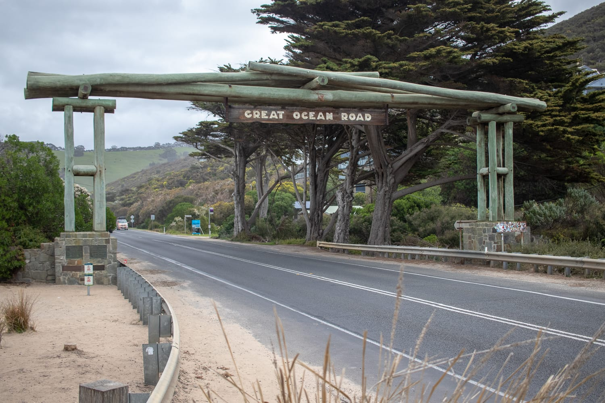
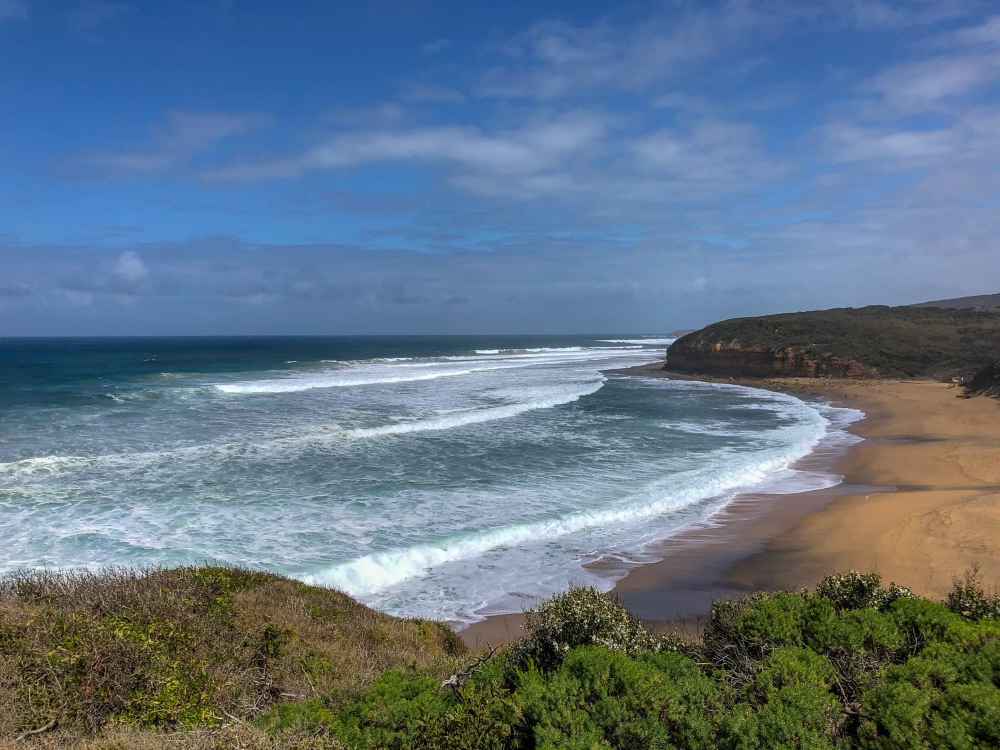
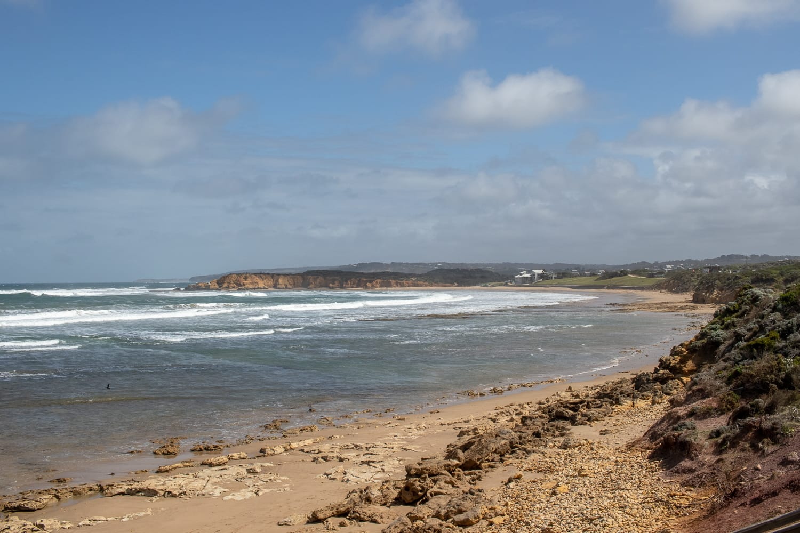
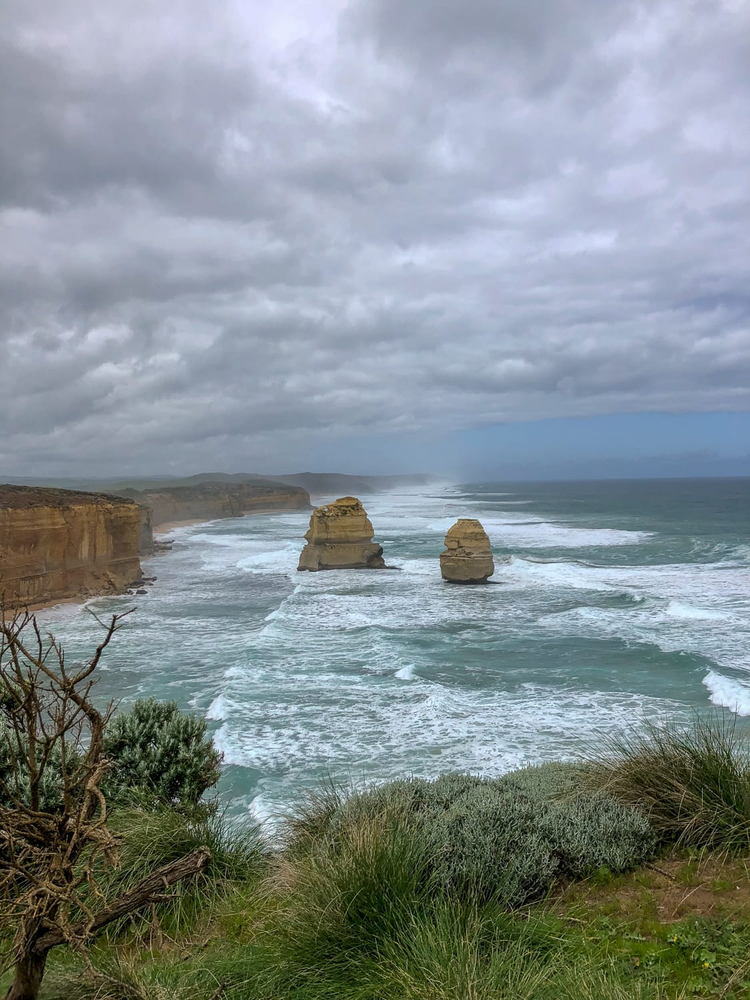
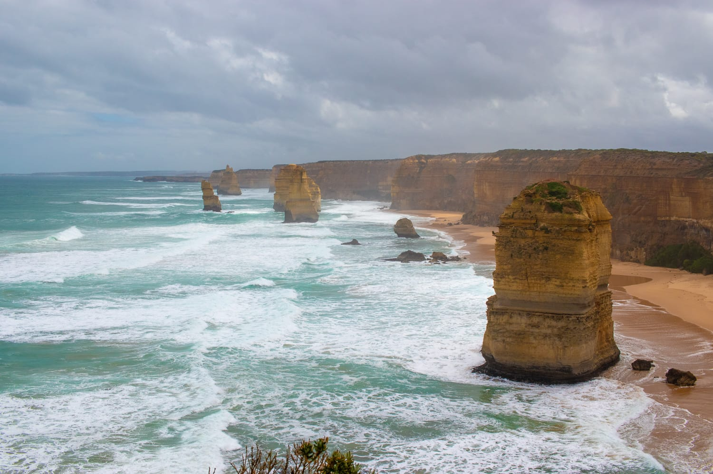
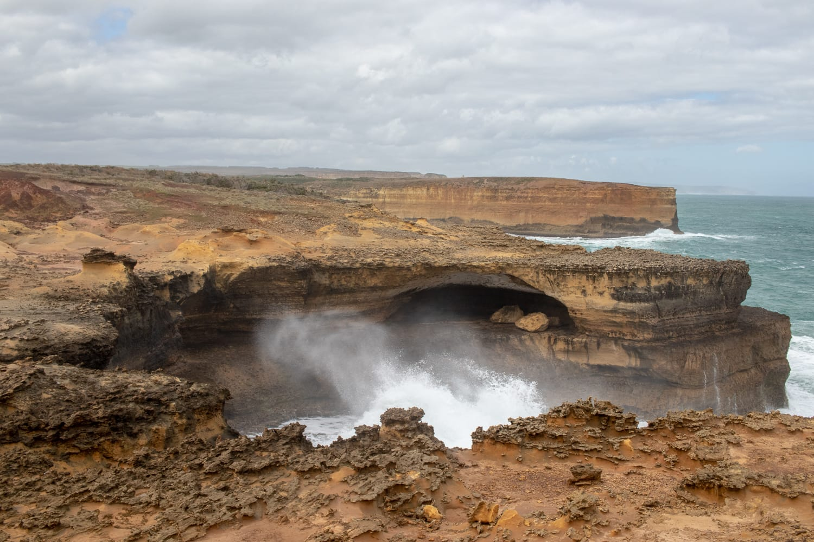
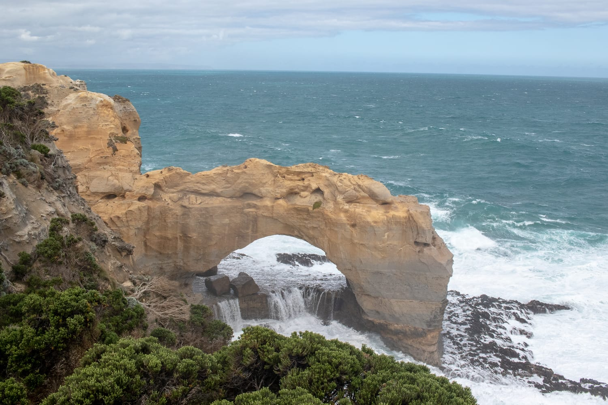
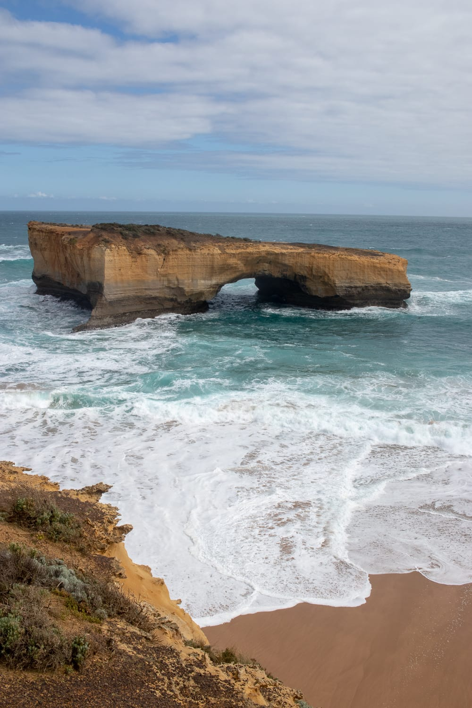
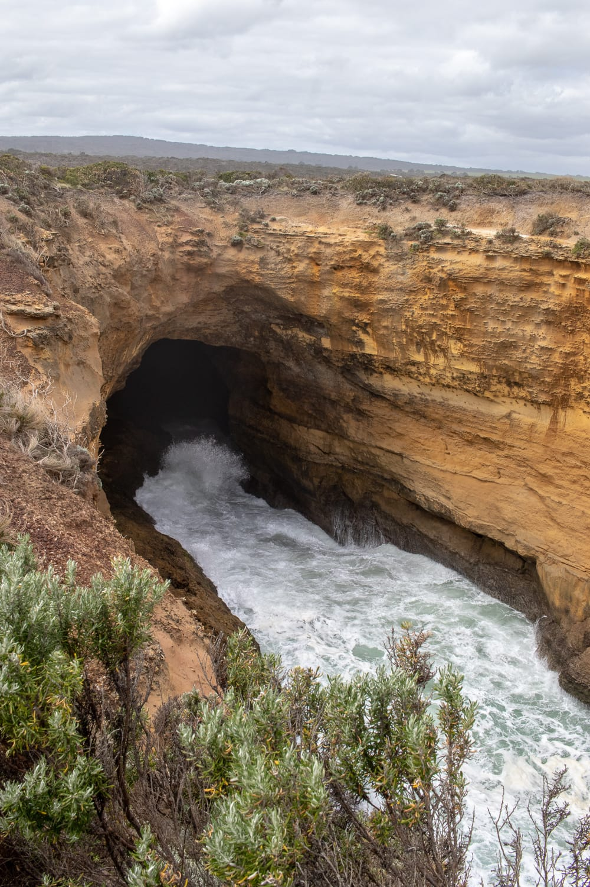

Bei unserer Ankunft in Melbourne haben wir noch nicht viel geplant, außer dass wir uns in Sydney wieder einen Camper ausborgen wollen. Wir überlegen schon vorher, ob wir die Great Ocean Road noch in unsere Pläne aufnehmen sollen. Das ist eine wunderschöne Küstenstraße, deren berühmtestes Highlight die Zwölf Apostel sind.

Auf der Fahrt vom Flughafen zur Unterkunft erzählt uns der Uber-Fahrer von einer Internetseite, auf der man Autos findet, die von einer Stadt in eine andere überstellt werden müssen. Die Preise sind ganz gering, nur hat man nicht lange Zeit für die Überstellung. Auf dieser Seite finden wir unser erstes Mietauto, für gerade einmal 3 australische Dollar. Ja, richtig gelesen: drei Dollar, das sind umgerechnet nicht einmal zwei Euro. Sprit und Versicherung sind natürlich nicht dabei, aber man kann trotzdem einiges sparen.

So beginnt unsere Reise von Melbourne nach Adelaide. Wir planen die Tage so, dass wir ohne zu lange Fahrten und rechtzeitig in Adelaide ankommen. Zuerst geht's von Melbourne nach Marengo bei Apollo Bay, wo wir den ersten Eindruck von der Natur Australiens bekommen.

Unser erster Halt ist Torquay. Hier beginnt die Great Ocean Road, und der Ort ist im Sommer ein Surferparadies. Wir machen einen kurzen Spaziergang am Meer und durch den Ort, dann geht's weiter zum Bells Beach, ebenfalls ein bekannter Surferstrand.

:::raster

:::

In Anglesea erleben wir unser erstes tierisches Highlight: Wir sehen zum ersten Mal Kängurus. Am Golfplatz von Anglesea lebt eine Kängurukolonie. Es gibt eigene Touren, für die man bezahlen muss, aber wir haben das riesige Glück, schon beim Vorbeifahren Kängurus zu sehen.

Als Nächstes geht's nach Lorne. Dort sehen wir die ersten Surfer im Wasser. Surfen kann man hier eindeutig mit Skifahren bei uns vergleichen, schon die ganz kleinen Kinder laufen mit Neoprenanzug und Minibrett herum. Es gibt auch einen Lookout, von dem man perfekt aufs Meer sieht, den lassen wir uns natürlich nicht entgehen. Die erste Nacht verbringen wir in Apollo Bay.

:::raster

:::

Nach dem Frühstück geht's zum Highlight der Route, den Zwölf Aposteln. Obwohl sie so heißen, sind es nur acht Kalksteinformationen, die aus dem Wasser ragen. Es gibt noch einige weitere Felsformationen wie die Loch Ard Gorge, The Arch und die London Bridge. Alle sehr beeindruckend und definitiv einen Besuch wert.

Es gibt noch viele weitere Aussichtsplattformen, bei denen es sich wirklich lohnt stehen zu bleiben und die Natur zu bewundern. Die Great Ocean Road endet in Warrnambool. Dort endet auch die eher gemütliche Fahrt, denn von dort liegen noch 600 Kilometer und fast sieben Stunden Fahrzeit vor uns. Den letzten Tag unseres Roadtrips verbringen wir deshalb nur noch im Auto.

:::galerie

:::
