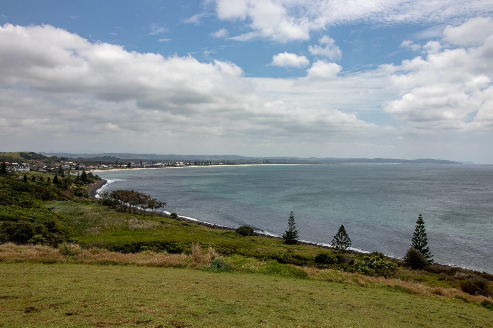
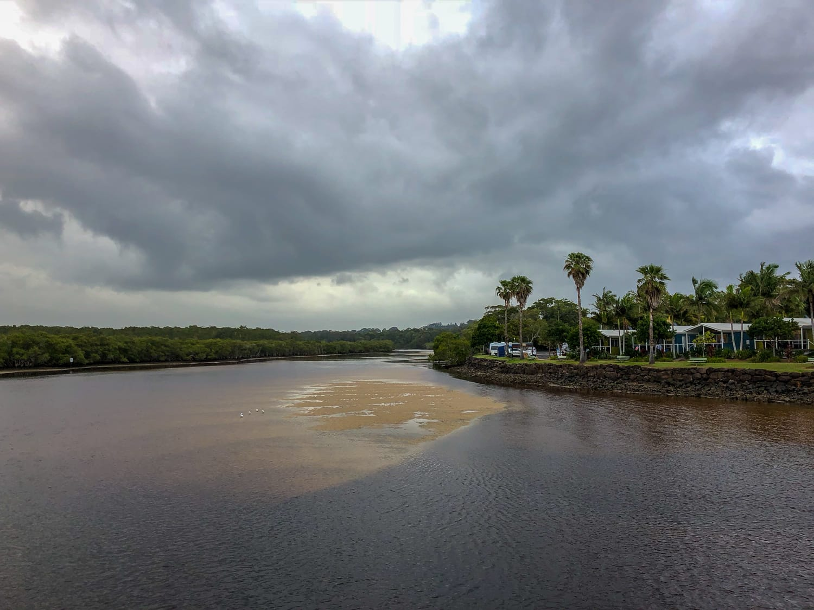
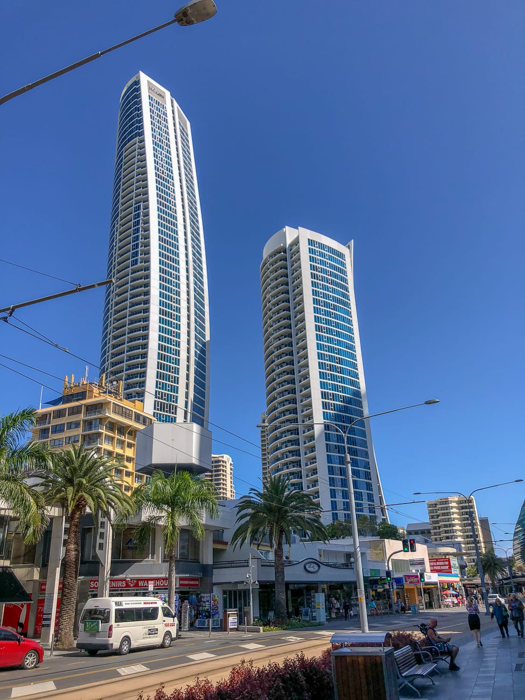
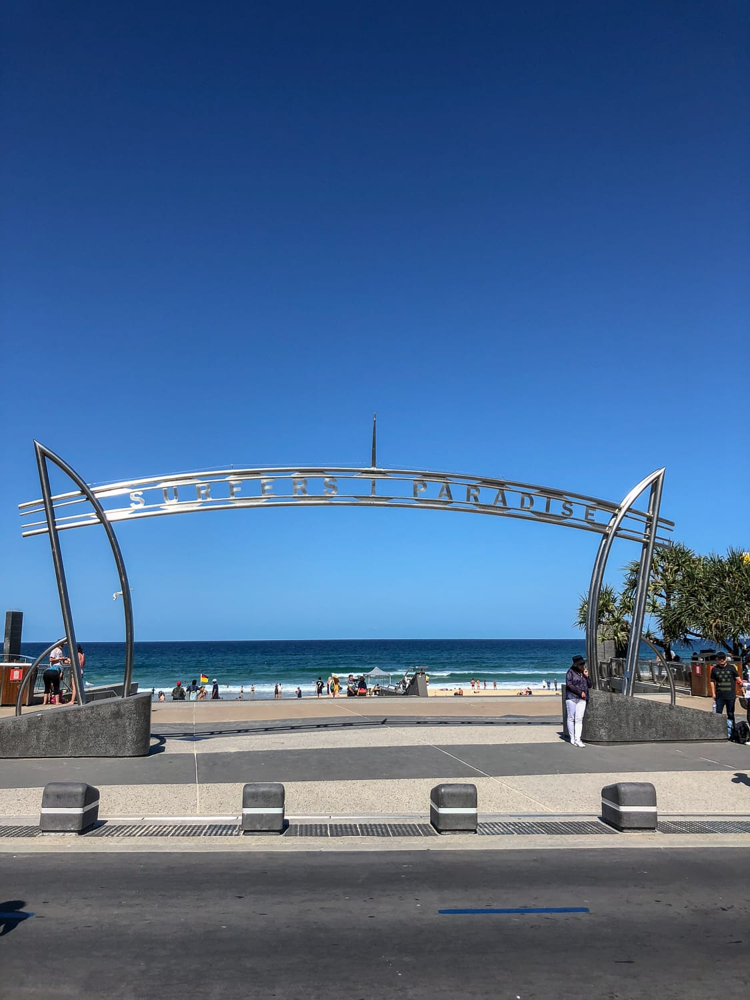
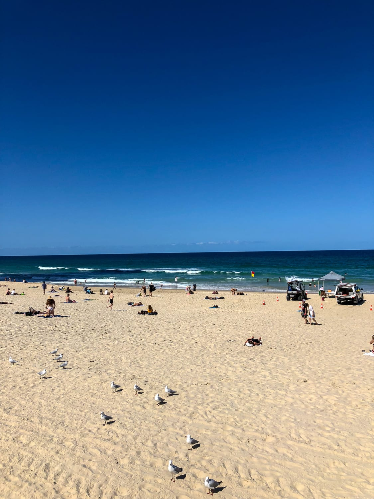

Nachdem wir die entzückenden Koalas hinter uns gelassen haben, geht's weiter Richtung Norden. Wir erkunden viele Urlaubsorte der Australier und besuchen Byron Bay, bis wir schließlich an der Gold Coast landen.

Zuerst legen wir einen Stopp in Yamba ein. Yamba ist ein typischer Urlaubsort, und so stehen wir Camper an Camper auf einem kostenpflichtigen Campingplatz. „Camper" ist eigentlich nicht ganz richtig, denn die meisten Australier reisen mit riesigen Wohnwagen samt Auto, Wäscheleine, Vorzelt, Grill und so weiter herum. Da kommen wir uns mit unserem Campervan eher unspektakulär vor. Hier bekommen wir einen ersten Eindruck, wie die Australier ihren Urlaub verbringen.

Am nächsten Tag, der eher regnerisch beginnt, fahren wir nach Byron Bay. Es ist Wochenende, und da der Ort an der Ostküste sehr bekannt ist, ist entsprechend viel los. Zuerst wissen wir gar nicht, wo wir den Camper abstellen sollen, und als wir ihn endlich los sind, beginnt es leicht zu regnen. Trotzdem machen wir einen Spaziergang durch den Ort. Ziemlich schnell fängt uns ein Mitarbeiter eines Reiseveranstalters ab. Zuerst sind wir etwas skeptisch, aber er sagt, er schreibe uns viele Tipps für die Weiterreise zusammen, ganz kostenlos und ohne Gegenleistung. Klingt nicht schlecht, also erzählt er uns über eine Stunde lang, was uns auf dem Weg Richtung Cairns erwartet. So sparen wir viel Zeit und Nerven, die wir sonst für die Recherche gebraucht hätten. Danach geht's noch kurz an den Strand, bevor wir zum nächsten Campingplatz fahren.

:::raster

:::

Am nächsten Tag regnet es leider den ganzen Tag, und wir beschließen, den Vormittag in einem Café zum Arbeiten zu verbringen. Bevor wir die Gold Coast erreichen, fahren wir hauptsächlich von einem kostenpflichtigen Campingplatz zum nächsten. Einerseits wegen des schlechten Wetters, andererseits weil es in dem Gebiet fast nur kostenpflichtige Plätze gibt und wir keine Umwege von ein bis zwei Stunden zu Gratisplätzen machen wollen.

Das Wetter wird langsam wieder besser, und wir erreichen endlich die Gold Coast. Zuerst besuchen wir Coolangatta, den inoffiziellen Ort der Surfer, und fahren danach nach Surfers Paradise. In Surfers Paradise sind wieder die Reichen zu Hause. Der Ort hat alles: Einkaufsgeschäfte, viele Restaurants, ein Hard Rock Cafe und so weiter. Wir spazieren kurz durch, aber so richtig begeistern kann uns diese Touristenhochburg nicht. Weil die Campingplätze hier entsprechend teuer sind und wir nicht einfach irgendwo am Strand schlafen wollen, fahren wir noch einmal zurück nach Boyds Bay.

Und dort beginnt das nächste Abenteuer! Wegen der Zeitverschiebung zwischen Queensland und New South Wales, ein Bundesstaat hat Sommerzeit, der andere nicht, haben wir echte Probleme, einen Campingplatz zu finden. Ursprünglich wollten wir zu demselben wie in der Nacht davor, aber der hat schon zu. Auch die drei weiteren, die wir ansteuern, haben schon geschlossen, und wir sind echt froh, als wir auf der anderen Seite in Queensland noch einen finden, der offen hat und uns aufnimmt.

:::raster

:::
