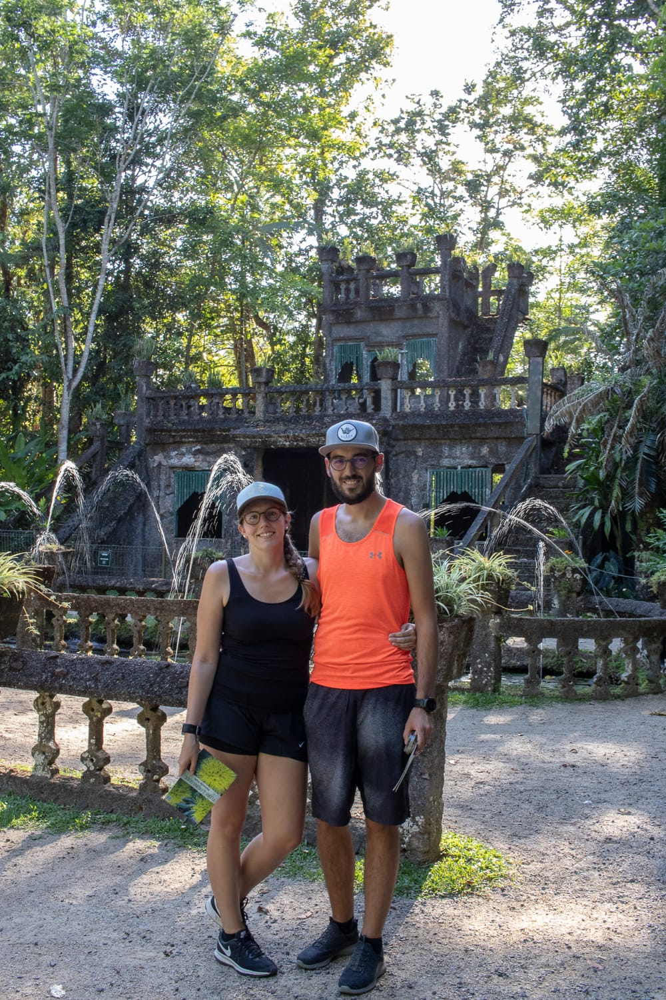
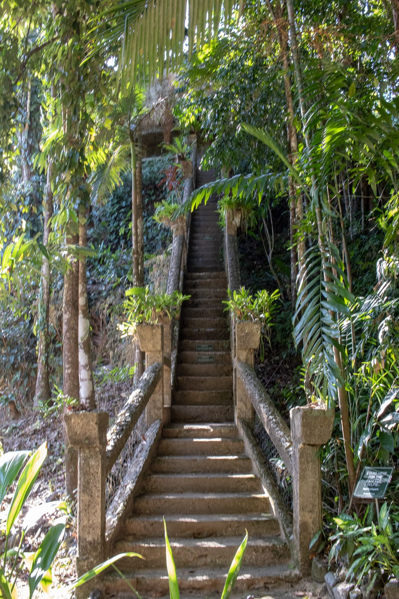
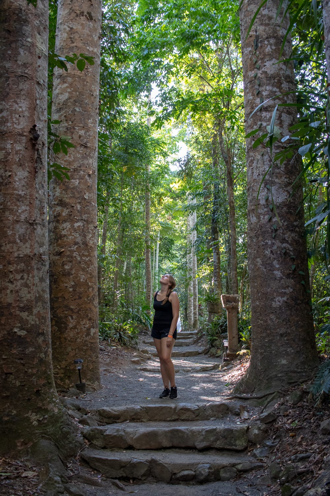
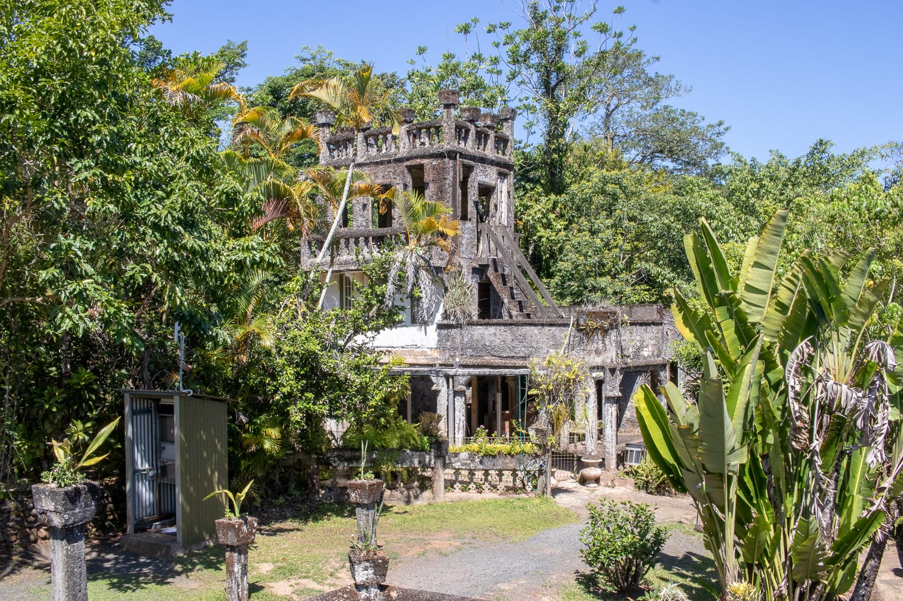
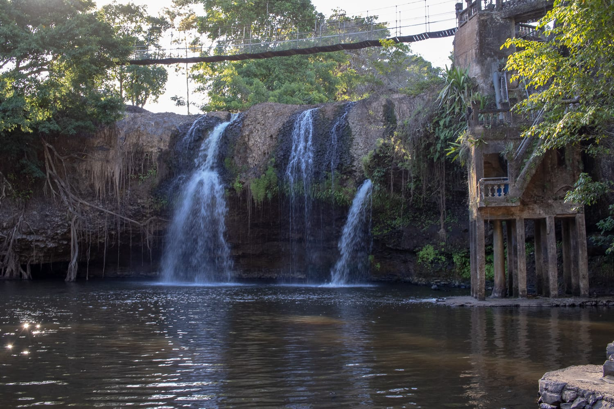
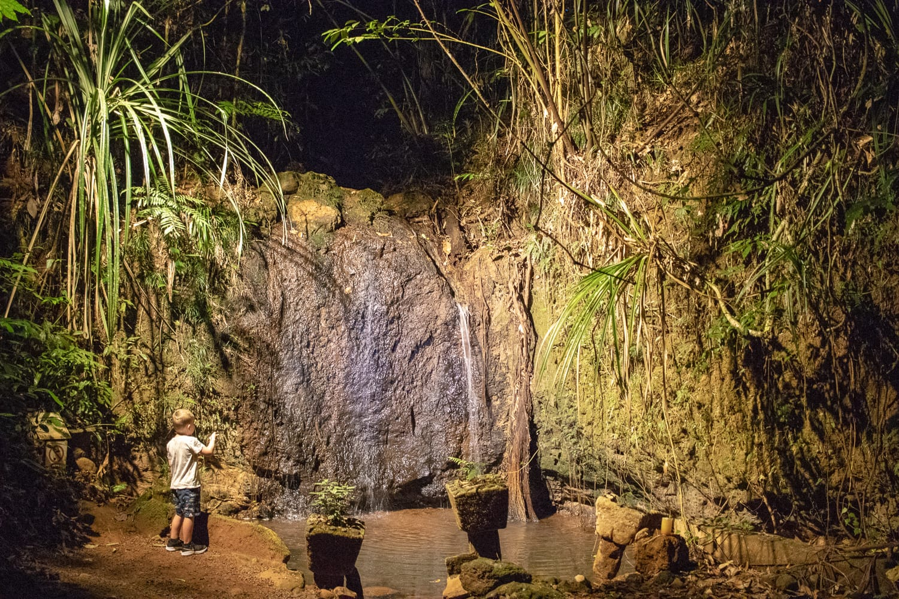
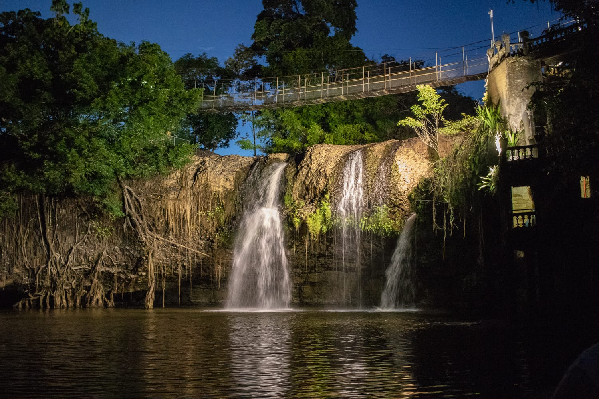
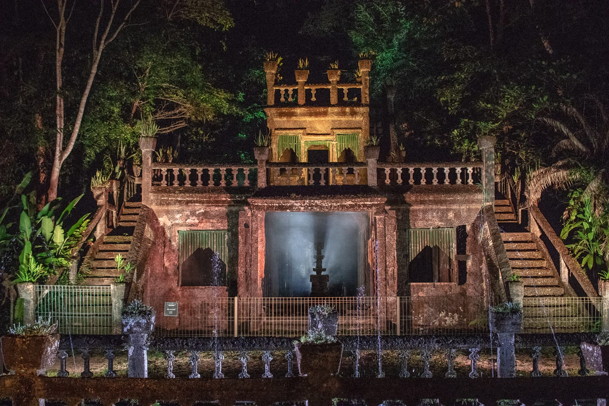

Auf unserer Reise in den Norden kommen wir auch beim Paronella Park vorbei. Von dem Park haben wir eher zufällig erfahren und fahren spontan hin. So spontan, dass wir weder wissen, ob man Eintritt zahlt, noch wie viel.

Gleich bei der Ankunft begrüßt uns ein Mann sehr freundlich. Er erklärt uns die verschiedenen Möglichkeiten, den Park zu besichtigen, und nennt uns den Preis: 46 Australische Dollar pro Person. Da müssen wir erst einmal überlegen. Für einen kurzen Besuch fast 100 Dollar zu zahlen, kommt uns hoch vor. Dafür ist eine Nacht am Campingplatz inklusive. Weil wir nicht recht wissen, was uns erwartet und ob es das wert ist, gönnen wir uns zuerst einen Kaffee und entscheiden uns währenddessen.

Während wir noch diskutieren, kommt eine Mitarbeiterin zu uns. Wir sind gespannt, ob sie uns jetzt überreden will. Sie macht uns aber ein tolles Angebot: Wir zahlen den Eintritt für einen Erwachsenen, der zweite ist gratis dabei. Da müssen wir nicht mehr lange überlegen, und wir tauchen in die Geschichte des Parks ein.

Wir stellen den Camper am Campingplatz ab und erkunden den Park bei einer Führung. Das Besondere sind die vielen kleinen Schlösser. Ein Spanier hat sich mit dem Park einen Traum erfüllt: Inspiriert von den Schlössern in Katalonien wollte er hier einen kleinen Vergnügungspark bauen. In den Schlössern gab es einen Tanzsaal, ein Kino und ein Café. Er hat unheimlich viel Geld in sein Projekt gesteckt.

:::galerie

:::

Ebenfalls bemerkenswert ist das Wasserkraftwerk. Er war der Erste in der Gegend, der eines gebaut hat. Heute wird der gesamte Strom des Parks noch immer dort erzeugt, das Kraftwerk wurde erst vor wenigen Jahren komplett restauriert. Sobald es Strom lieferte, begann der Erbauer, den Wasserfall zu beleuchten. Einfach nur, um zu zeigen, dass er es kann.

Leider hat die Gegend immer wieder mit Fluten und Zyklonen zu kämpfen. Das am besten erhaltene Schloss steht auch heute jedes Jahr unter Wasser, und ein Feuer in der Küche hat Teile des zweiten Schlosses zerstört. Alles in Schuss zu halten ist also ziemlich schwierig, und vom Wasser liegt auf allen Steinbauten ein grüner Schleier.

Die Tour am Tag gefällt uns sehr gut. Wir sind die Einzigen in der Gruppe, und so kann sich der Guide ganz auf uns konzentrieren. Der Park hat noch mehr zu bieten, etwa die Kauri Avenue, einen Bambuswald und viele Schildkröten.

Für die Gäste des Campingplatzes gibt's abends noch eine Nachttour. Mit Taschenlampen bewaffnet gehen wir gleich nach Sonnenuntergang noch einmal durch den Park, am beleuchteten Wasserfall vorbei und durch den stimmungsvoll beleuchteten Wald. Den Abschluss bildet eine Licht- und Musikshow, bei der das Schloss toll in Szene gesetzt wird.

:::raster

:::
