Am zweiten Tag im Zentrum Australiens steht das Highlight am Programm. Wir machen uns auf den Weg zum Mala Carpark direkt beim Uluru. Wie (fast) immer sind wir spät dran, und statt eines ordentlichen Frühstücks gibt's eine Banane und einen Müsliriegel auf dem Weg zum Parkplatz.

Jeden Tag um 8 Uhr gibt's nämlich eine kostenlose Tour mit einem Nationalpark-Ranger, und die wollen wir uns nicht entgehen lassen. Wir gehen gemeinsam den Mala Walk, und der Ranger erzählt viel über die Kultur und die Geschichte des Uluru. Die Tour dauert ungefähr zwei Stunden und ist sehr interessant. Wir können sie nur jedem empfehlen! Man bekommt einen tollen Eindruck und erfährt viel über Tiere, Pflanzen und das Leben der Aborigines.

Nach der geführten Tour steht noch die Wanderung um den Uluru an. Mittlerweile ist es schon warm, aber durch den Wind ist es auszuhalten. Der Weg führt teilweise ganz nah am Uluru vorbei, sodass wir ihn berühren können, und dann wieder weiter weg. Der Ranger hat erklärt, dass der Weg bewusst so angelegt wurde, damit die Aborigines einen Teil des Uluru für sich haben und nicht alles mit den Touristen teilen müssen.

:::galerie
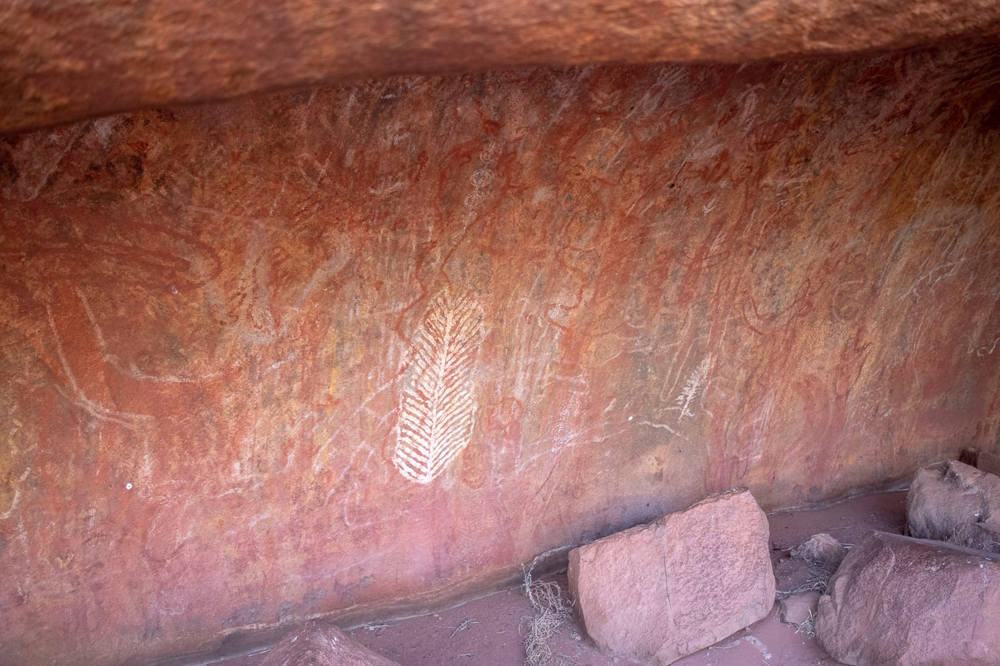
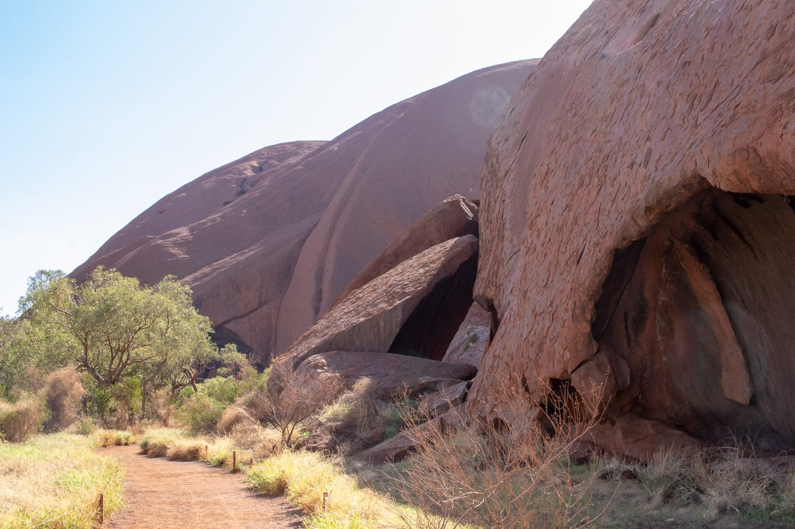
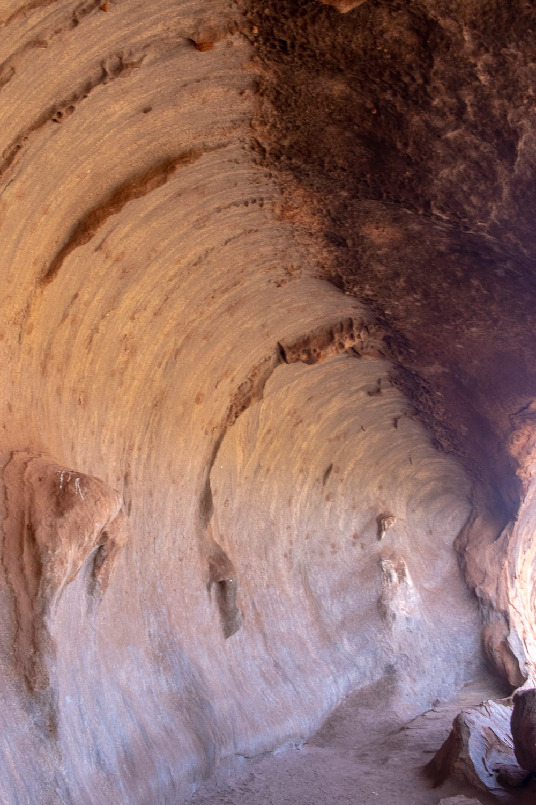
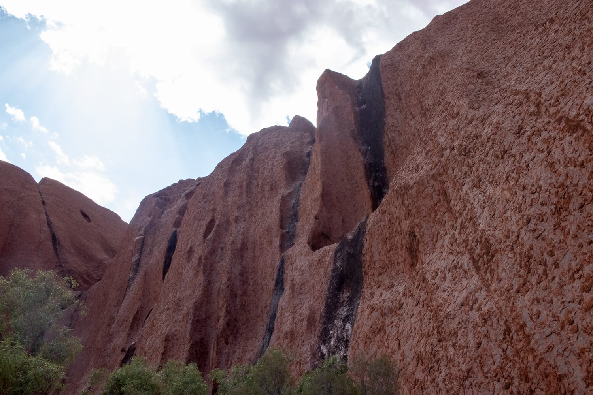
:::

Obwohl es „nur" eine rote Felsformation ist, beeindruckt sie uns sehr. Es gibt immer wieder Höhlen, Grotten und Formationen, die den ganzen Weg spannend machen. Wegen der religiösen Bedeutung sollte man von vielen Stellen keine Fotos machen. Schilder weisen darauf hin, aber leider halten sich nicht alle daran.

Insgesamt sind wir über drei Stunden unterwegs. Es wird immer wärmer, und regelmäßige Trinkpausen sind ein Muss. Auf dem Weg gibt's leider nur eine einzige Auffüllstation für Wasser. Wir würden jedem raten, die Flasche dort aufzufüllen, egal wie viel noch drin ist. Viel wird zu dem Zeitpunkt ohnehin nicht mehr drin sein. Kurz vor dem Parkplatz sind wir beide schon ziemlich geschlaucht, es ist extrem heiß und die Luft steht. Als wir wieder im Auto sitzen, zeigt es 38 Grad an, und wir genießen die Klimaanlage.

:::berg Uluru | -25.3444, 131.0369 | 863 m | 5 km

:::galerie
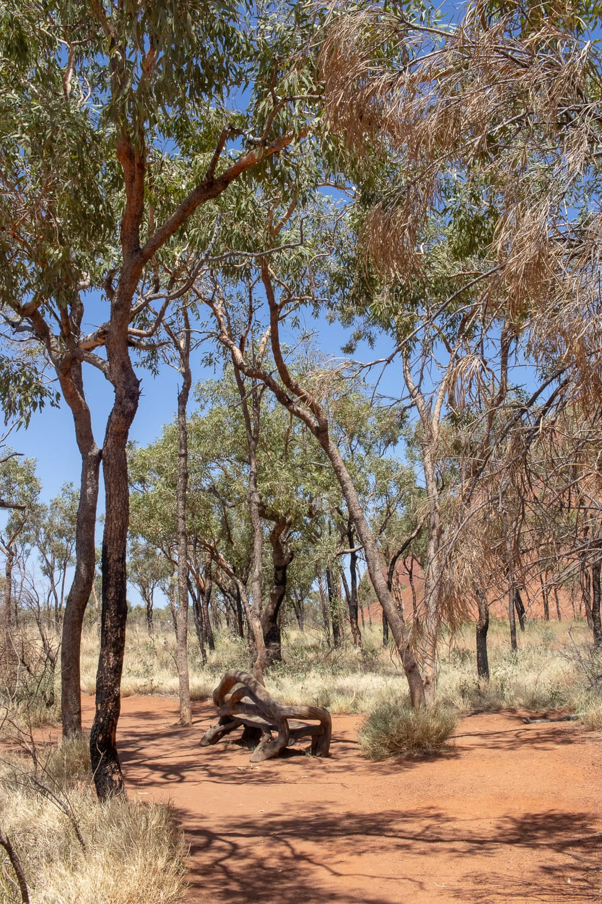
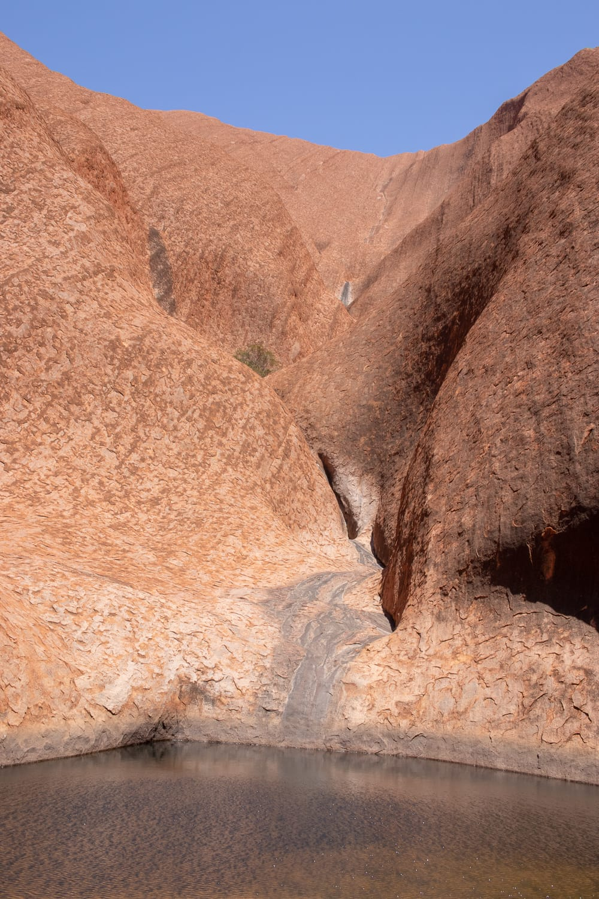
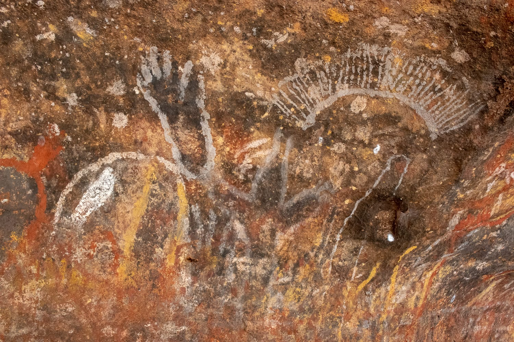
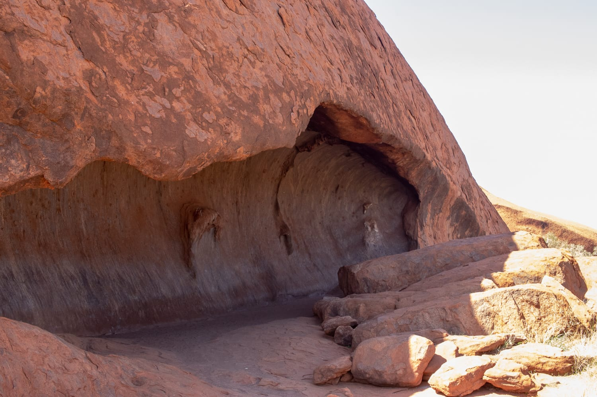
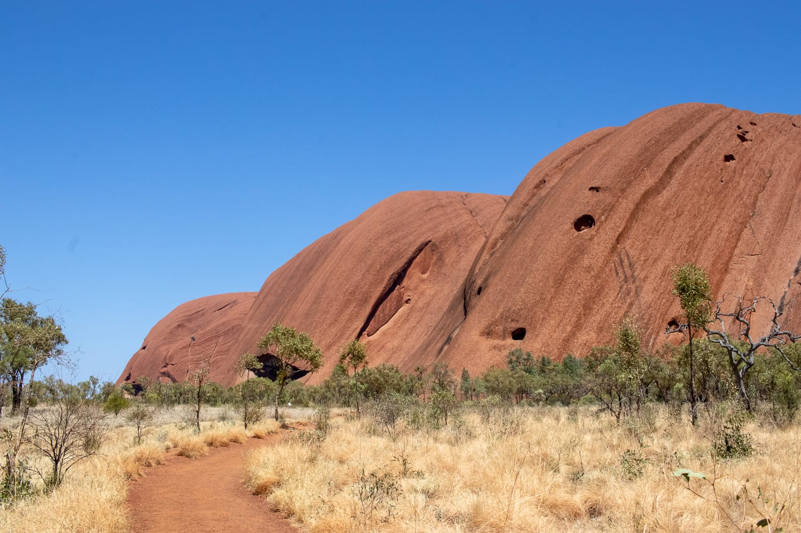
:::

Wenn der Wetterbericht mehr als 36 Grad vorhersagt, werden hier übrigens viele Wege gesperrt. Bei solchen Temperaturen wandern ist einfach zu gefährlich.

Gesperrt wird auch der Weg auf den Uluru. Bei unserer Ankunft haben wir nämlich festgestellt, dass man ihn immer noch besteigen darf. Aus Respekt vor den Aborigines machen das aber viele nicht mehr, und auch wir haben uns dagegen entschieden. Ab Oktober 2019 ist der Aufstieg endgültig gesperrt, und man kann den Uluru nur mehr umrunden.

Zurück im Resort, sind wir beide fast am Verhungern. Wir gehen gleich in ein Restaurant und stärken uns mit Kürbisrisotto mit Süßkartoffeln und Gewürzen aus dem Outback. Danach ruhen wir uns erst einmal aus, bevor wir abends zu einem anderen Aussichtspunkt fahren, um noch einmal den Sonnenuntergang zu sehen.

:::galerie
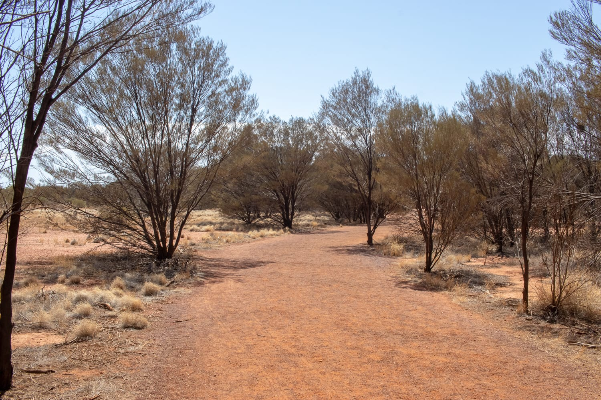
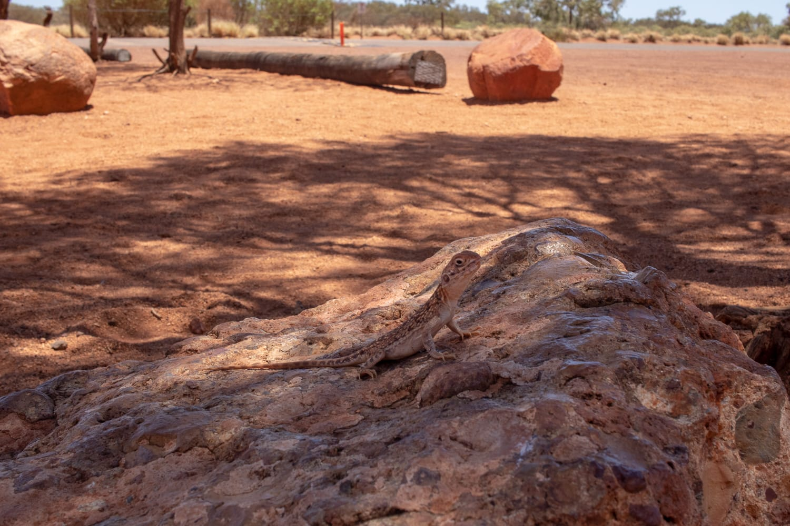
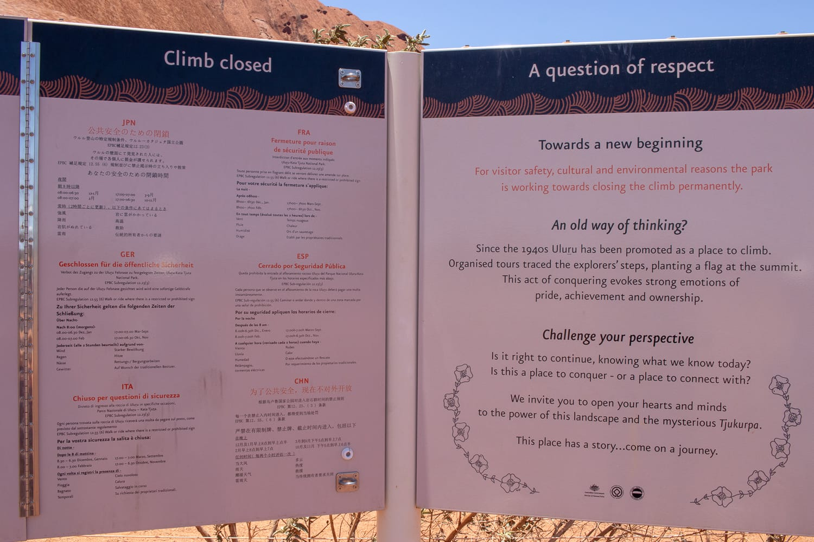
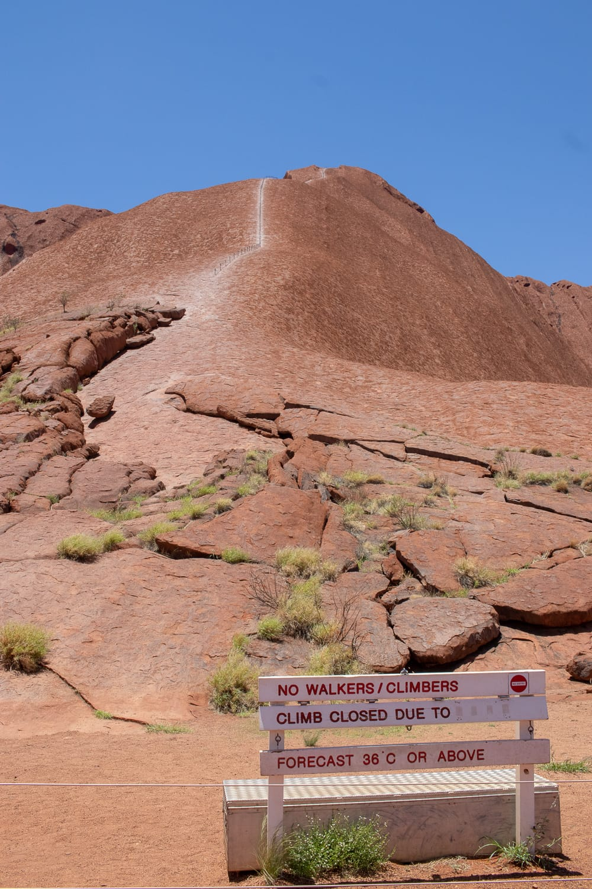
:::

Der ist diesmal leider nicht so spektakulär. Es sind viele Wolken am Himmel, und der Uluru wird nicht so schön beleuchtet wie am Tag davor. Bald fahren wir zurück ins Resort und lassen den Abend bei einem Cider und einem Bier ausklingen.

Nach zwei intensiven Tagen geht's auch schon wieder weiter. Bevor wir uns endgültig vom Outback verabschieden, schauen wir uns um 5.45 Uhr noch den Sonnenaufgang an. Danach hauen wir uns kurz aufs Ohr, packen, und schon geht's zum Flughafen.

Unsere Zeit im Outback ist viel zu schnell vergangen, wir hätten uns noch ein paar Tage mehr vorstellen können. Vor allem der Kings Canyon und Alice Springs sind sich in so kurzer Zeit leider nicht mehr ausgegangen. Aber man soll gehen, wenn es am schönsten ist, und so haben wir für den nächsten Besuch in Australien noch etwas zu entdecken ;)

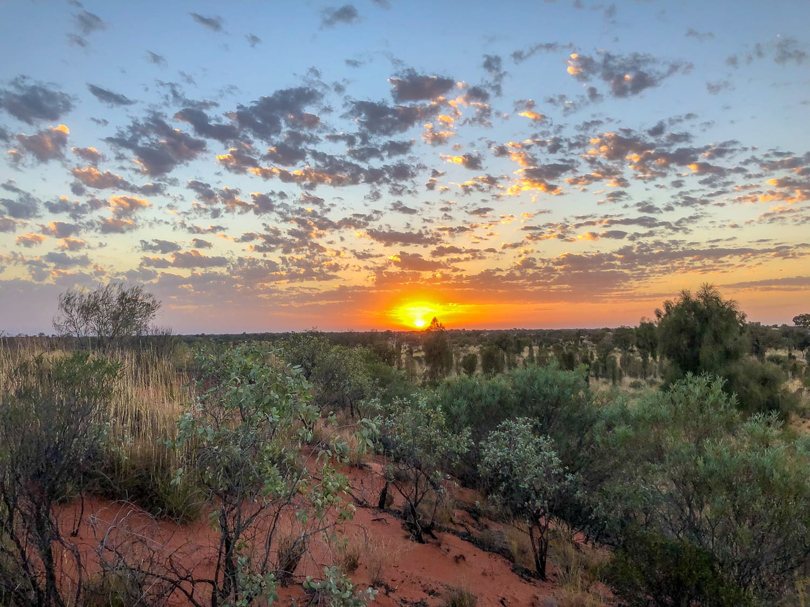
