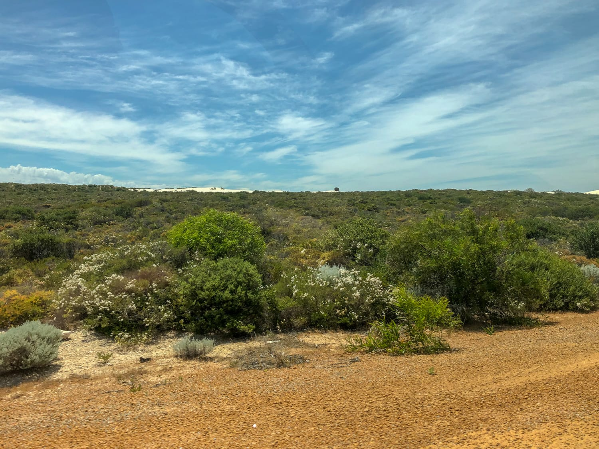
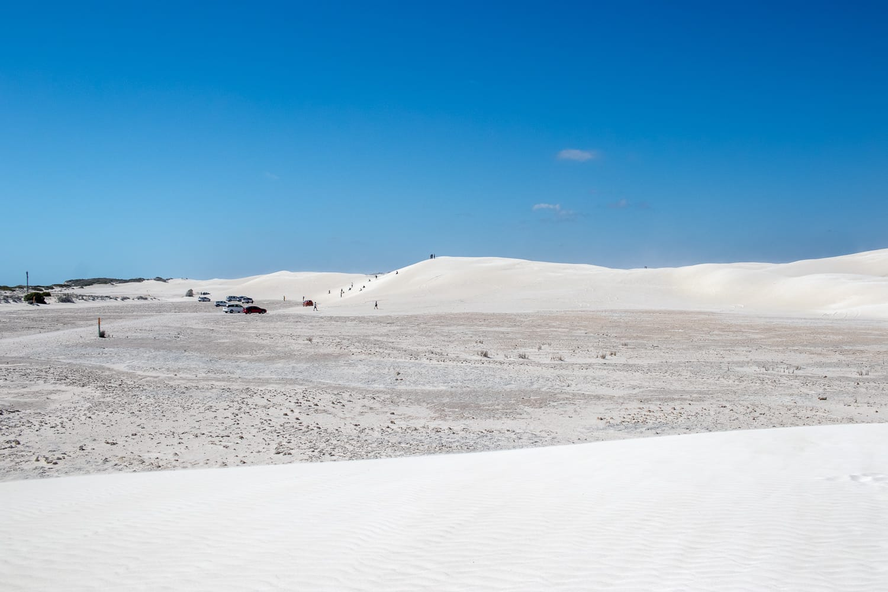
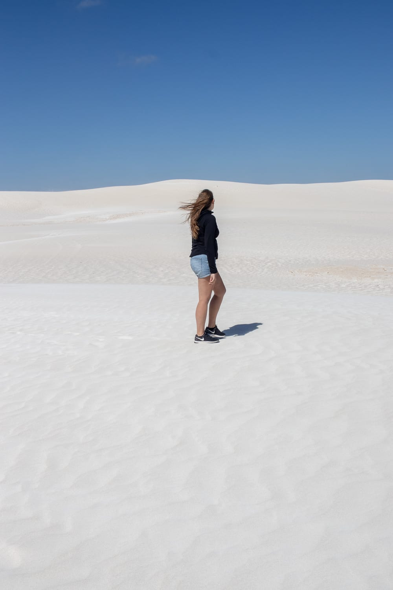
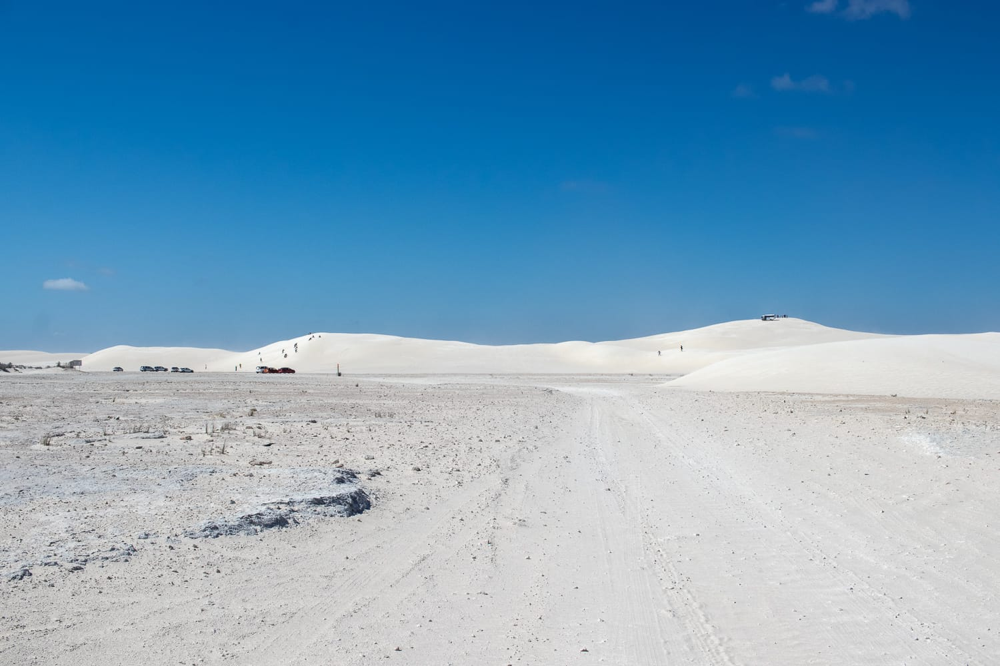
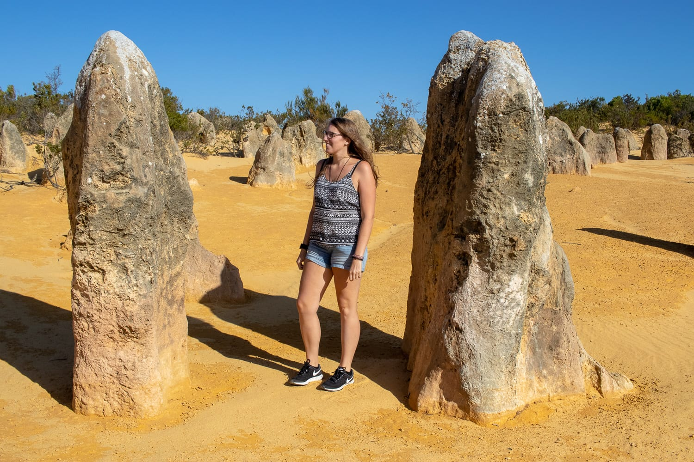
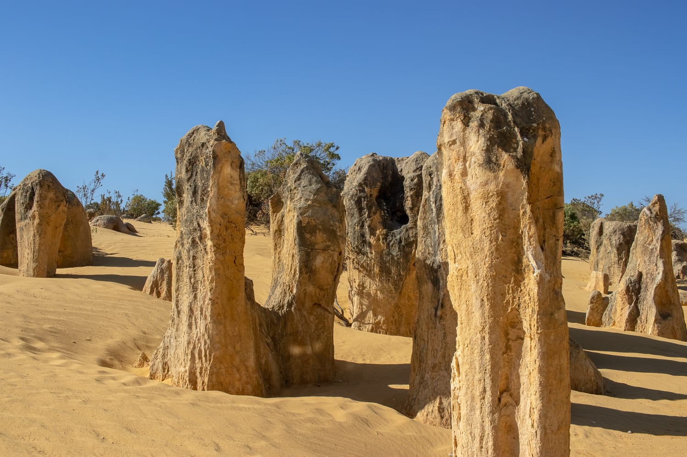
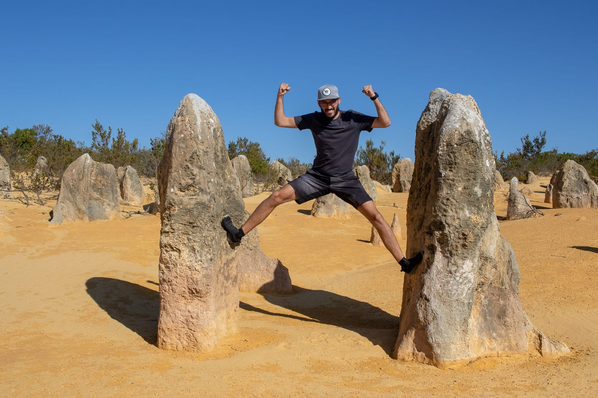
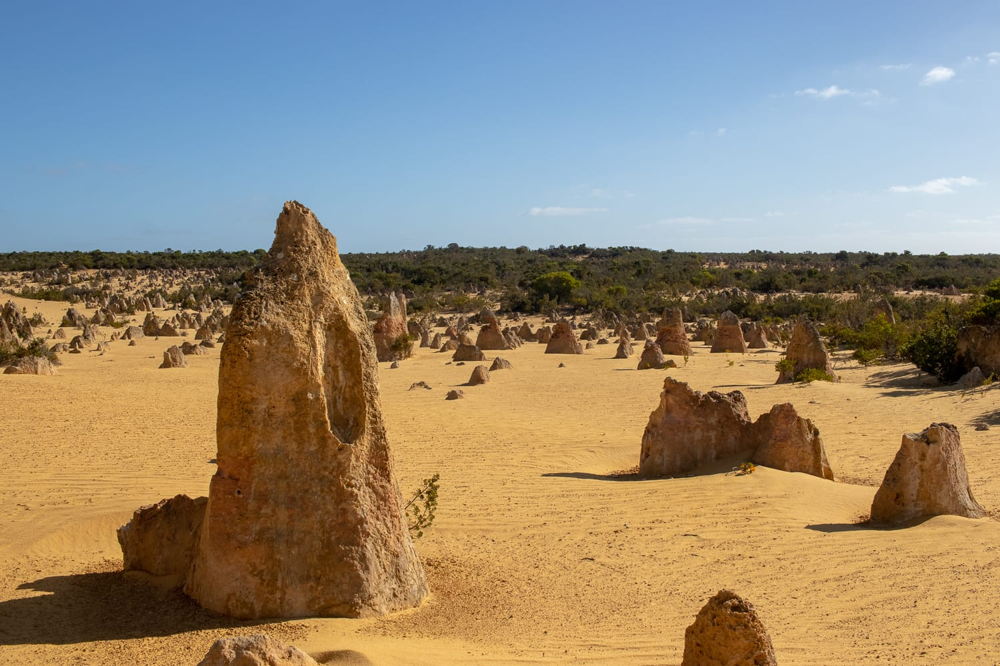
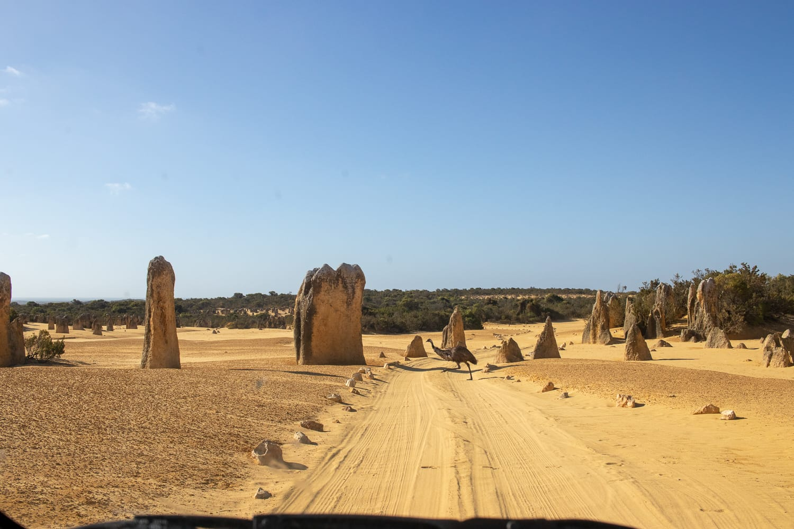

Nach fünf Tagen in Perth heißt es für uns wieder: ab in den Camper! Diesmal geht's die Westküste hinauf, und wir sehen noch einmal eine ganz andere Seite von Australien.

Schon bei der Recherche haben wir oft gelesen, die Westküste sei das „richtige" Australien. Und tatsächlich entspricht das, was wir neben dem Uluru in den letzten Tagen gesehen haben, dem, was wir uns ursprünglich unter Australien vorgestellt haben. Sobald man Perth verlässt, kommt nämlich ewig nichts. Es gibt nur kleinere Dörfer, und die liegen meistens direkt am Meer. Vom Highway aus sieht man kaum Zivilisation, und es scheint, als käme man stundenlang nicht von der Stelle, weil sich die Landschaft kaum ändert.

Am ersten Tag holen wir den Camper ab und decken uns mit Vorräten ein. Mittlerweile hatten wir fast alle Arten von Campern. Diesmal nehmen wir einen ohne Toilette. Die letzten beiden hatten eine an Bord, aber weil wir diesmal nur für eine Woche unterwegs sind und sowieso nur auf Campingplätzen schlafen wollen, brauchen wir sie nicht. Von der Größe her ist es der kleinste, eigentlich für vier Leute ausgelegt, mit einem Bett über der Fahrerkabine und einem im hinteren Bereich. Praktisch: Es ist der erste Camper, der auch auf einen normalen Parkplatz passt.

:::raster

:::

Nun zur Tour. Wir verlassen Perth Richtung Norden, und der erste Stopp sind die weißen Sanddünen von Lancelin. Auf den Dünen kann man entweder mit Boards hinunterdüsen oder mit Allradfahrzeugen herumfahren. Die Dünen sind so weiß, dass man das Gefühl hat, das Licht blendet auch von unten.

Weiter geht's in den Nambung-Nationalpark. Dort stehen die bis zu vier Meter hohen Kalksteinsäulen, die Pinnacles. Wir fahren den Pinnacles Drive, eine kleine Rundfahrt, bei der man ganz nah an den Säulen vorbeikommt und immer wieder aussteigen und Fotos machen kann. Die Pinnacles schauen wirklich toll aus, und wir haben das Glück, sowohl Kängurus als auch Strauße zu sehen.

:::galerie

:::
