Der erste Tag des Roadtrips hat uns schon ordentlich beeindruckt. Von Cervantes, wo wir auf dem Campingplatz übernachtet haben, geht's weiter nach Geraldton, eine Fahrt von etwa drei Stunden.

Bevor wir Cervantes hinter uns lassen, fahren wir noch zum Lake Thetis. Dort kann man Stromatolithen sehen. Ehrlich gesagt hatten wir noch nie davon gehört, und viel Spektakuläres gibt's auch nicht zu sehen. Stromatolithen sind aber eine der ältesten Lebensformen auf der Erde, und wenn man schon in der Gegend ist, kann man sie sich ja anschauen.

:::raster
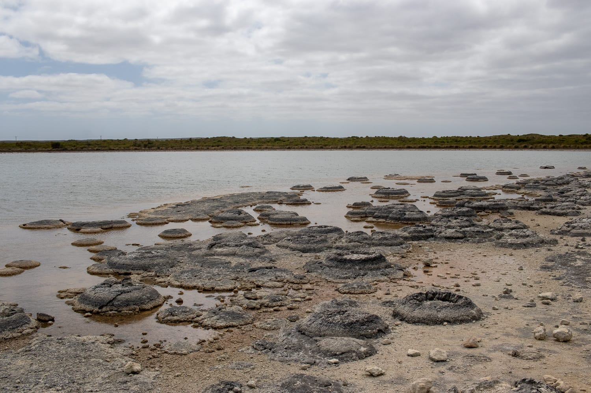
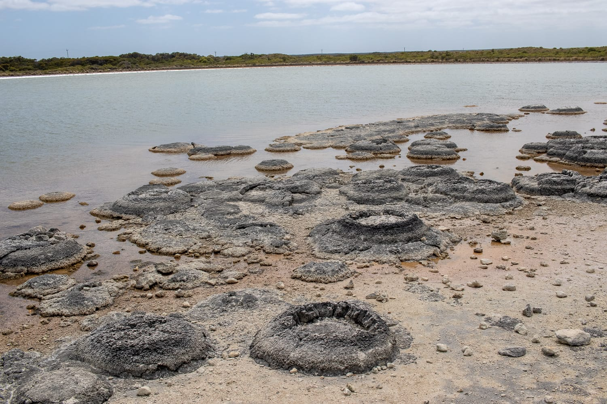
:::

Weiter geht's Richtung Green Head. Dort biegen wir auf den Tourist Drive ab, der einzigartige Blicke über das Meer bietet. Das Wasser an der Westküste ist so wunderschön blau. Wäre der Indische Ozean nicht so eisig, würde man am liebsten gleich hineinspringen.

Die Nacht verbringen wir in Geraldton. Obwohl es erst Mittag ist, beschließen wir, nicht mehr weiterzufahren. Der Wind und die langen Distanzen machen mir ganz schön zu schaffen. Wir überlegen an dem Tag lange, wie weit wir noch in den Norden fahren sollen.

:::raster
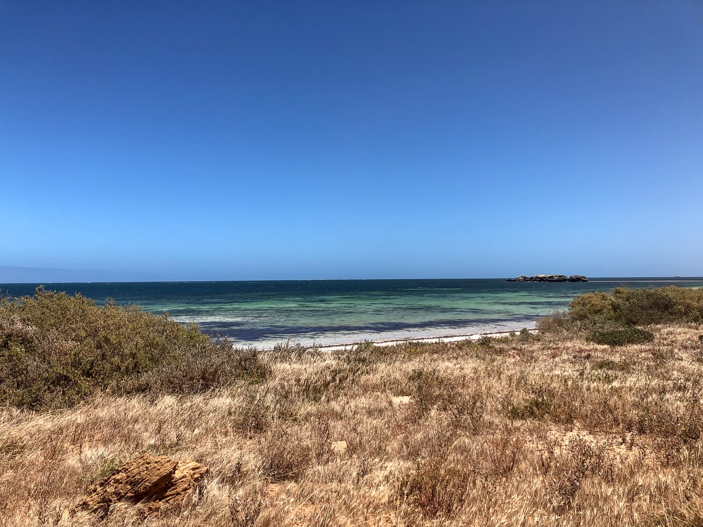
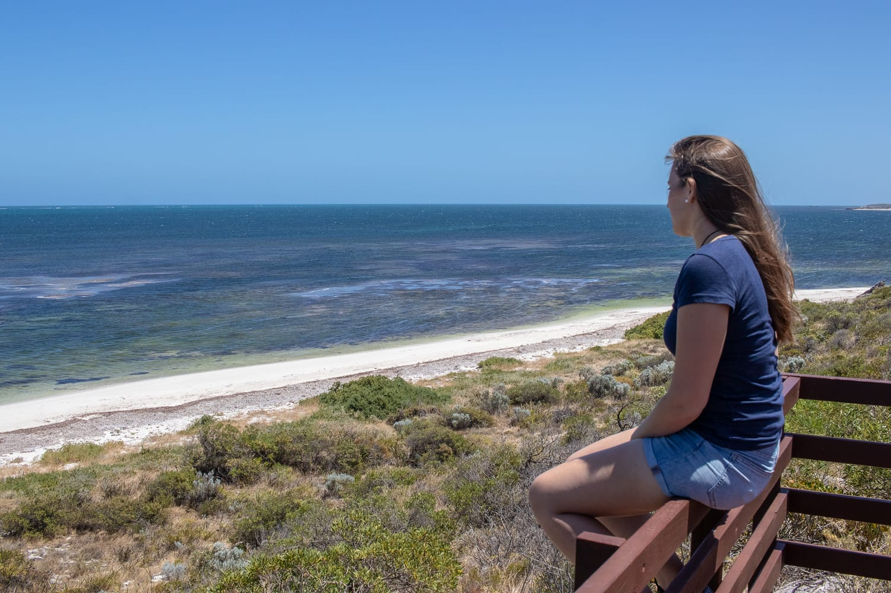
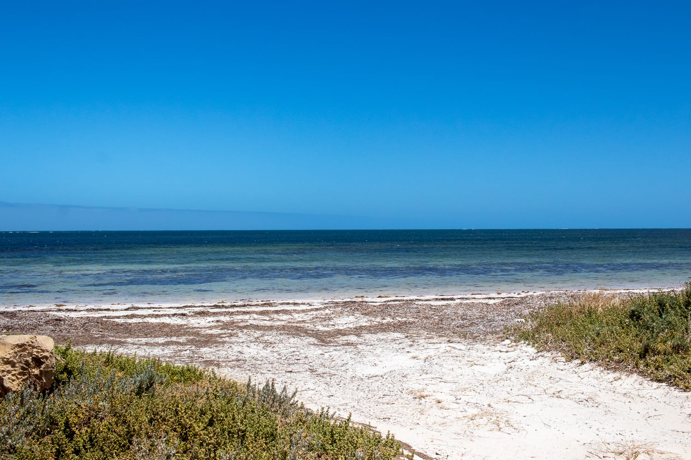
:::

Ursprünglich wollten wir bis nach Monkey Mia, das wären fast 850 Kilometer und reine Fahrzeit von neun Stunden gewesen. Wir entscheiden uns dann aber, nur noch bis Gregory zu fahren und danach wieder zurück nach Perth.

Unser letztes Ziel ist also Gregory mit dem Pink Lake. Der See ist, wie der Name sagt, pink, aber nicht ein bisschen rosa oder leicht pink, sondern richtig pink. Die Farbe kommt vom Beta-Carotin der Algen, die dort leben. Wir machen ganz viele Fotos und packen endlich wieder einmal die Drohne aus.

:::galerie
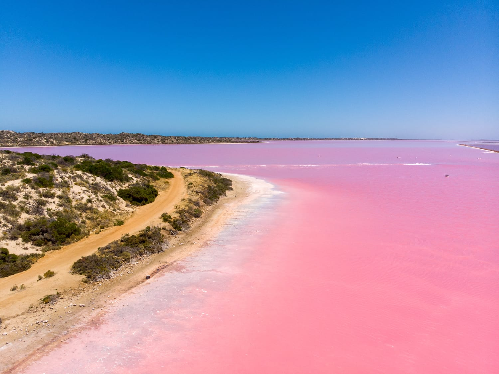
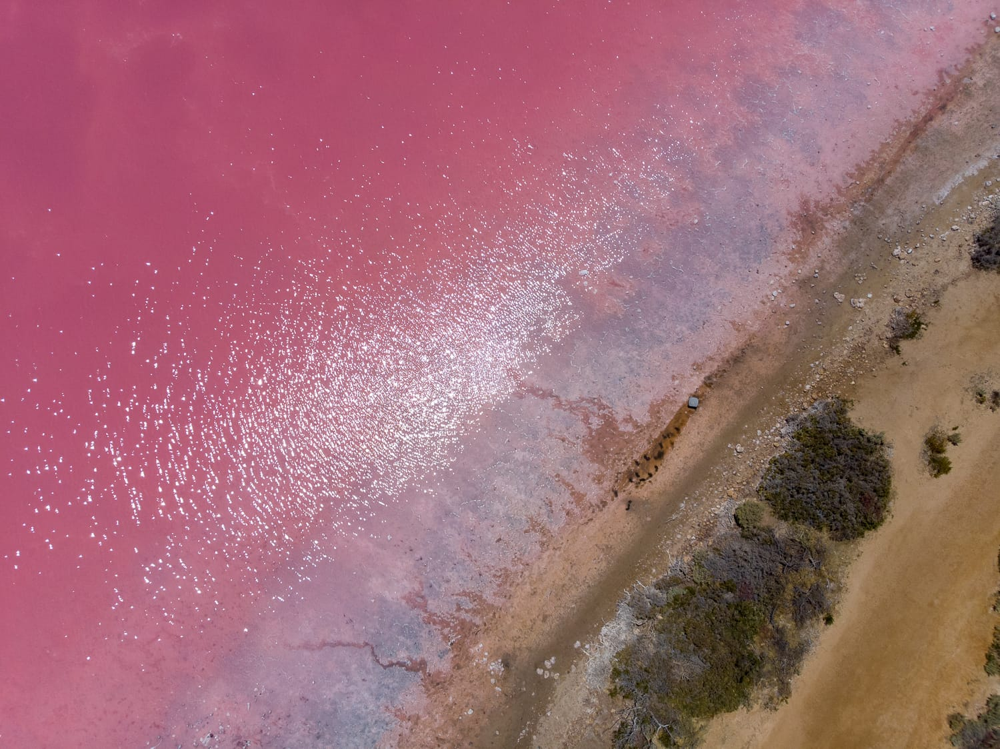
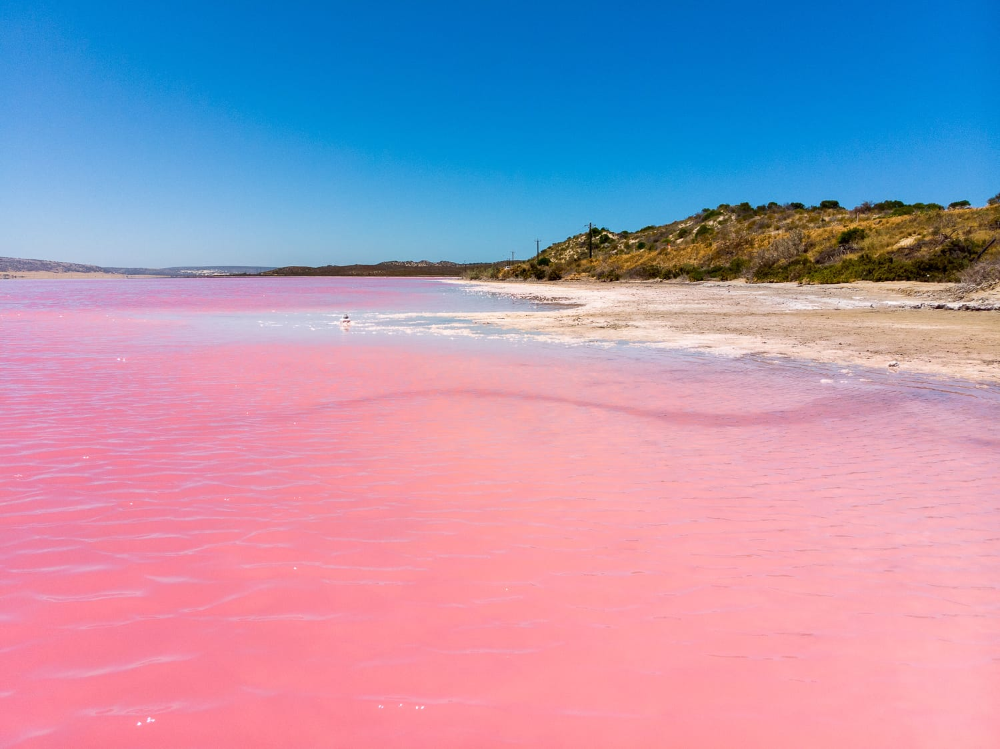
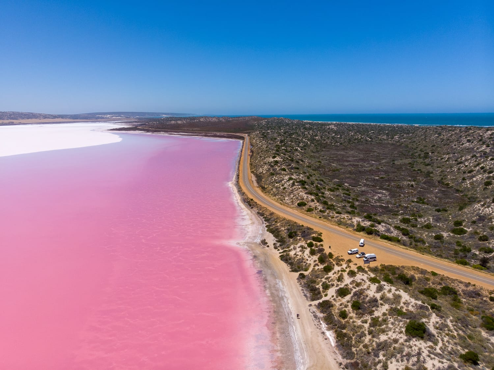
:::

Danach geht's zurück Richtung Perth. Auf der Fahrt nach Norden haben wir einige Buchten ausgelassen, die erkunden wir jetzt am Rückweg.

:::galerie
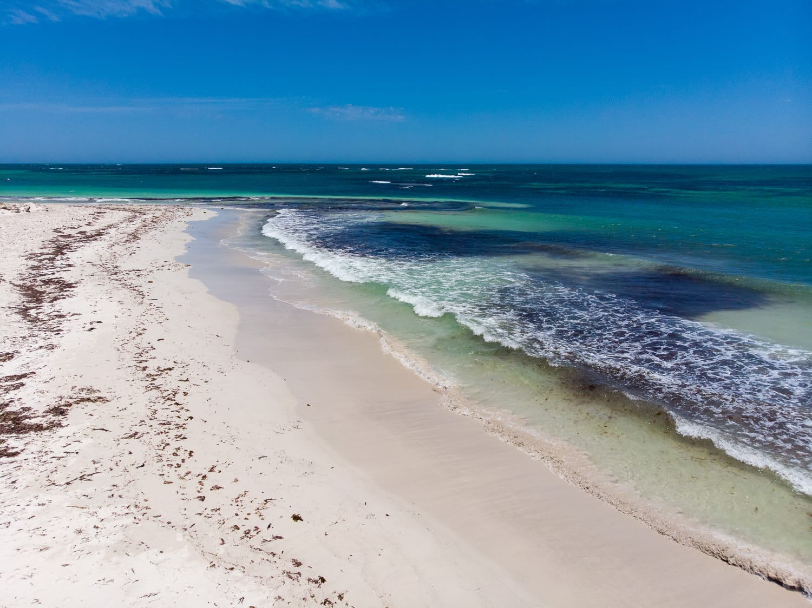
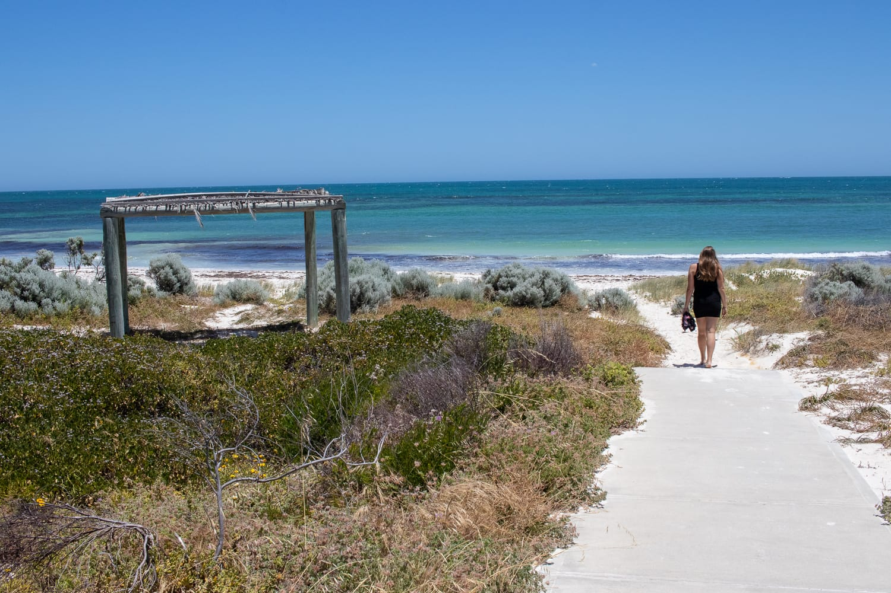
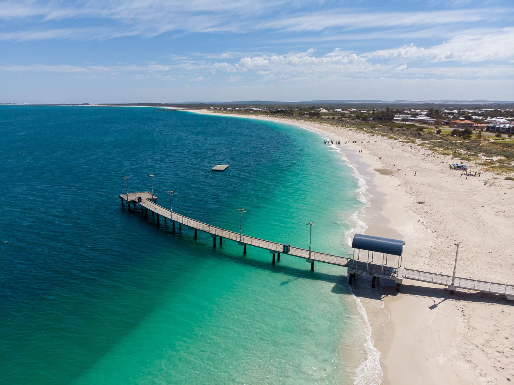
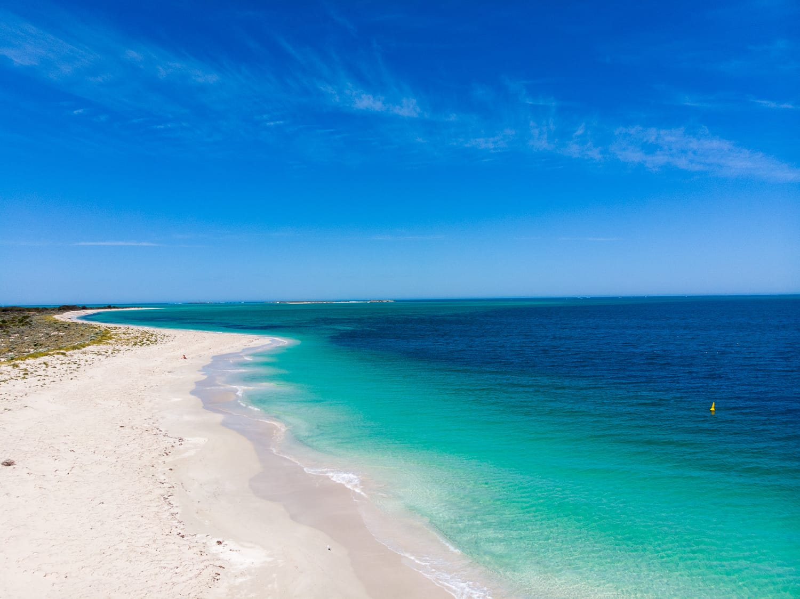
:::
