In Australien haben wir eine der abwechslungsreichsten, schönsten und faszinierendsten Zeiten unserer Reise verbracht. Das Land hat uns immer wieder überrascht.

Das Lustige: Australien stand ursprünglich nicht ganz oben auf unserer Reiseliste. Durch den Aufenthalt in Neuseeland hat es sich mehr oder weniger ergeben, nach dem Motto: „Wenn wir schon mal in dieser Ecke der Welt sind, schauen wir uns das Land halt auch an!" Im Endeffekt sind wir sehr froh, dass wir dort waren, und planen in Gedanken schon den nächsten Aufenthalt. Aber keine Angst, der kommt erst in den nächsten 10 bis 20 Jahren ;)

:::galerie

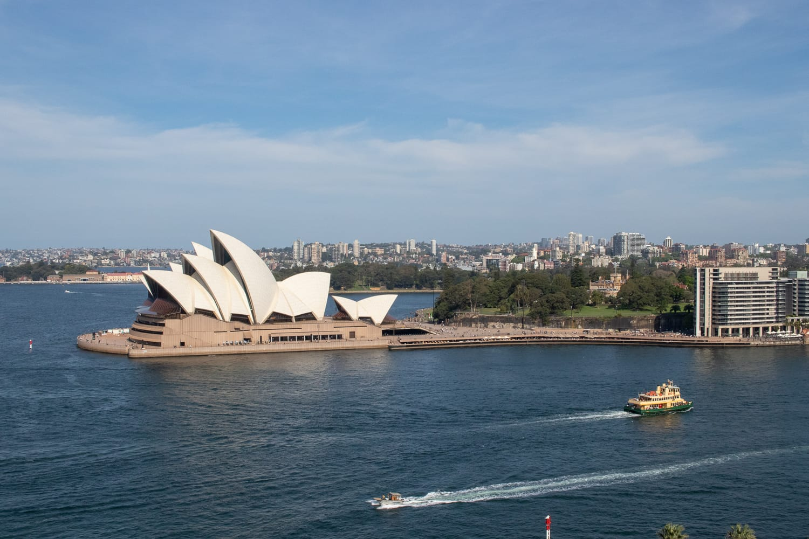
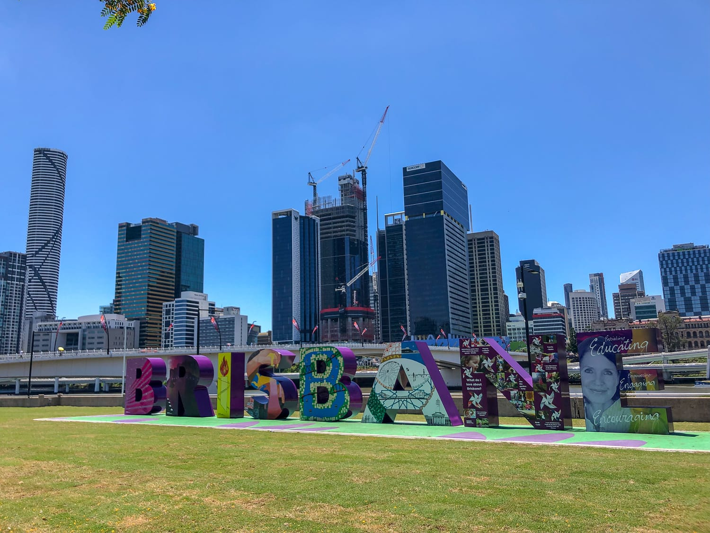
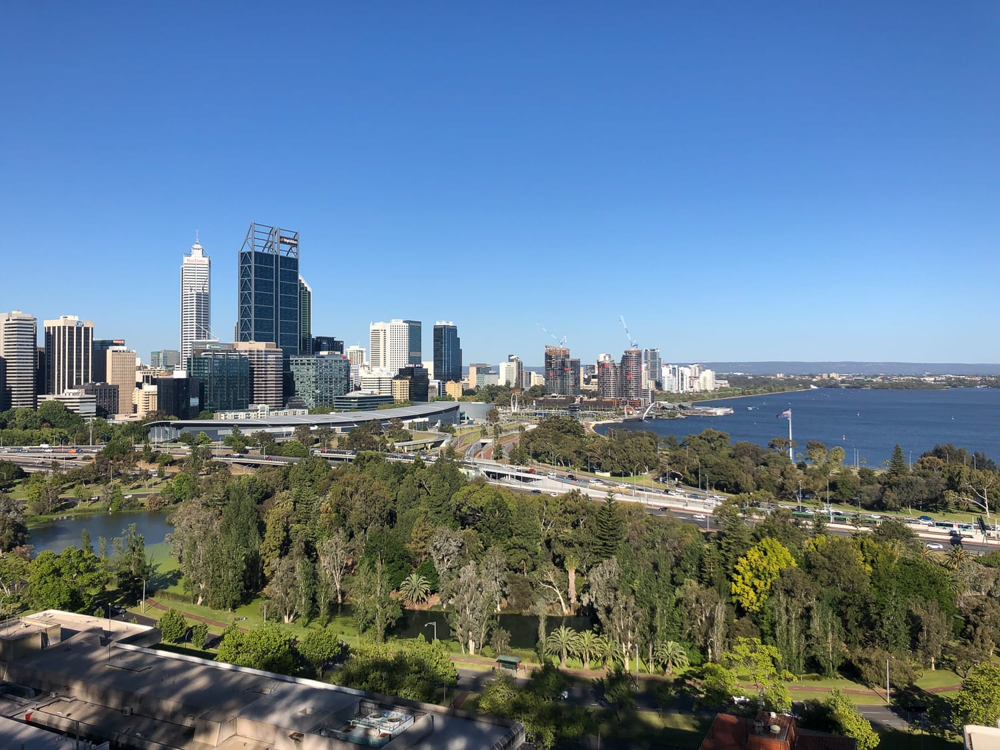
:::

Am 30. September geht unser Flug von Christchurch nach Melbourne. Wir mieten ein Airbnb-Zimmer und verbringen die ersten Tage in der Stadt. Dann geht's mit einem Mietauto für drei Dollar die Great Ocean Road entlang nach Adelaide. Die Great Ocean Road gibt uns einen ersten Vorgeschmack auf Australien und ist ein wunderschöner Start.

Von Adelaide geht's zurück und im Roadtrip bis nach Sydney. Dort mieten wir uns wieder für ein paar Tage ein Apartment, bevor es im Camper Richtung Norden weitergeht. Mittlerweile fühlen wir uns im Camper schon wie richtige Profis. Wir wissen, was wir beim Einziehen besorgen müssen, wie man ihn am besten einräumt und wie man ihn wieder leert.

:::galerie
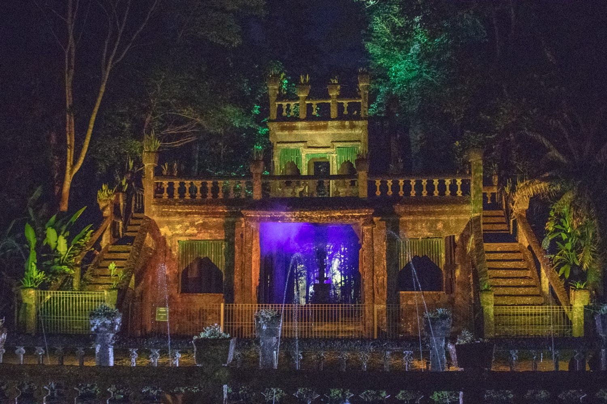
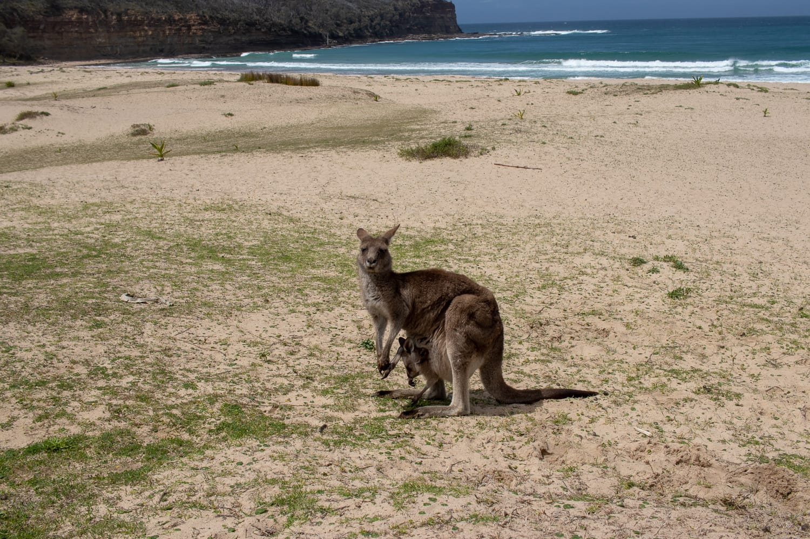
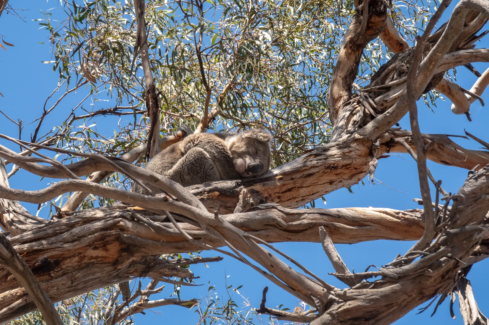

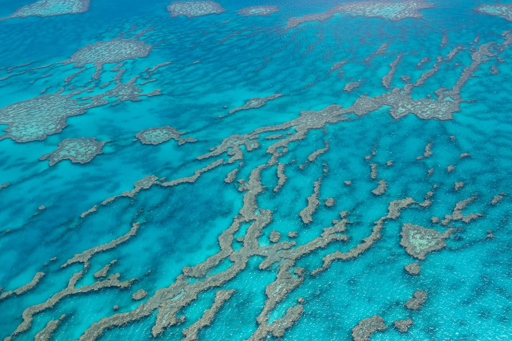
:::

Von Sydney fahren wir die Küste entlang bis nach Cairns. Wir besuchen Yamba, Byron Bay, die Gold Coast, Brisbane, die Sunshine Coast, Hervey Bay, Seventeen Seventy und das Great Barrier Reef, um nur einige Orte zu nennen. Wir sehen unglaublich viel, machen viele Fotos und erleben einiges. Ein Highlight an der Ostküste ist definitiv der Rundflug über das Great Barrier Reef, genauso wie die vielen Kängurus und Koalas in freier Wildbahn.

Nach der schönen Zeit an der Ostküste fliegen wir ins Zentrum. Drei Tage verbringen wir im roten Herzen des Landes und sind von der Landschaft sehr beeindruckt. Die Wanderung um den Uluru ist ein tolles Erlebnis, und wir haben das Gefühl, dort Australien noch einmal ganz anders erlebt zu haben.

:::galerie
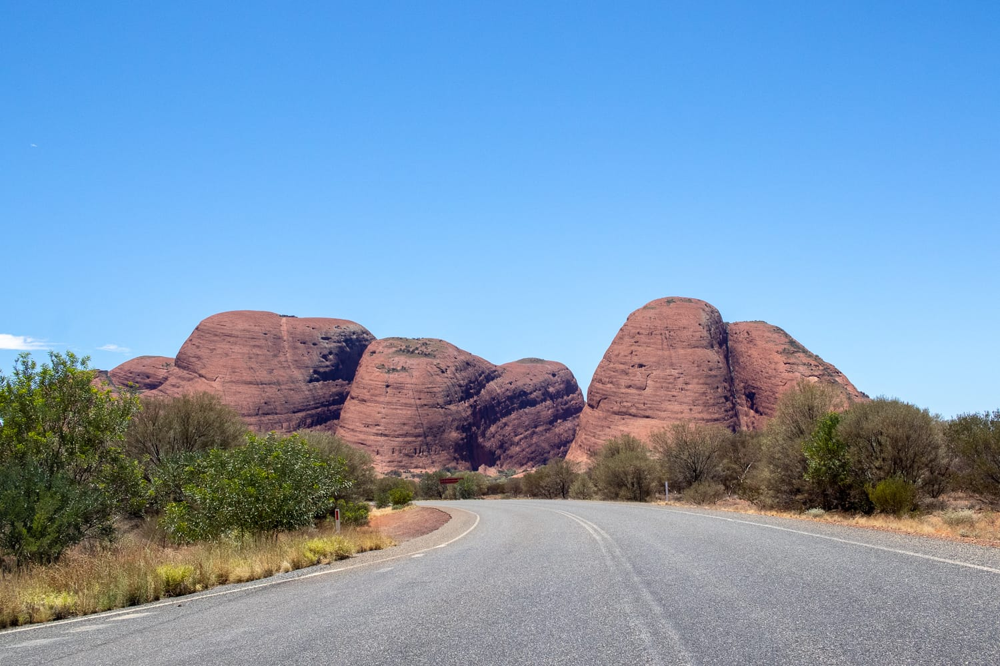
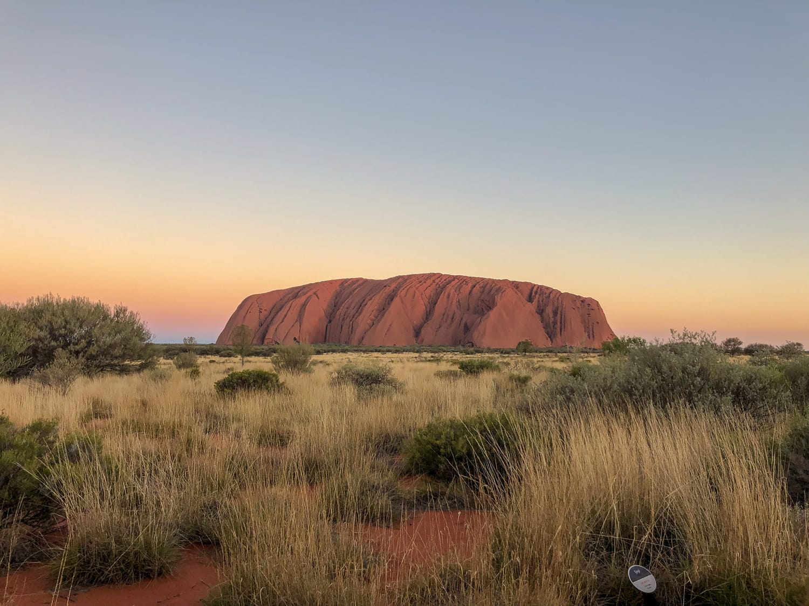

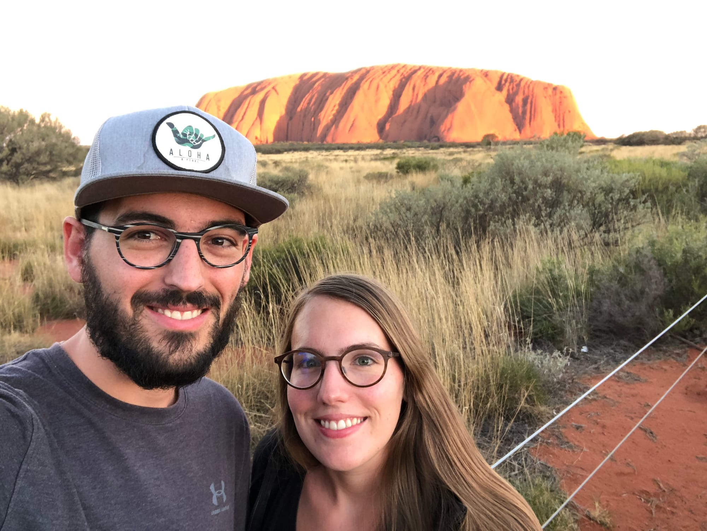
:::

Den Abschluss bilden zwei Wochen an der Westküste. Zuerst verbringen wir fast eine Woche in Perth, dann geht's im Camper nach Norden bis zum Pink Lake in Gregory. An der Westküste sehen wir eindeutig das schönste Meer der ganzen Reise und machen viele tolle Aufnahmen, auch aus der Luft.

Ein Muss für mich ist der Besuch auf Rottnest Island. Wir fahren zuerst eine Runde mit dem Rad über die Insel, die restliche Zeit verbringen wir mit Spielen und Fotografieren der Inselbewohner, der Quokkas. Der Tag dort ist der perfekte Abschluss einer wunderschönen Zeit in einem der faszinierendsten Länder dieser Welt.

### Unterkünfte

:::galerie
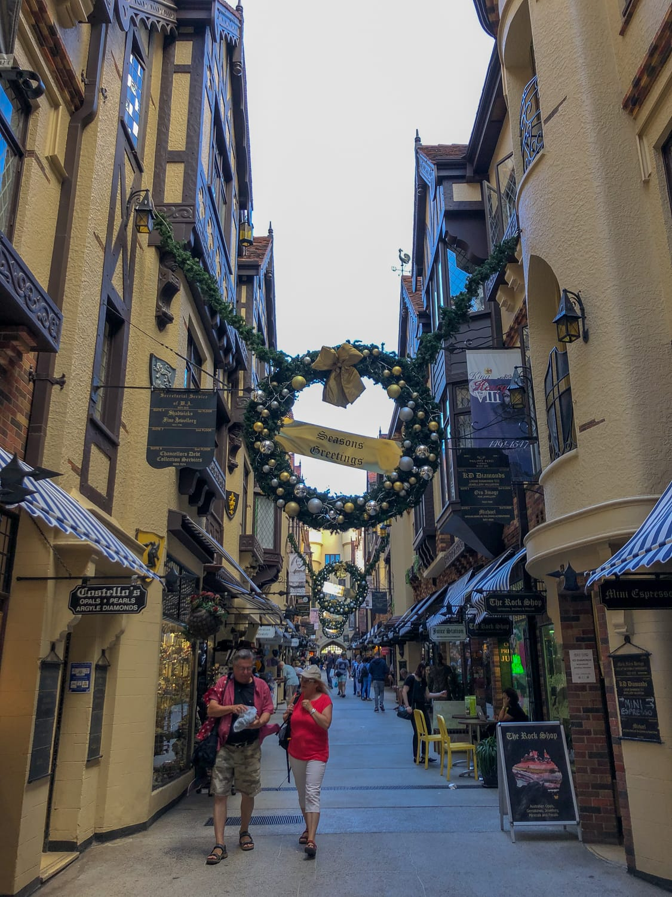

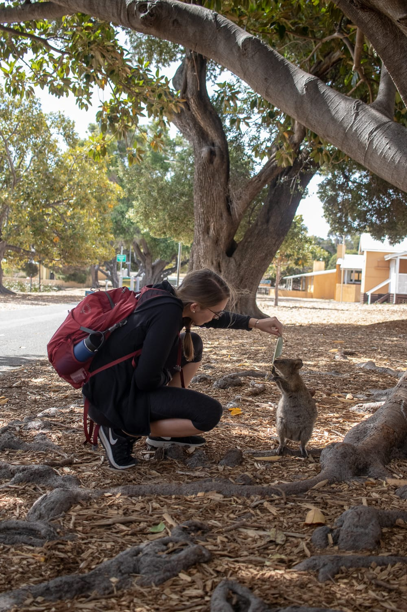
:::

Wie in Amerika haben wir auch in Australien in einer ganzen Reihe verschiedener Unterkünfte geschlafen. Diesmal ausschließlich in privaten Unterkünften, die wir über Airbnb gebucht haben. Wir lernen wieder eine Menge interessanter Menschen kennen, diskutieren mit ihnen über Gott und die Welt, erzählen von daheim und müssen gestehen, dass wir zwar aus Österreich kommen, „Sound of Music" aber noch nie gesehen haben.

Bei den Reisen mit den beiden Campern sehen wir auch viel von Australien und lernen eine Menge unterschiedlicher Campingplätze kennen. Diesmal schlafen wir vorwiegend auf bezahlten Plätzen, denn so schöne Gratis-Campingplätze wie in Neuseeland gibt's hier leider nicht, zumindest nicht auf den Routen, auf denen wir unterwegs sind.

### Autos

Mit den Autos haben wir wieder riesiges Glück. Gleich zu Beginn ergattern wir ein wahres Schnäppchen und fahren für drei australische Dollar nach Adelaide. Danach bekommen wir einen nagelneuen Toyota Corolla mit keinen hundert Kilometern am Tacho, mit dem wir bis nach Sydney fahren. Nach den zwei kleinen Autos muss ich mich in Sydney wieder an ein großes Fahrzeug gewöhnen: Unser Camper ist stolze acht Meter lang, und zur Eingewöhnung geht's gleich einmal quer durch Sydney. Ich gewöhne mich aber schnell daran und bleibe beim Ein- und Ausparken immer cool.

:::raster
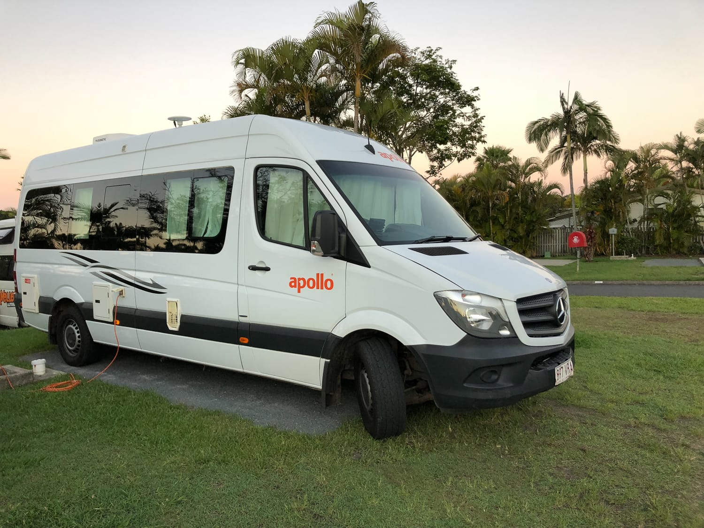

:::

Unsere Rückblicke auf Amerika und Neuseeland findest du ebenfalls hier im Blog.
