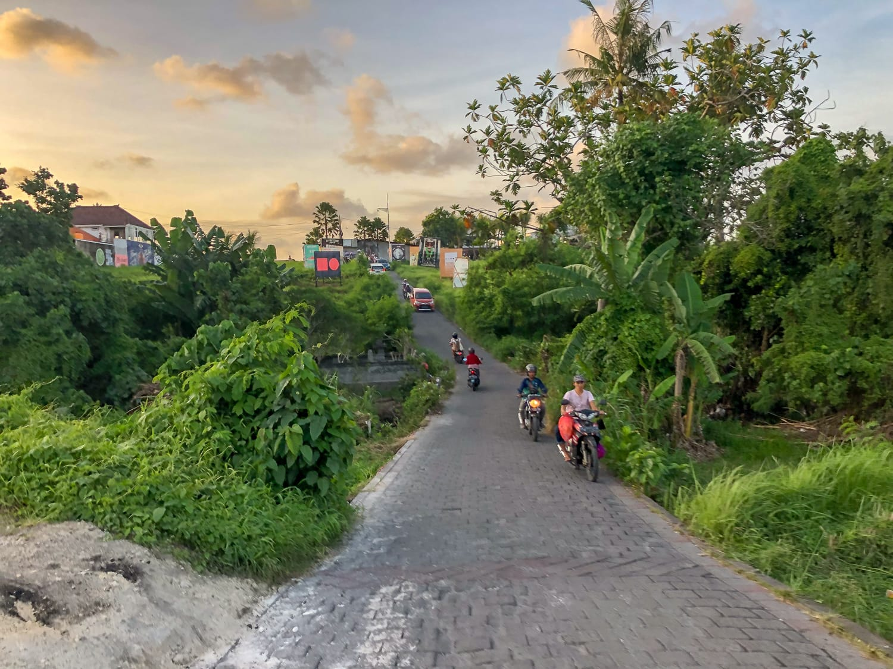
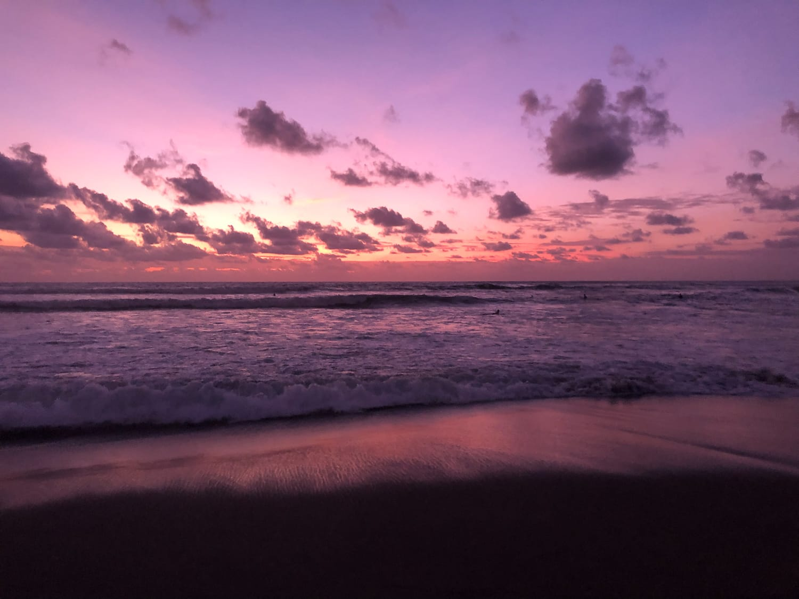
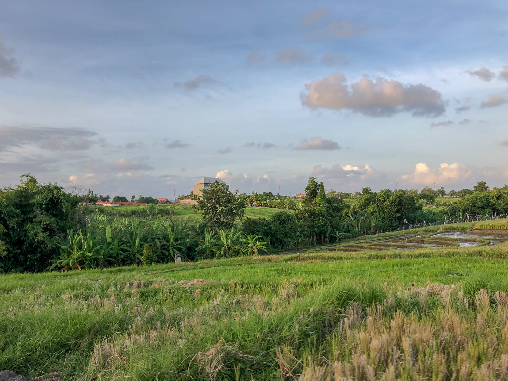
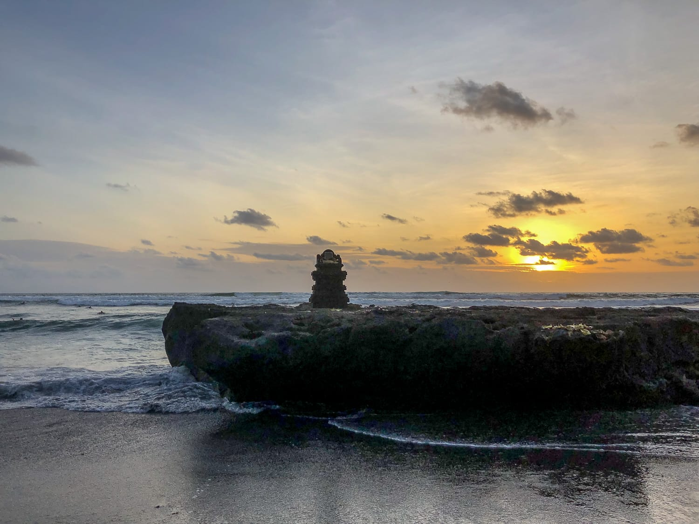
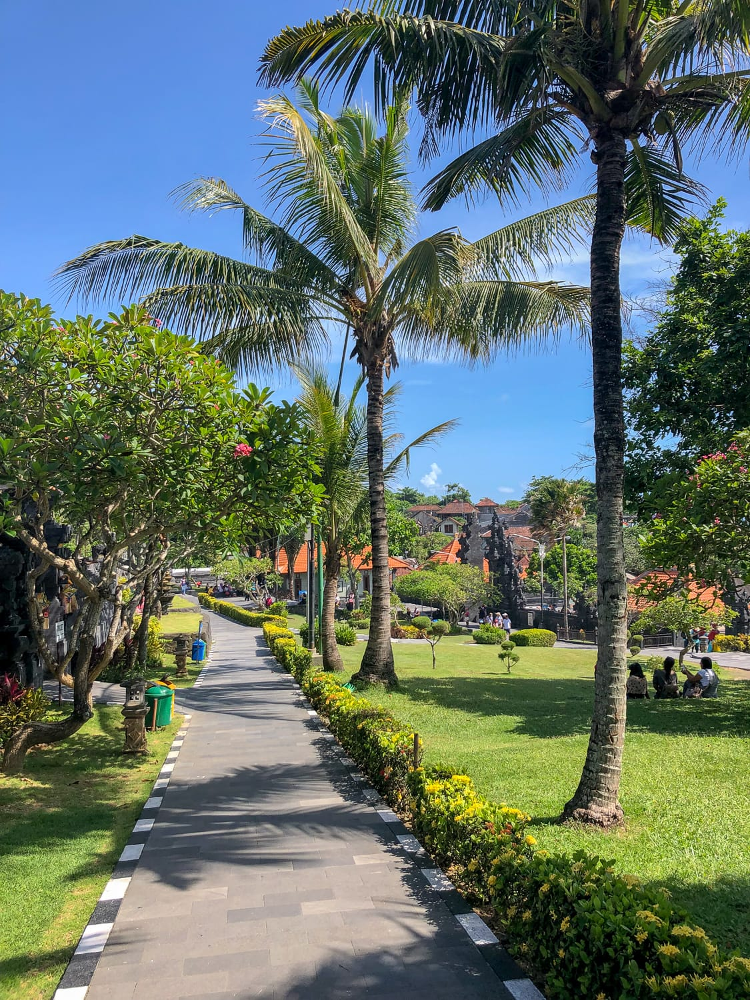
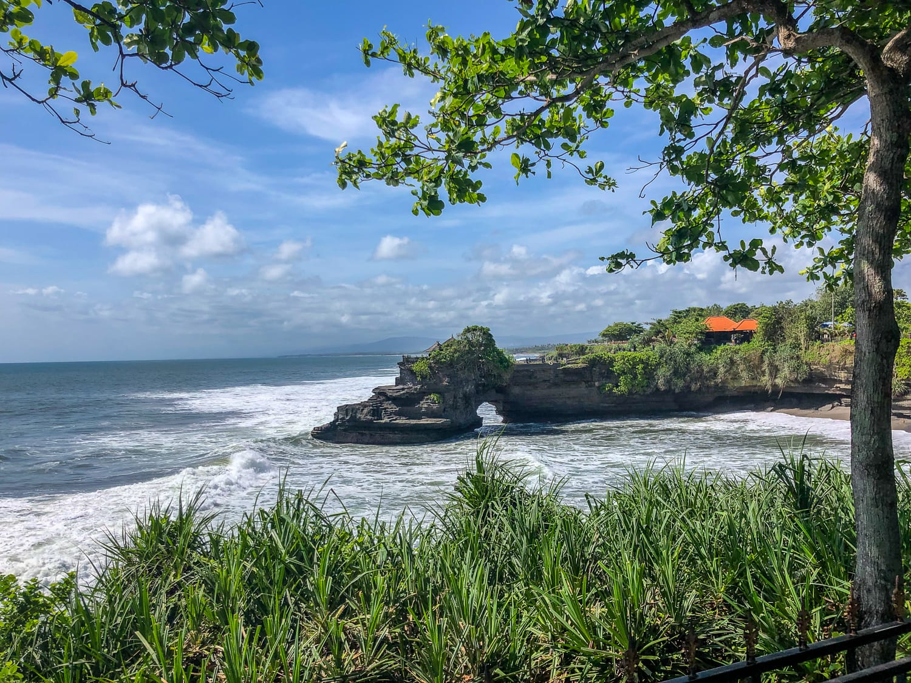
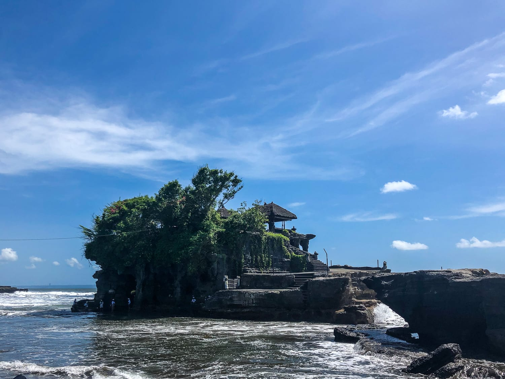

Nach den ersten, nicht wirklich positiven Tagen in Canggu muss dringend eine Lösung her. Immerhin wollen wir hier zehn Tage verbringen und nicht nur im Hotelzimmer sitzen. Wir mieten einen Roller!

Man glaubt gar nicht, wie sehr diese kleine Entscheidung unseren Alltag hier erleichtert. Es ist schade, dass man in Canggu kaum irgendwo zu Fuß hinkommt. Deshalb wollen wir nicht mehr schutzlos am Straßenrand gehen, sondern uns direkt ins Getümmel stürzen. Ganz nach dem Motto: mittendrin statt nur dabei!

Mit dem Roller düsen wir in wenigen Minuten durch die Straßen und können endlich die ganze Umgebung erkunden. Unser Alltag besteht meistens aus Frühstücken und Arbeiten am Laptop, Mittagessen und Yoga, Abendessen und Sonnenuntergang anschauen.

:::galerie

:::

Zwischendurch machen wir immer wieder kleinere Ausflüge und fahren eine der meistbefahrenen Straßen entlang, zwischen Reisfeldern, bis zur nächsten Hauptstraße. In Canggu genießen wir richtig unseren Urlaub: Wir schlafen lange und essen viel und gut!

### Ausflug zum Tanah Lot Tempel

Damit wir nicht die ganze Zeit in Canggu bleiben, machen wir einen Ausflug zum Tanah-Lot-Tempel. Wir wagen uns mit dem Roller auf die große Hauptstraße und fahren etwa 20 Minuten bis zum Tempel. Ein bisschen aufgeregt sind wir beide schon, denn so weit weg haben wir uns mit dem Roller noch nie getraut. Aber der Tempel ist den Ausflug eindeutig wert. Das Besondere an dem hinduistischen Tempel ist die tolle Lage, mitten im Meer auf einem Felsen. Wir machen einige Fotos, aber die Hitze und die Luftfeuchtigkeit laden nicht wirklich zum langen Verweilen ein. Nach einer kleinen Runde, bei der wir uns von Schatten zu Schatten kämpfen, fahren wir wieder nach Hause.

:::raster

:::
