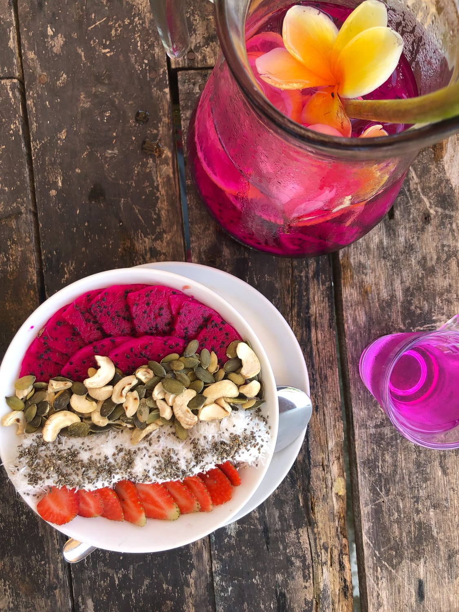
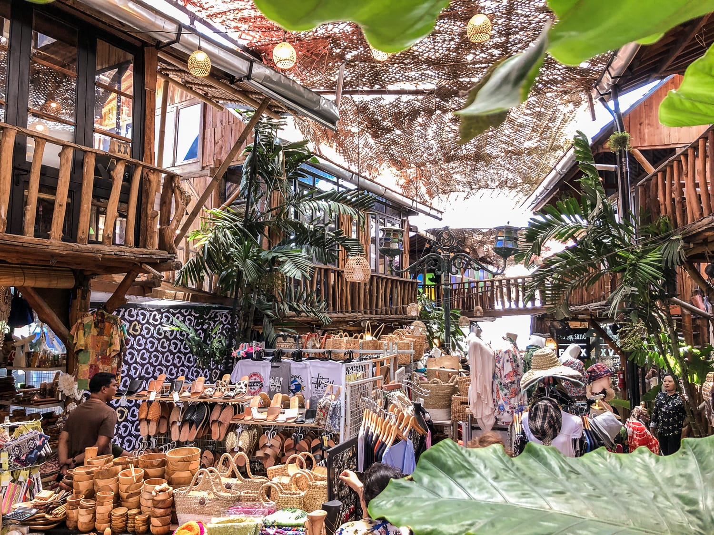
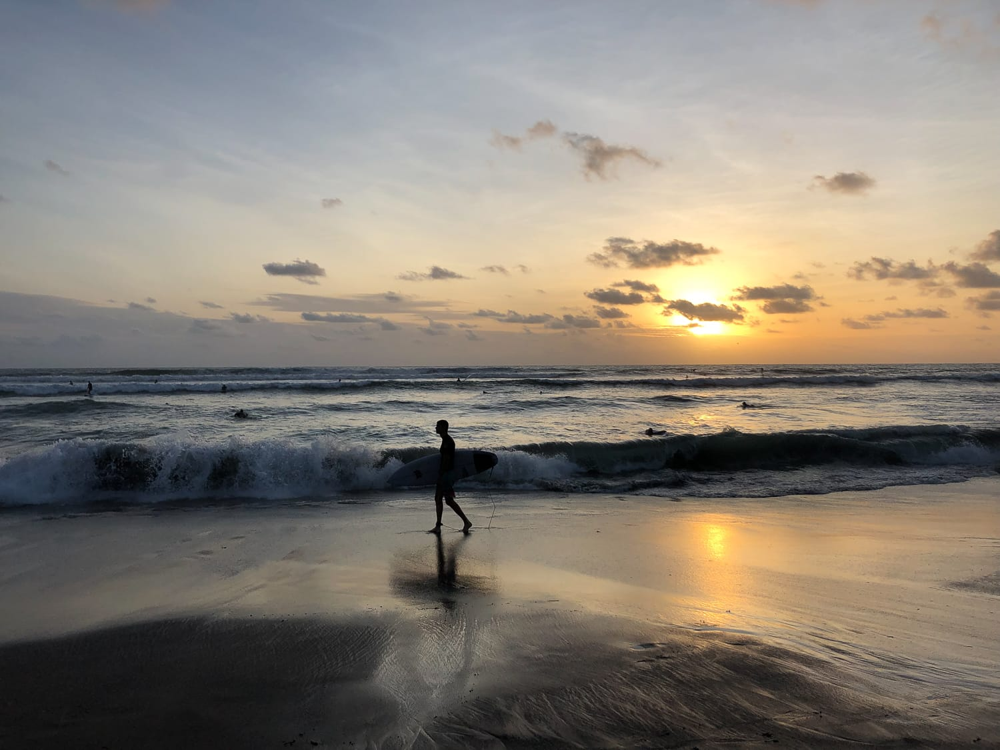
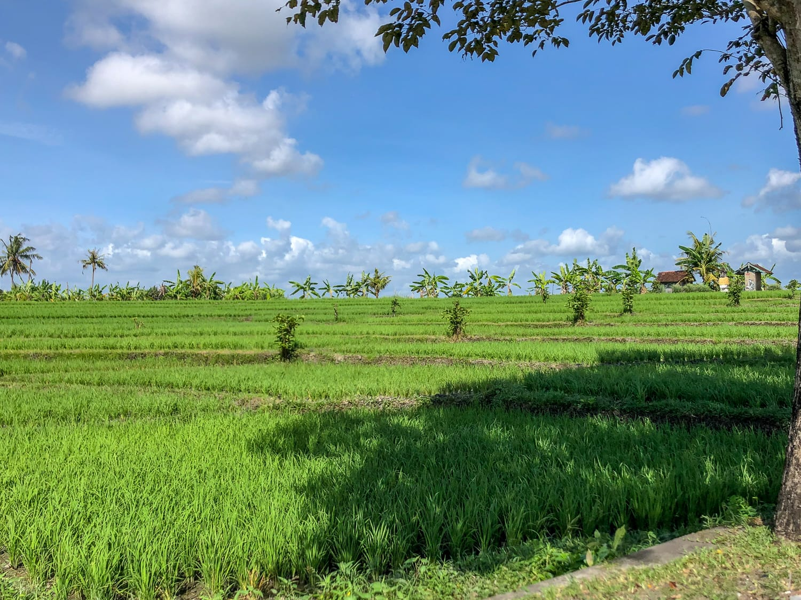
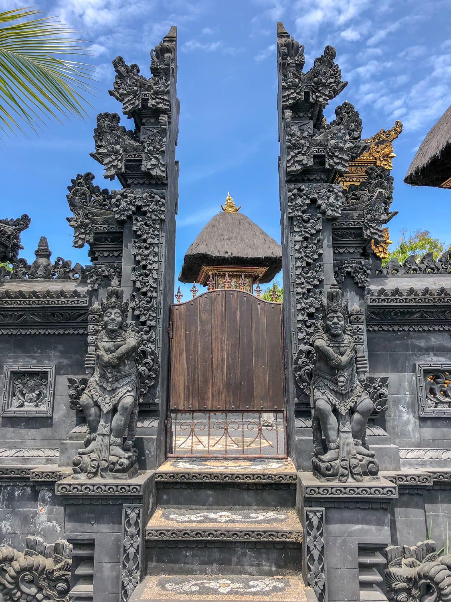
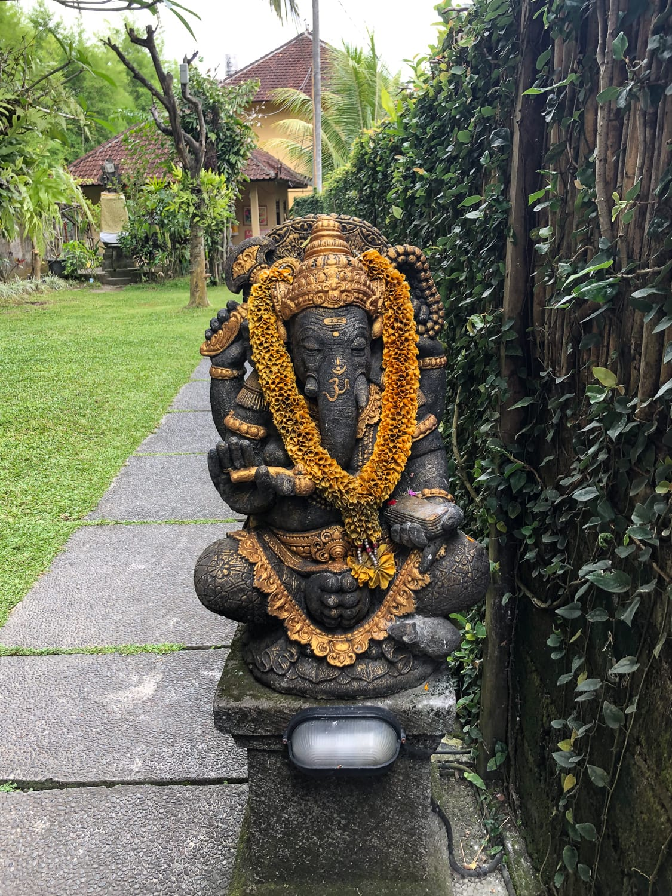
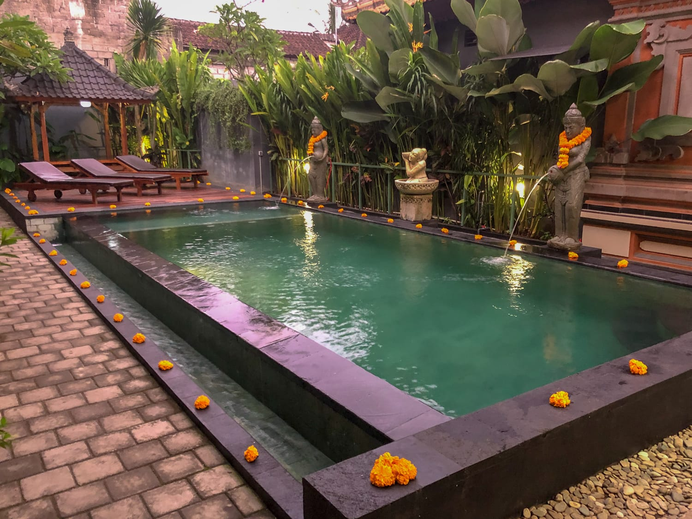
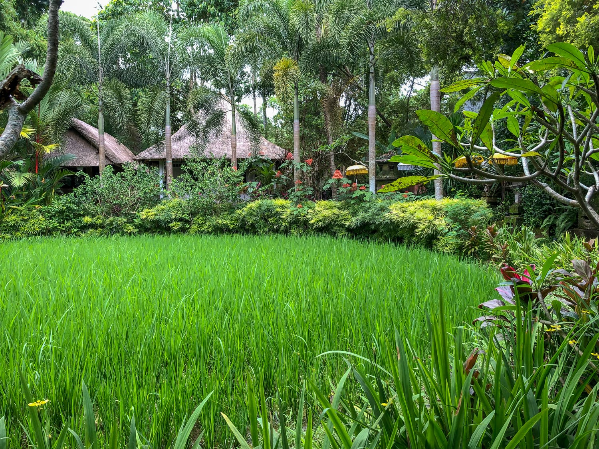

Bali war die letzte Station unserer Weltreise und zugleich das erste Land in Asien, das wir beide je besucht haben. Vorgenommen hatten wir uns nicht viel: ausrasten, die letzten Monate sacken lassen und Weihnachten und Silvester ganz ruhig verbringen. Ganz so entspannt, wie wir uns das vorgestellt hatten, ist es dann zwar nicht gestartet, aber am Ende haben wir doch noch zueinander gefunden, Bali und wir.

### Ankunft im Chaos

Nach über zwei Monaten Australien flogen wir von Perth nach Denpasar. Visum und Bargeld waren schnell erledigt, und zum Glück hatte unser Vermieter einen Fahrer organisiert. In der Ankunftshalle riefen Taxifahrer durcheinander, Leute wollten uns das Gepäck abnehmen, und auf der Straße ging das Chaos gleich weiter: Gehupe, Roller links und rechts, jeder fährt irgendwie und irgendwohin. Nach eineinhalb Stunden waren wir in Canggu, in einer einfachen, sauberen Unterkunft mit Pool, gleich neben dem Yogastudio Samadi.

Die ersten Tage waren ehrlich gesagt anstrengend. Es war heiß, laut und stinkig, überall lag Müll, und Gehsteige gibt's in Canggu praktisch keine. Die Roller fuhren oft nur ein paar Zentimeter an uns vorbei, und zum Strand hätten wir eine halbe Stunde neben der Straße gehen müssen. Dazu die Luftfeuchtigkeit: Wir haben permanent geschwitzt und uns von Café zu Café gerettet. Davon gibt's zum Glück mehr als genug, und die Smoothie-Bowls und Säfte haben über so manchen Schreckmoment hinweggetröstet.

:::raster

:::

### Mit dem Roller wird alles leichter

Die Lösung war am Ende ganz einfach: Wir haben uns einen Roller gemietet. Statt schutzlos am Straßenrand zu gehen, waren wir plötzlich mittendrin statt nur dabei und in ein paar Minuten überall. Unsere Tage bestanden dann aus Frühstück und Arbeit am Laptop, Mittagessen und Yoga, Abendessen und Sonnenuntergang. Zwischen den Reisfeldern haben wir die Umgebung erkundet, und einmal haben wir uns sogar auf die große Hauptstraße zum Tanah-Lot-Tempel getraut, der auf einem Felsen mitten im Meer steht. Lang gehalten hat's uns dort in der Hitze nicht, aber der Ausflug hat sich ausgezahlt.

:::raster

:::

### Durchatmen in Ubud

Am 18. Dezember ging's ins Landesinnere nach Ubud, und schon auf der Fahrt änderte sich unser Bild von der Insel: grüne Reisfelder, prächtige Tempel und Statuen, und für ein paar Kilometer sogar weniger Verkehr. In Ubud gab es dann etwas, das wir in Canggu so vermisst hatten: Gehsteige! Überhaupt war hier alles entspannter. In Canggu wirkte vieles so, als wäre es nur für Instagram da. In Ubud merkt man den Lokalen an, dass es sie schon länger gibt, und auch die Leute auf der Straße wirkten viel gelassener.

Gewohnt haben wir in einer kleinen, ruhigen Oase nahe der Hauptstraße. Hinein ging's über einen typisch balinesischen Innenhof, in dem eine Familie lebt. Jeden Morgen gab's Frühstück auf unserer Terrasse, und direkt davor lag der Pool, in dem wir uns mehr als einmal abgekühlt haben. Wir sind regelmäßig zum Yoga gegangen und haben auch einmal in eine Einheit Qigong hineingeschnuppert, damit sind wir aber nicht so recht warm geworden. Zu Silvester haben wir uns zum Abschluss noch etwas gegönnt: vier Tage in einem Hotel mit eigenem Pool.

:::galerie

:::

### Selamat tinggal, Bali

Bali hatten wir uns anders vorgestellt, und der Einstieg in Asien war ein ordentlicher Kulturschock. Gerade nach den Monaten in den USA, in Neuseeland und in Australien, wo alles geordnet und zu Fuß erreichbar war. Mit dem Roller in Canggu und spätestens in Ubud haben wir aber unseren Rhythmus gefunden: viel Yoga, gutes Essen, lange Frühstücke und Zeit, um all das zu verarbeiten, was wir in den Monaten davor erlebt haben. Für das Ende einer so langen Reise war das genau richtig.
