Die Coromandel-Halbinsel ist nach Cape Reinga der nächste Höhepunkt unserer Reise durch Neuseeland. Schon bei den ersten Recherchen für das Land war uns klar, dass wir hier länger bleiben werden. Und so kommt es auch.

Nach einer ruhigen Nacht, in der wir die Halbinsel schon sehen können, machen wir uns nach dem Frühstück auf den Weg. Von Miranda geht's über den Highway 25, den Pacific Coast Highway, und über Thames wieder nach Norden bis Coromandel. Dort verlassen wir den Highway 25 und fahren weiter nördlich die Küste entlang. Die Straße ist, wie so oft in Neuseeland, eng, sehr kurvig, und es geht ständig bergauf und bergab. Als Fahrer ist das ganz lustig, als Beifahrerin kann es schnell auf den Magen schlagen. Dafür wird man alle paar Meter mit traumhaften Ausblicken belohnt.

:::galerie
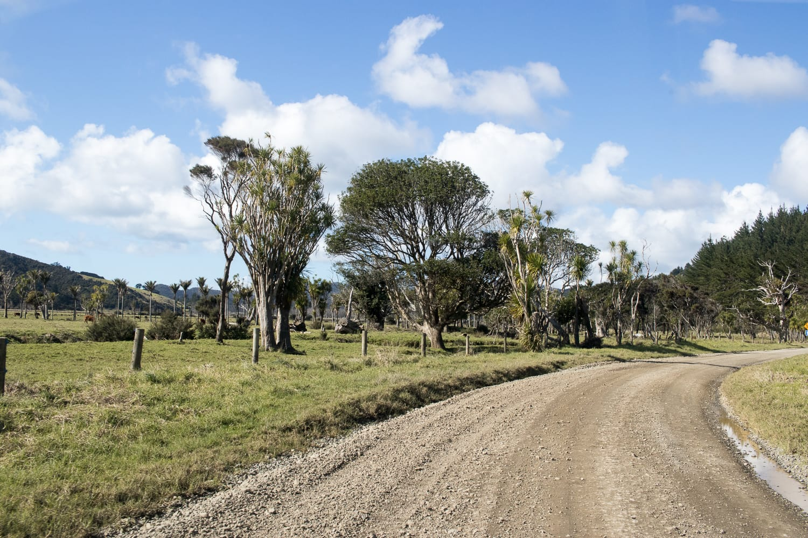
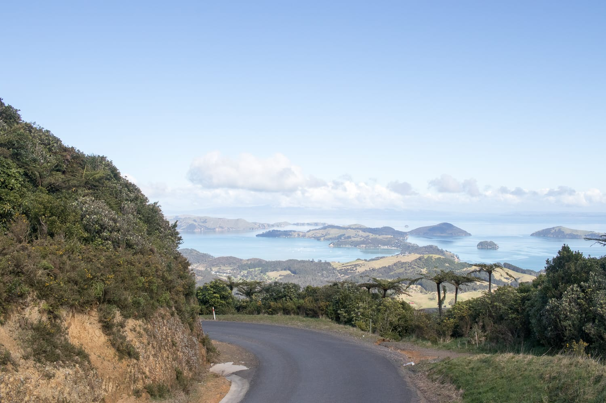
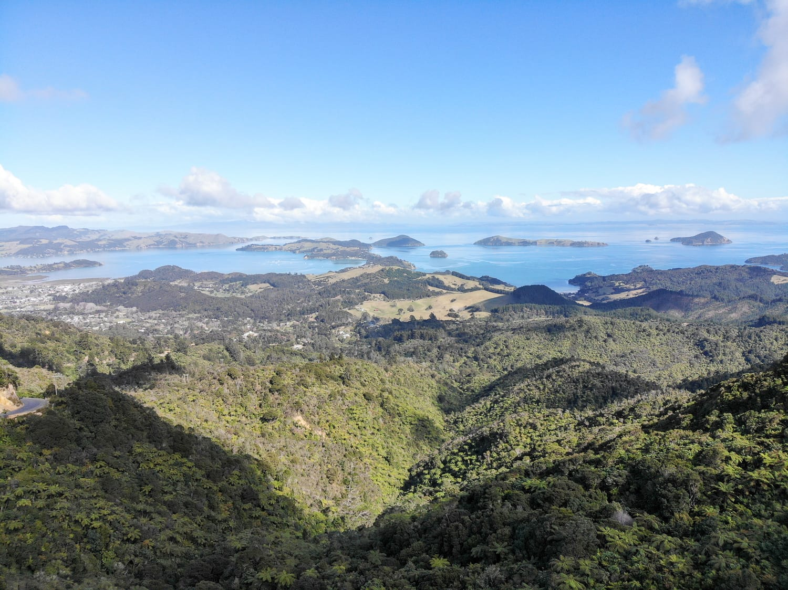
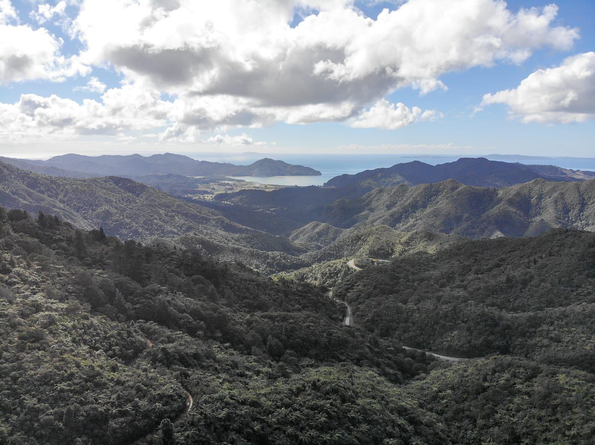
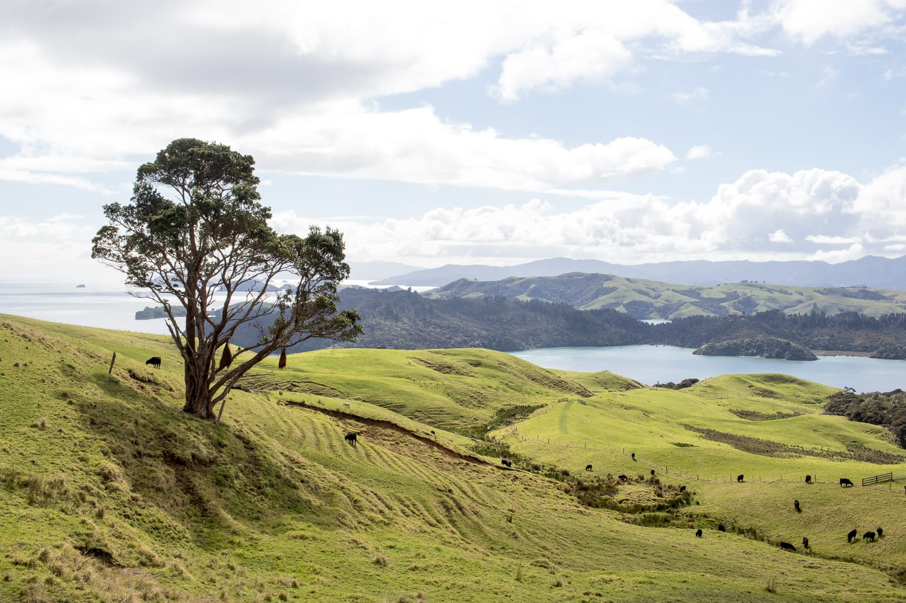
:::

Als der Hunger kommt, nutzen wir eine der vielen Ausbuchtungen und kochen uns etwas. Voll praktisch, wenn man seine Küche immer dabeihat 😃 Nach einem reichhaltigen Mittagessen geht's weiter Richtung Norden. Inzwischen ist es wieder Zeit, einen Campingplatz zu suchen. Der Camper hängt schon einige Tage nicht mehr am Strom, die Batterien müssen geladen werden. Beim ersten Versuch haben wir kein Glück: Wegen des vielen Regens der letzten Tage können wir auf der aufgeweichten Wiese nicht stehen, also fahren wir ein paar Kilometer weiter. Bei der Otautau Bay Farm klappt es, wieder einmal mit grandiosem Panorama!

Am Sonntag geht's zurück nach Coromandel, aber nicht auf der gleichen Straße wie am Vortag, sondern über Waikawau, Tuateawa und Kennedy Bay. Dieser Weg ist wieder sehr abenteuerlich. Daheim in Österreich sind Forststraßen oft in besserem Zustand als diese Straße. Aber es macht echt Spaß, mit dem Camper über Stock und Stein zu reiten, und die Ausblicke sind wieder traumhaft.

Zurück am Pacific Coast Highway geht's weiter über Te Rerenga und Whitianga bis nach Cooks Beach, wo wir wieder einen kostenlosen Campingplatz finden. Diesmal sind wir allerdings alles andere als allein. Die Camper stehen hier aufgereiht wie auf einem normalen Parkplatz. Der Hinweis auf den Mindestabstand von drei Metern zwischen den Fahrzeugen wurde von unseren Nachbarn offenbar „überlesen".

:::galerie
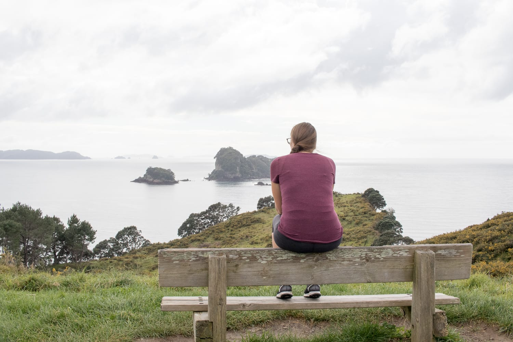
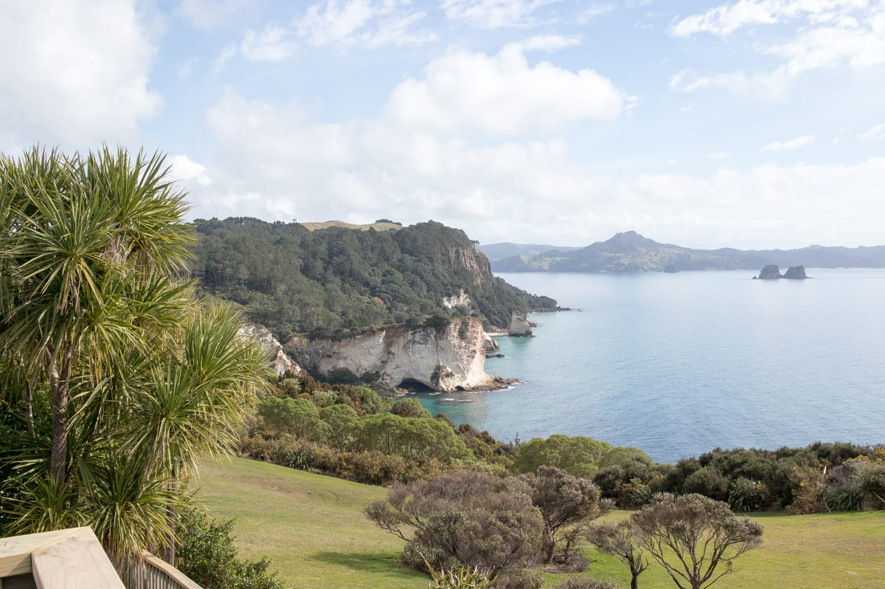
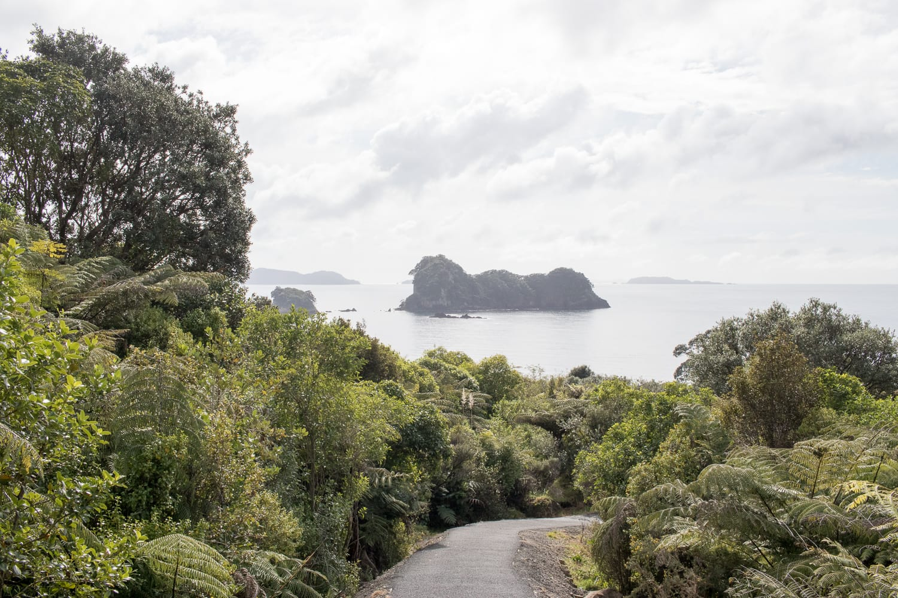
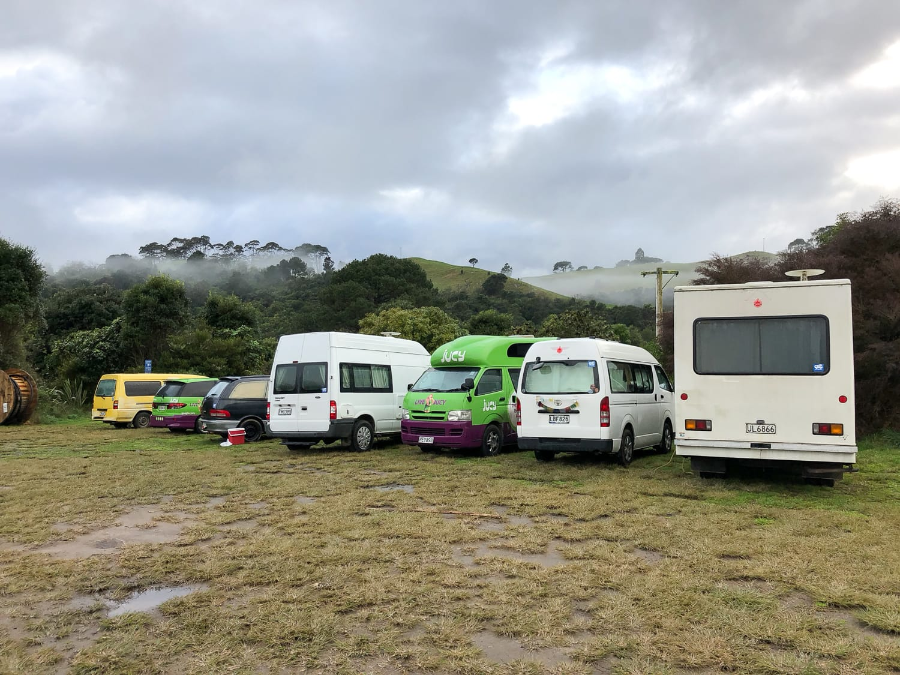
:::

Am Montag heißt es „früh" aufstehen. Zum Abschluss der Coromandel-Runde stehen nämlich die zwei Highlights der Halbinsel am Programm. Früh raus müssen wir, um am Hot Water Beach die heißen Quellen zu erwischen, die nur zwei Stunden vor und nach Ebbe zu finden sind. Die Ebbe ist an diesem Tag um 7.52 Uhr (die Zeiten kann man übrigens online nachschauen).

Als wir am Hot Water Beach ankommen, wissen wir gleich, wo die heißen Quellen sind: Bei 10 bis 15 Grad Außentemperatur sieht man die Dampfwolken schon aufsteigen. Außerdem baden bereits einige Leute in selbst gegrabenen „Jacuzzis", die Schaufeln dafür kann man sich am Strand ausleihen.

Um zu den Quellen zu gelangen, müssen wir noch ein Stück über den Strand gehen und einen Bach überqueren. Wir haben die Schuhe gleich im Auto gelassen, gehen barfuß und werden vom heißen Wasser überrascht. Das Wasser ist wirklich heiß!

:::raster
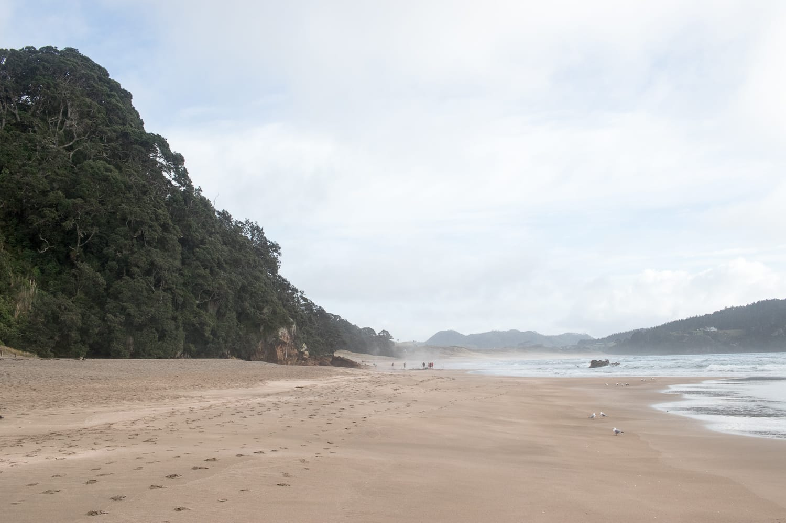
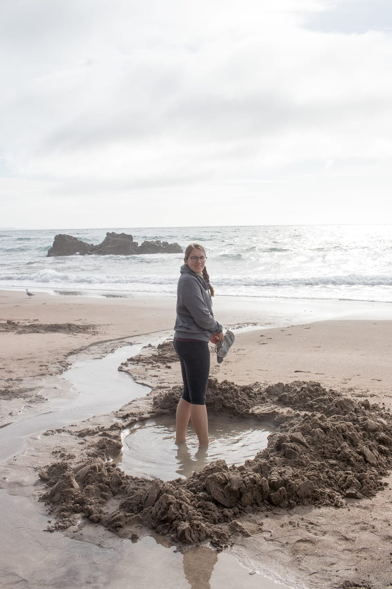
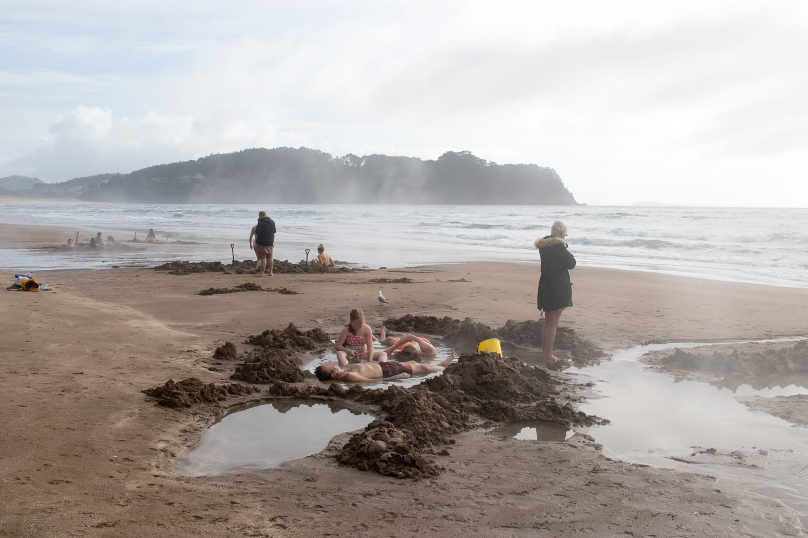
:::

Danach geht's weiter zur Cathedral Cove, einer Höhle am Strand, die innen die Form einer Kirche hat. Wir gehen ungefähr eine halbe Stunde hin. Zum Glück sind wir nicht in der Hauptsaison hier, sonst müssten wir pro Strecke 20 Minuten länger gehen, weil man dann nur am großen Parkplatz parken darf. An diesem Tag gibt's keine Parkplatzprobleme.

Danach fahren wir noch einmal zum Hot Water Beach zurück, genauer zum Hot Waves Café, einem kleinen, aber feinen Café am Strand. Das Angenehme: 1. sehr guter Kaffee und 2. gratis WLAN. Das haben wir die letzten Tage schon verzweifelt gesucht, denn es mussten ja neue Beiträge für den Blog geschrieben werden ;)

Als alles erledigt ist, verlassen wir die Coromandel-Halbinsel und fahren weiter nach Tauranga, wo wir übernachten.

:::galerie
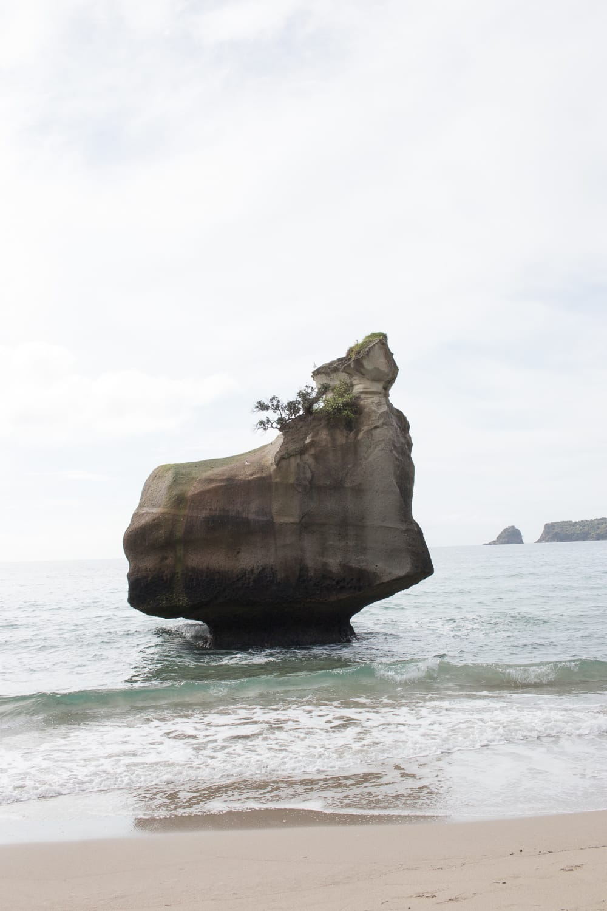
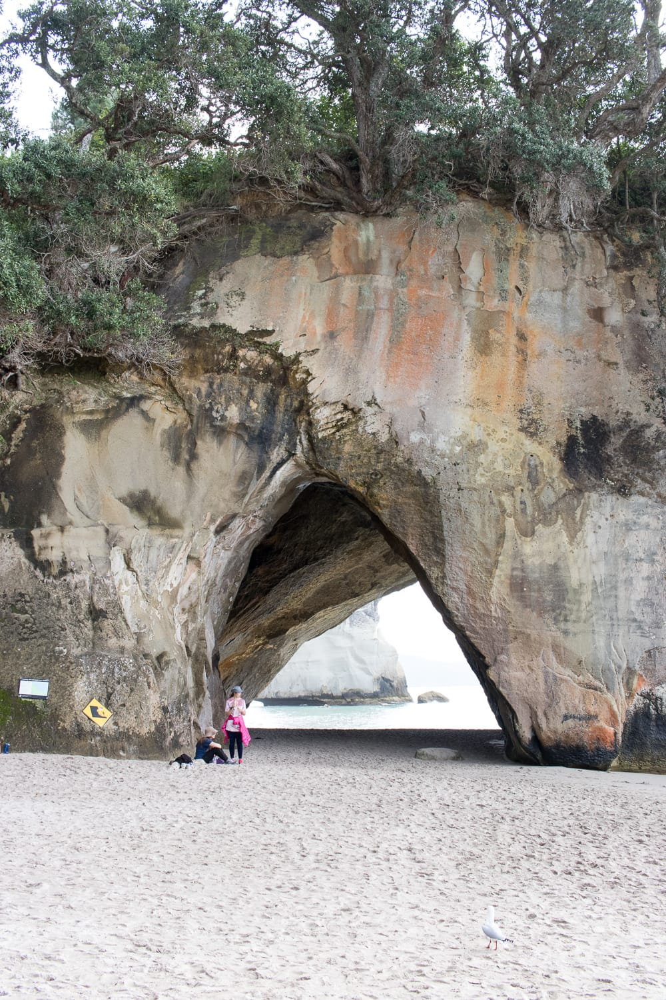

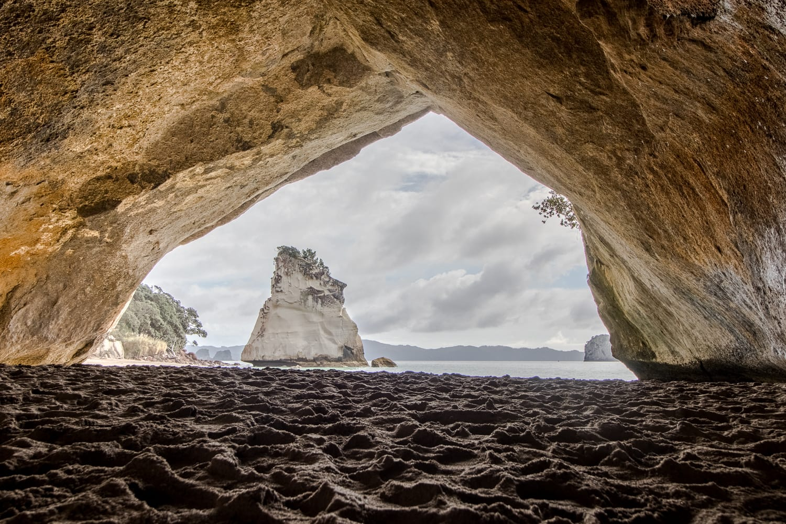
:::
