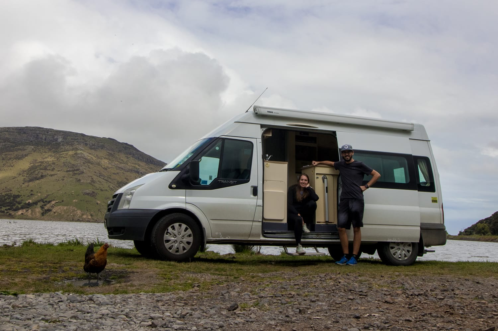
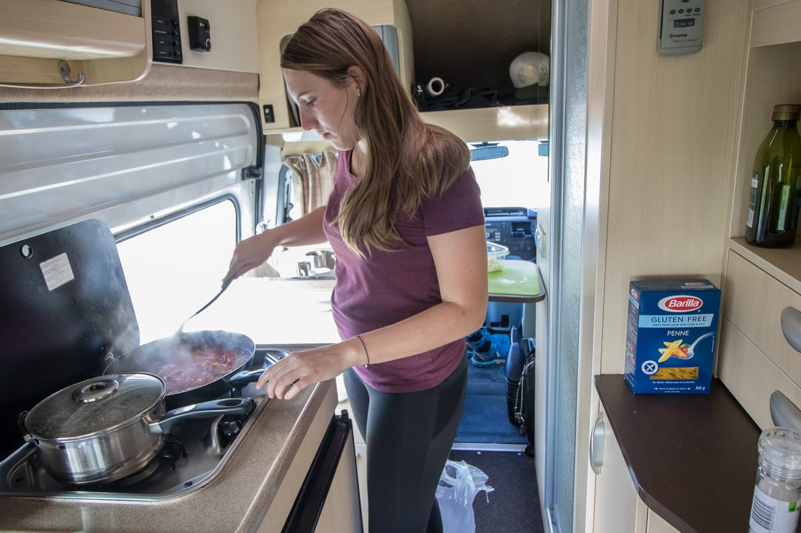
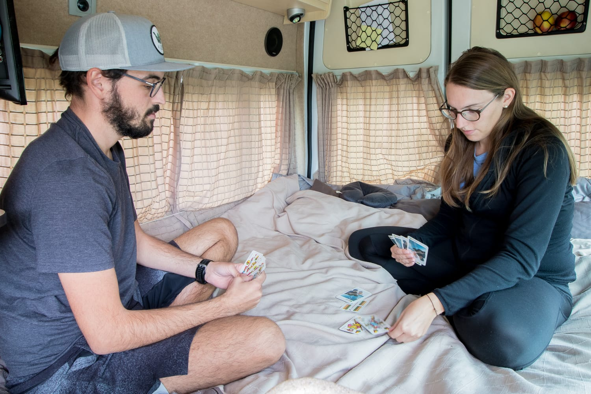
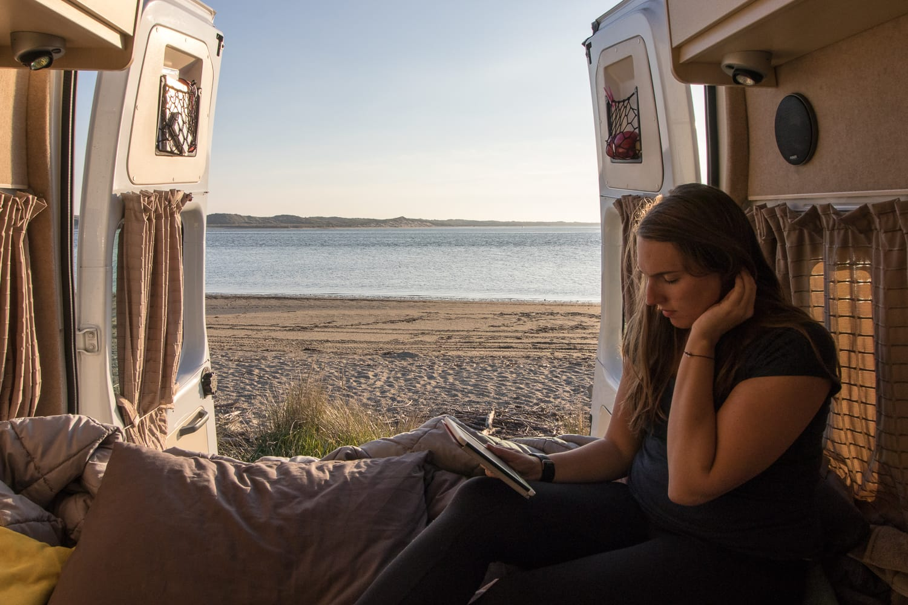

Heute erzählen wir einmal, wie ein typischer Tag in Neuseeland für uns ausschaut. Wir werden meistens zwischen 7 und 8 Uhr munter, entweder weil draußen die Vögel schon sehr laut zwitschern oder weil uns extrem kalt ist. Je weiter wir in den Süden gekommen sind, desto kälter ist es geworden. Anfangs haben wir noch im kurzen T-Shirt geschlafen, daran ist inzwischen nicht mehr zu denken. Jetzt schlafen wir im langen T-Shirt, mit Pulli und Kapuze über dem Kopf.

Dann krabbeln wir schweren Herzens aus dem warmen Bett und stellen einen Tee auf. Bis der kocht, huschen wir noch einmal unter die warme Decke, denn wenn wir den Gasherd benutzen, machen wir immer die Tür vom Camper auf. Danach wird das Frühstück vorbereitet: Hummus, Käse, Marmelade und manchmal Spiegeleier oder Eierspeis. Nach der ganzen Zeit in Amerika, wo es meistens nur darum ging, dass die Lebensmittel den Tag im Auto überleben, genießen wir den Luxus eines richtigen Frühstücks umso mehr!

Nach dem Frühstück wird abgewaschen, danach muss alles wieder fahrsicher verstaut werden. Das Geschirr kommt weg, das Gas wird abgedreht, die Wasserpumpe ausgeschaltet, meistens halt. Es kann hier schon 11 Uhr werden, bis wir wirklich wegkommen.

Los geht's, jetzt wird wieder etwas Neues entdeckt! In Neuseeland muss man sich gar nicht viel vornehmen, meistens ist die Landschaft allein schon so beeindruckend, dass man auch so viel erlebt. Ansonsten verbringen wir viel Zeit in der Natur, mit kleinen Wanderungen, Ausflügen ans Wasser oder einem Spaziergang durch eine Stadt.

Schon am Vorabend schauen wir meistens, welcher Campingplatz das nächste Ziel ist. Zwei Tage kommen wir locker ohne fixen Platz aus, am dritten Tag müssen wir die Batterie des Campers wieder aufladen, Wasser auffüllen beziehungsweise das Schmutzwasser und die Toilette entleeren. Die Batterie können wir leider nur auf richtigen Campingplätzen laden, zum Entleeren des Grauwassers gibt es aber viele Gratisstationen.

Wie gesagt, wir sind nicht an einen richtigen Campingplatz gebunden. In Neuseeland ist „wildes Campen" sehr beliebt, also Campen neben der Straße, auf Parkplätzen oder in der freien Natur. Dafür gibt es zwei Apps, die einem die ganzen Gratis- und kostenpflichtigen Plätze anzeigen, was wirklich super ist. Auf den Gratisplätzen kann man ganz beruhigt stehen bleiben, aber Achtung: nur wenn man eine eigene Toilette und einen Tank für das Schmutzwasser hat, also mit einem „Certified Self-Contained"-Camper unterwegs ist.

So, zurück zum Tag. Wir versuchen, nicht zu viel Zeit im Auto zu verbringen. Erstens haben wir den Luxus, wirklich viel Zeit zu haben, und zweitens merken wir, wie uns das lange Sitzen belastet. Deshalb kann es passieren, dass wir schon um 15 Uhr den Motor abstellen und gleich am Schlafplatz bleiben. Dort wird zuerst gekocht und Kaffee getrunken, dann entspannen wir. Danach kommen die täglichen Aufgaben: Bilder auf den Computer ziehen und bearbeiten, Blogbeiträge schreiben und so weiter.

Manchmal genießen wir aber auch einfach die Aussicht bei einer Tasse Tee und einem guten Buch. Ein fixer Punkt am Abend ist inzwischen das Kartenspielen geworden. Wir spielen fleißig Schnapsen und freuen uns schon darauf, unsere Künste daheim in Österreich unter Beweis zu stellen.

Nach einem langen Tag mit vielen Eindrücken sind wir abends schnell müde. Nur wenn das Buch ganz spannend ist, schaffen wir es bis 23 Uhr, sonst schlafen wir schon um 22 Uhr ganz brav.

:::raster

:::
