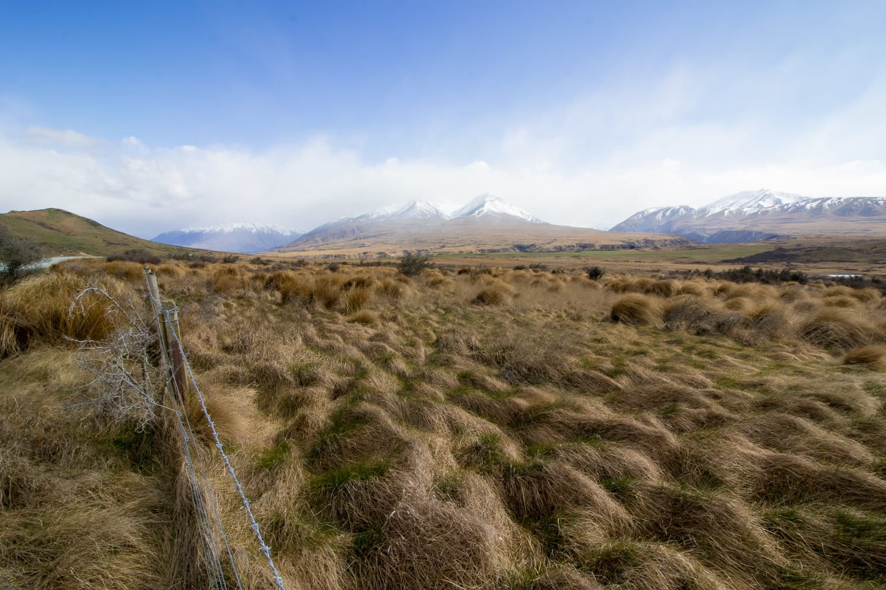
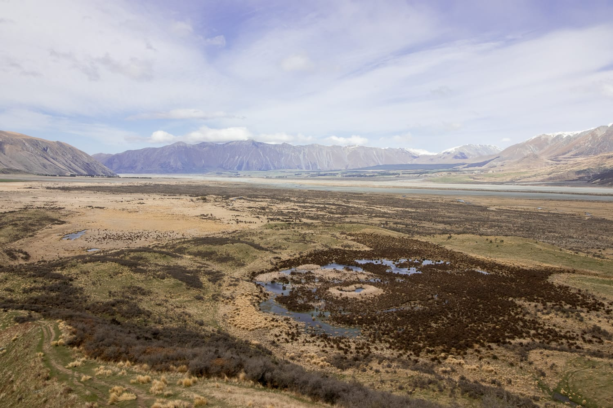
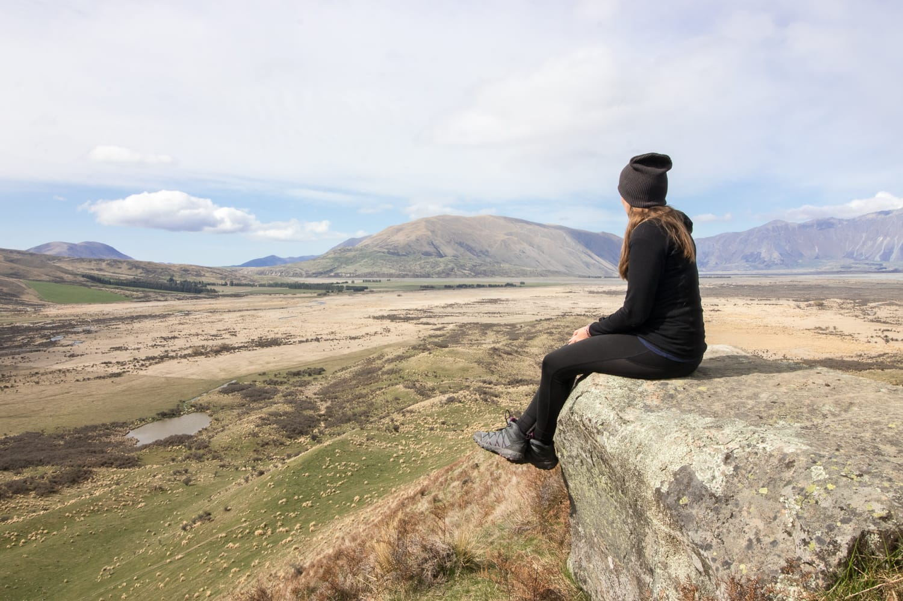

Am Sonntag steht wieder ein besonderer Punkt auf der Liste: der Mount Sunday. Dazu muss man sagen, dass das nicht wirklich ein Berg ist, sondern eher ein Hügel mit wunderschönem Blick auf die Landschaft. Neben Hobbiton ist der Mount Sunday einer der vielen Drehorte von „Herr der Ringe".

Bei ziemlich windigem Wetter machen wir uns von Mount Somers auf den Weg. Die Anreise ist mehr als beschwerlich, und unser Camper kommt ganz schön an seine Grenzen. Die letzten 20 Kilometer geht's über eine Schotterpiste. Die Strecke ist mehr als holprig, und hätten wir nicht alles gut verstaut, würden wir einige böse Überraschungen erleben. Das Highlight ist ein kleiner Fluss, den wir durchfahren müssen. Mehr als einmal überlegen wir, ob das Ziel die Fahrt überhaupt wert ist, aber nach mehr als 10 Kilometern wollen wir wissen, was diesen Ort so besonders macht.

:::raster

:::

Kaum sind wir am Ziel, kommt zum Wind auch noch Regen. Also Regenjacke raus, wasserfeste Wanderschuhe an, und los geht der letzte Fußmarsch. Die Anreise wollen wir nämlich kein zweites Mal auf uns nehmen.

Angeschrieben mit 1,5 Kilometern und 45 Minuten Gehzeit, führt ein markierter Weg auf die Spitze des Mount Sunday. Weder Distanz noch Gehzeit stimmen mit der Anzeige auf unseren Sportuhren überein, ans Gehen sind wir aber inzwischen gewöhnt.

Vom Mount Sunday hat man wirklich einen wunderbaren Blick auf die Landschaft, auch wenn sich an dem Tag der eine oder andere Gipfel in den Wolken versteckt. Die Spitze würde zum Verweilen einladen, wenn es uns nicht fast vom Wind verblasen würde. Wir schießen ein paar Fotos, machen einen kleinen Rundgang auf dem Plateau und treten dann die Heimreise an. Die führt auf der gleichen Strecke zurück. Also wieder: festhalten und durchrütteln lassen!

:::berg Mount Sunday | -43.5481, 170.8931 | 611 m | 2 km

:::raster

:::
