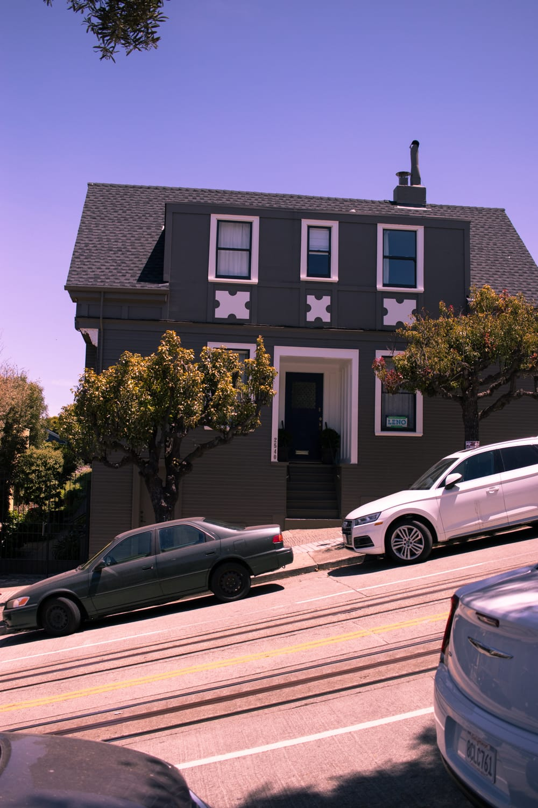

Ein Buch, zwei Filme, zwei Mahlzeiten, unzählige kleine Nickerchen und fast zwölf Stunden Flug später sind wir endlich da. Angekommen am ersten Ziel unserer Reise: San Francisco.

Wegen der Zeitverschiebung landen wir um 12.26 Uhr Ortszeit, daheim in Österreich ist es da schon 21 Uhr. Nach dem ganzen Einreiseprozedere samt Fragen, was wir hier machen und wie lange wir bleiben, holen wir unsere riesigen Rucksäcke ab und brauchen erst einmal eine kleine Orientierungs- und Verschnaufpause.

Ehrlich gesagt sind wir ziemlich unorganisiert angekommen. Einen Plan, wie wir am besten in die Stadt und ins Hotel kommen, haben wir nicht. Nach kurzer Recherche nehmen wir den BART, den Zug, der direkt in die Stadt fährt. Je nach Station in Downtown kostet das zwischen 7 und 9 Dollar.

### Die Suche nach dem Hotel

In der Stadt wären wir also einmal. Aber wie kommen wir jetzt zum Hotel? Zuerst wollen wir mit dem Cable Car fahren. Wir haben aber kein Ticket, und es kommt auch keins daher, also gehen wir in unserer Euphorie einfach zu Fuß.

Stellt euch das ungefähr so vor: zwei Touristen, schwer bepackt mit zwei riesigen Rucksäcken, zwei kleineren Rucksäcken, einer Tasche und zwei dicken Pullis, ein bisschen erledigt und übermüdet, die durch San Francisco stapfen.

Was wir bei dem tollen Plan nicht bedacht haben: Die Straßen hier verlaufen nicht gerade, sondern sind teilweise richtig steil. Und natürlich müssen wir genau so eine hinauf. Ich habe die letzten Tage mit einer Erkältung gekämpft und bin noch nicht ganz fit, also legen wir immer wieder Pausen ein, und am Ende bin ich einfach nur noch geschafft. Als wir nach langer Qual endlich beim Hotel stehen, merken wir: Es ist das falsche. Alles umsonst!

Jetzt denken sich vielleicht einige: „Wie verwirrt kann man bitte sein?" Zu unserer Verteidigung: Wir hatten in San Francisco zwei Hotels in der engeren Auswahl und haben uns anscheinend für das andere entschieden. Im Kopf war aber immer noch das Cable-Car-Hotel, und die Buchungsbestätigung hatten wir nur am Laptop.

Nach dem Missgeschick gönnen wir uns ein Taxi und lassen uns zum richtigen Hotel kutschieren. Dort würden wir am liebsten gleich wieder umdrehen. Die Gegend ist bei weitem nicht so schön wie beim anderen Hotel, und wir sind anfangs ziemlich abgeschreckt. Wir bleiben trotzdem, denn die Zeit wollen wir ja sowieso nicht im Hotel verbringen.

Heute geht's mit der richtigen Erkundung los, und wir freuen uns schon auf die Stadt!

