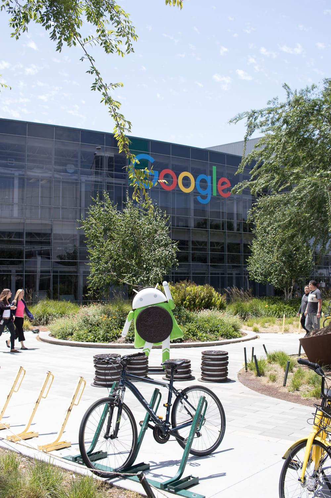
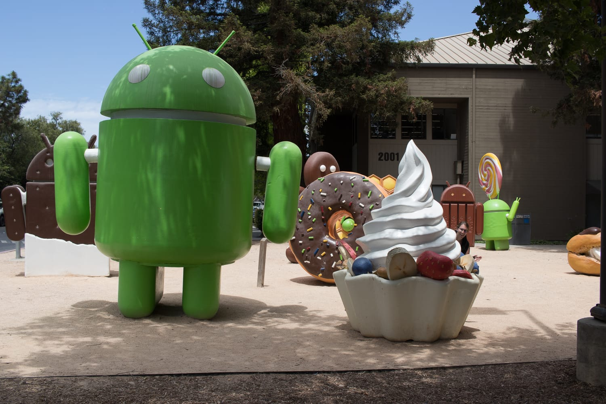
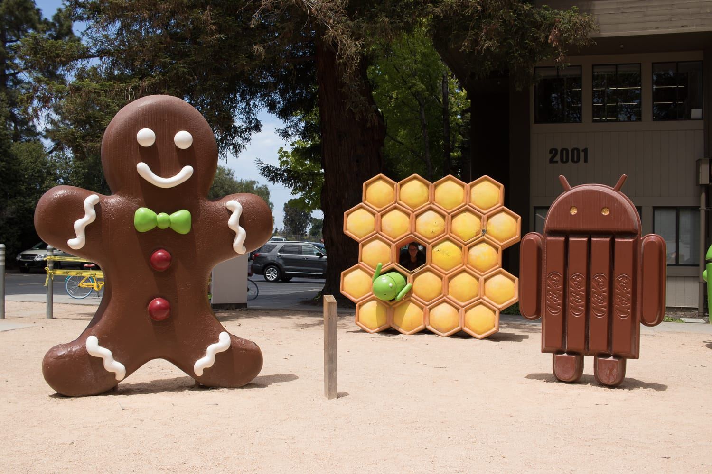
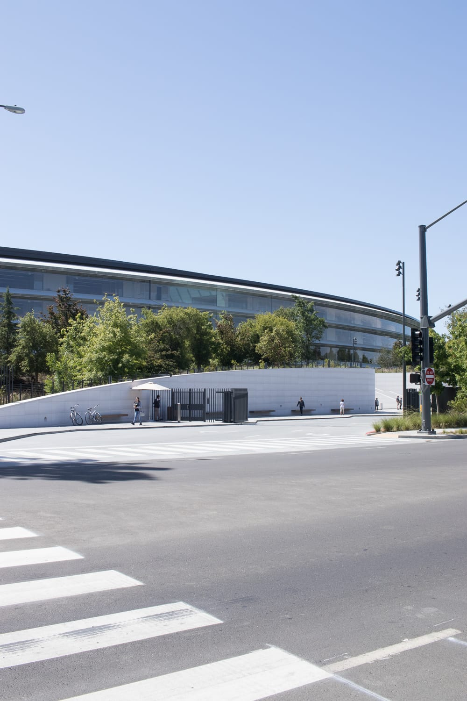
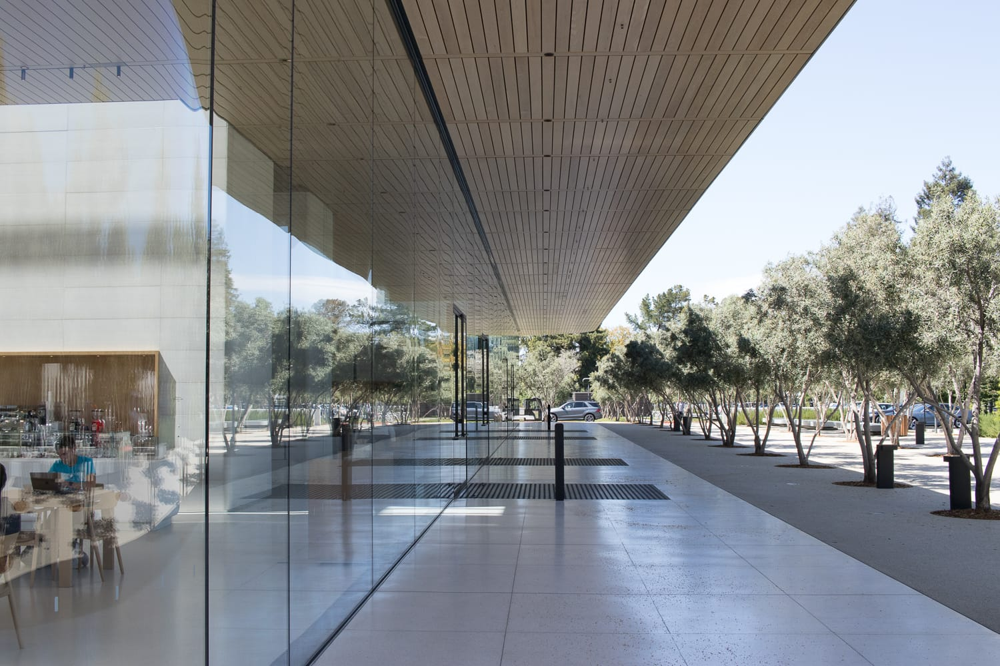
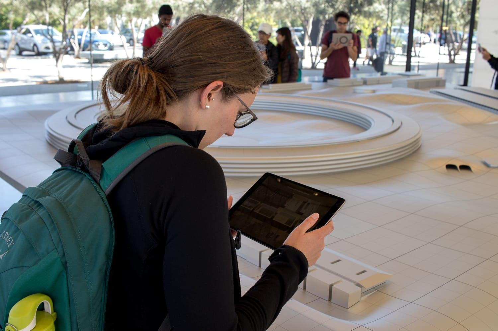
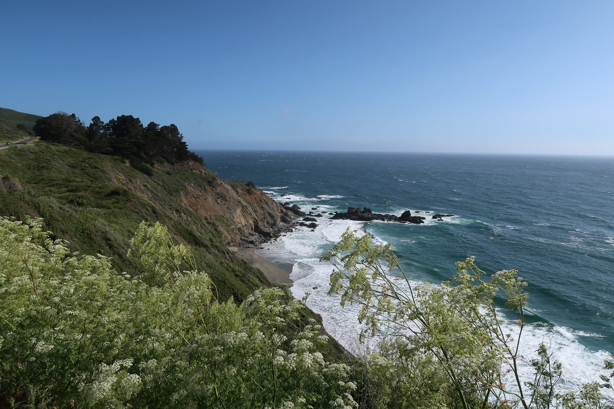
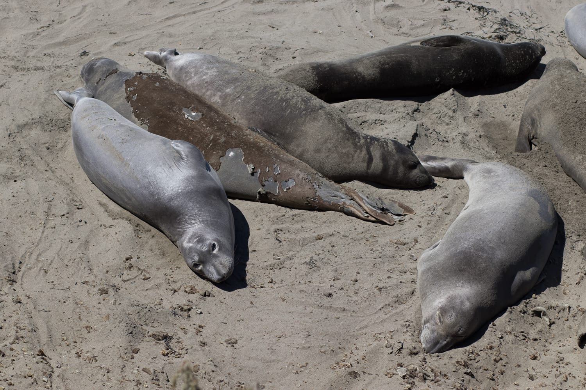
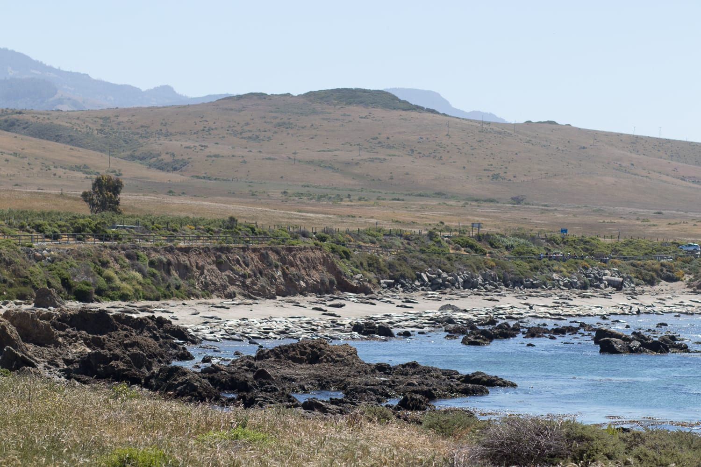

Nach vier Tagen in San Francisco ist es am Mittwoch so weit: Wir holen uns ein Mietauto und machen seitdem Kalifornien unsicher. Bevor wir San Francisco aber endgültig auf Wiedersehen sagen, muss noch ein letzter Punkt von der To-do-Liste gestrichen werden: die Golden Gate Bridge, die wir bis dahin immer nur aus der Ferne gesehen haben.

Dann geht's wirklich los, und zwar direkt ins Silicon Valley, wo ich schon ewig einmal hinwollte. Zuerst schauen wir uns das Gelände von Google an. Alles ist total offen, man kann zwischen den Gebäuden spazieren, nur der Weg hinein ist überall durch Kartenleser versperrt.

Nur eine kurze Autofahrt später wartet das Highlight des Tages, zumindest für mich: der Apple Campus. Es herrscht reges Treiben, aber es fahren auch ständig Lkw aus und ein, ganz fertig ist das neue Hauptquartier offenbar noch nicht. Anders als bei Google wirkt der Campus wie ein Hochsicherheitsgelände: hoher Zaun rundherum, jede Einfahrt von Security bewacht. Im Visitor Center kommen wir trotzdem auf unsere Kosten. Dort kann man den ganzen Campus mit iPads und einem Aluminium-Miniaturmodell erkunden.

:::galerie

:::

## Hallo Pazifik

Nach einer Stunde im Auto sind wir im Surferort Santa Cruz und sehen zum ersten Mal auf dieser Reise den Pazifik. Nach einem Spaziergang an der Küste und über den Pier steigen wir ein letztes Mal an diesem Tag ins Auto, um zum Motel in der Monterey Bay zu kommen.

Nach einer erholsamen Nacht und einem guten Frühstück erkunden wir die Monterey Bay. Das Monterey Bay Aquarium lassen wir aus, 50 Dollar Eintritt pro Person sind uns dann doch zu viel.

Die 10,25 Dollar für den 17-Mile Drive gönnen wir uns aber. Entlang der Küste führt eine enge, verschlungene Straße vorbei an Golfplätzen und Villen. Immer wieder bleiben wir stehen, um die zum Teil atemberaubenden Ausblicke aufs Meer zu genießen und Fotos zu schießen.

## Hallo Highway One

Nach einem kurzen Stopp in Carmel heißt es dann wirklich: Hallo Highway One! Auf dem waren wir zwar vorher schon unterwegs, aber ab Carmel wird es so richtig cool. Irgendwie verlassen wir die Zivilisation und sind allein mit dem Auto. Rechts der Pazifik (oder ganz viele Bäume), links Berge (oder ganz viele Bäume). Immer wieder müssen wir stehen bleiben, etwa bei der Bixby Bridge oder den McWay Falls, so schön ist die Aussicht.

:::raster

:::

Kurz vor Plaskett ist erst einmal Schluss. Wegen einer Straßensperre müssen wir die Route ändern. Von der Sperre haben wir zwar gewusst, aufregend ist es trotzdem. Ich werde nervös, weil der Tank immer leerer wird und ich uns schon im Nirgendwo mit leerem Tank stehen sehe. Meine Reisebegleitung wird immer nervöser, weil wir noch keine Unterkunft haben und schon im Auto schlafen müssen. Wer amerikanische Filme kennt, weiß, wie solche Szenarien meistens enden. Zum Glück finden wir dann doch noch eine Tankstelle und später ein günstiges Motel und enden nicht in einem Horrorfilm.

Am Freitag müssen wir wieder auf den Highway One kommen. Wir fahren ein Stück zurück Richtung Norden, weil wir zwei Punkte nachholen wollen, die wir wegen der gesperrten Straße am Vortag nicht mehr erreicht haben. Zuerst besuchen wir die Seeelefanten beim Leuchtturm von Piedras Blancas, dann geht's zum Hearst Castle.

Wie es dort war und wie es am Highway One weitergeht, erzählen wir im nächsten Teil.

:::raster

:::
