Nach Teil 1, von San Francisco bis zum Leuchtturm von Piedras Blancas, nehmen wir euch heute mit bis nach Los Angeles. Von den Seeelefanten beim Leuchtturm sind es nur ein paar Autominuten zum Hearst Castle.

Dort verbringen wir fast den ganzen Nachmittag. Wir gönnen uns eine geführte Tour und sehen uns die privaten Räume dieser modernen Burg an. Modern deshalb, weil es die erste Burg ist, die ich gesehen habe, die schon Heizkörper, Lichtschalter und Steckdosen hat. Hearst Castle ist nämlich noch keine hundert Jahre alt. Nach der Führung erkunden wir die Außenanlagen auf eigene Faust und genießen die Aussicht aufs Meer und die Berge rundherum.

Zum Tagesausklang fahren wir noch nach Morro Bay, spazieren den Pier entlang und gehen dann im Taco Temple Tacos essen (no na ned).

:::galerie
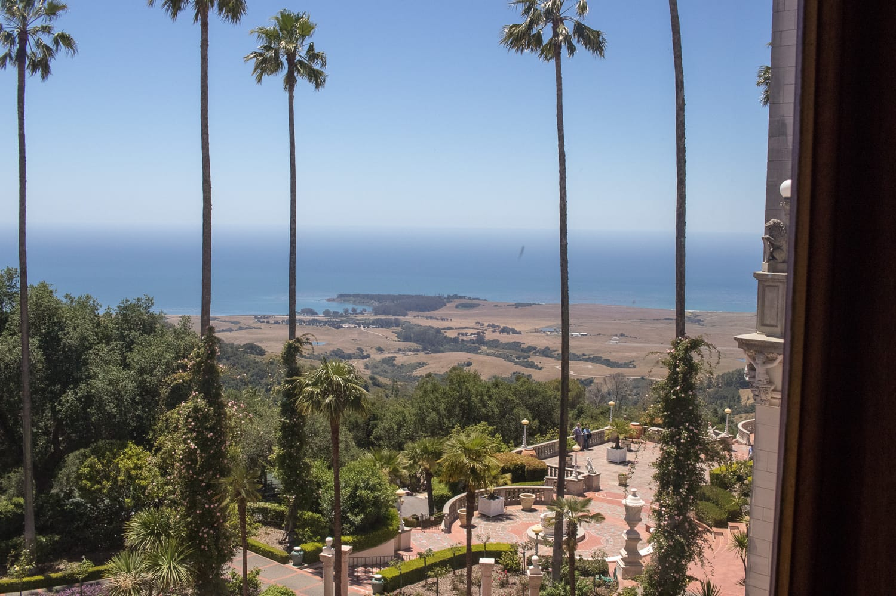
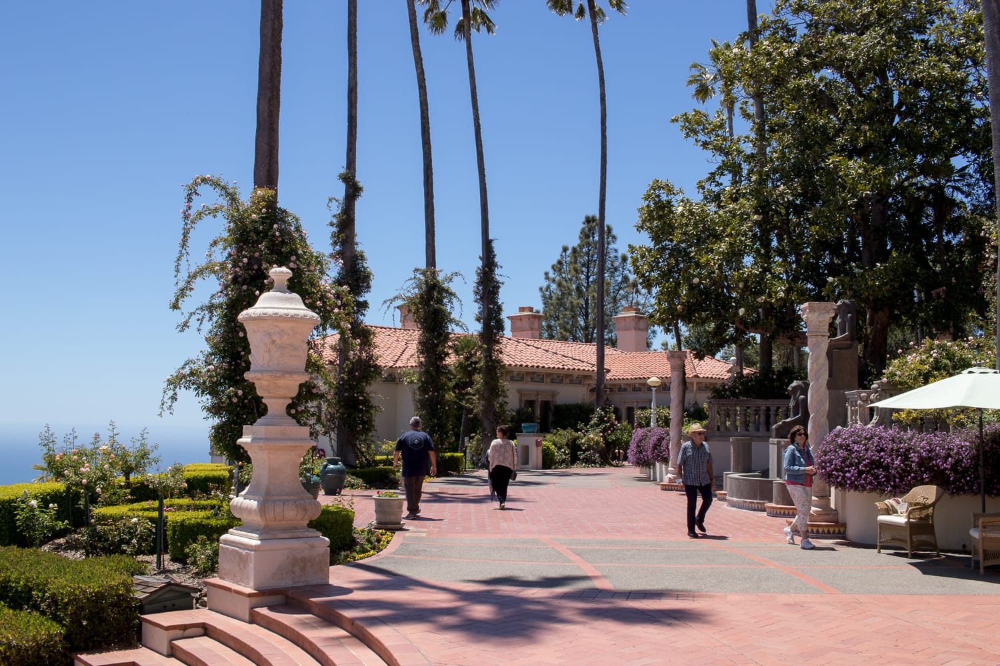
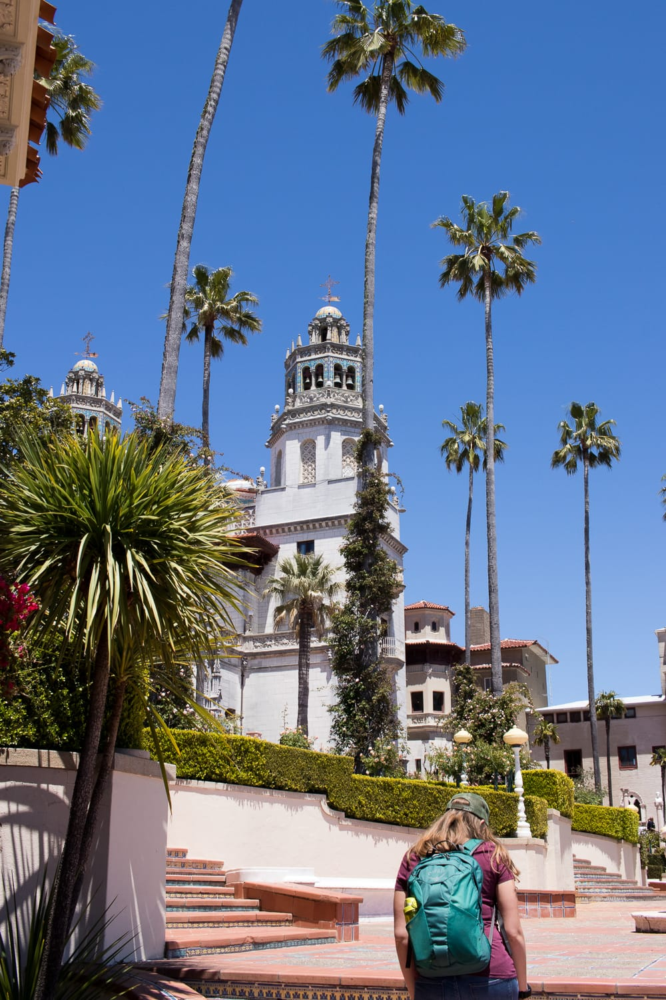
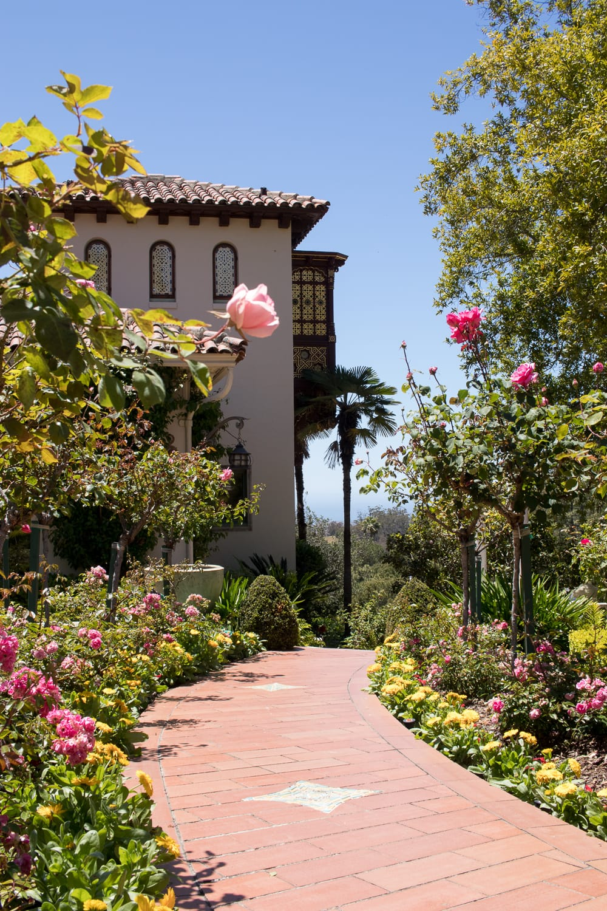
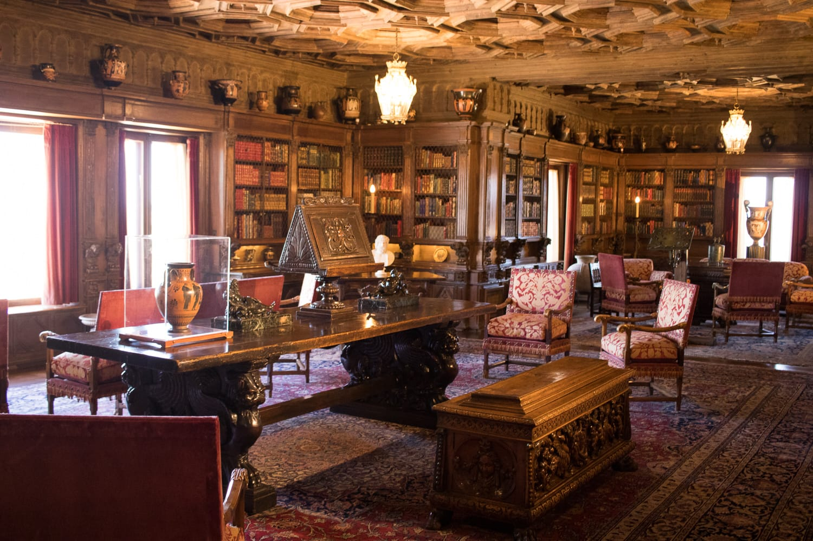
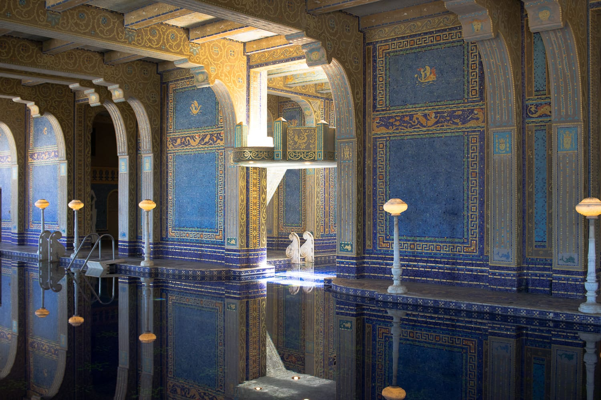
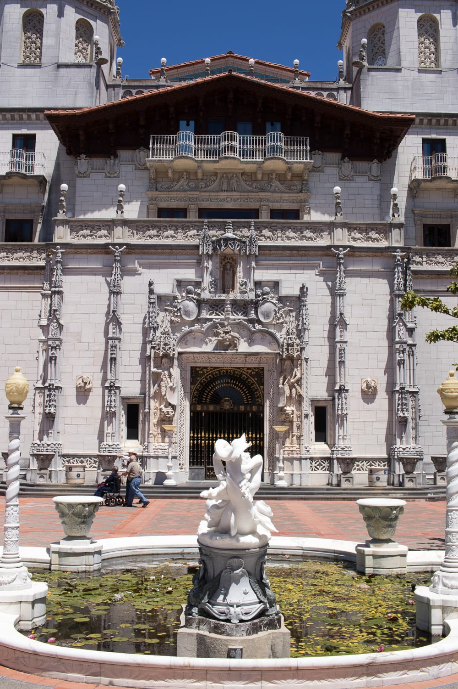
:::

Am nächsten Morgen weckt uns in Santa Maria die High-School-Band. Vor dem alljährlichen Rodeo zieht eine Parade mit Musik, vielen Pferden, Leuten auf allen möglichen Fahrzeugen und Tänzerinnen die Hauptstraße entlang, an der unser Motel liegt. Die Parade lassen wir uns natürlich nicht entgehen, für das Rodeo fehlt uns dann leider die Zeit.

Weiter geht's nach Solvang, einem kleinen Städtchen, das aussieht, als wäre man in Dänemark. Ein bisschen zumindest, denn es schreit trotzdem überall nach Amerika. Die Amerikaner und Japaner, die an diesem Samstag in Massen da sind, finden das sicher ganz nett. Wir finden es eher skurril.

:::galerie
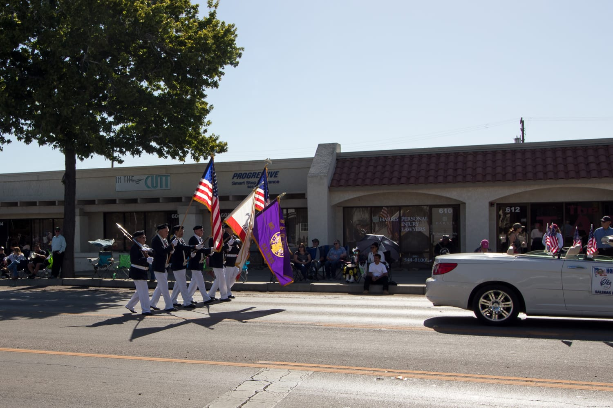
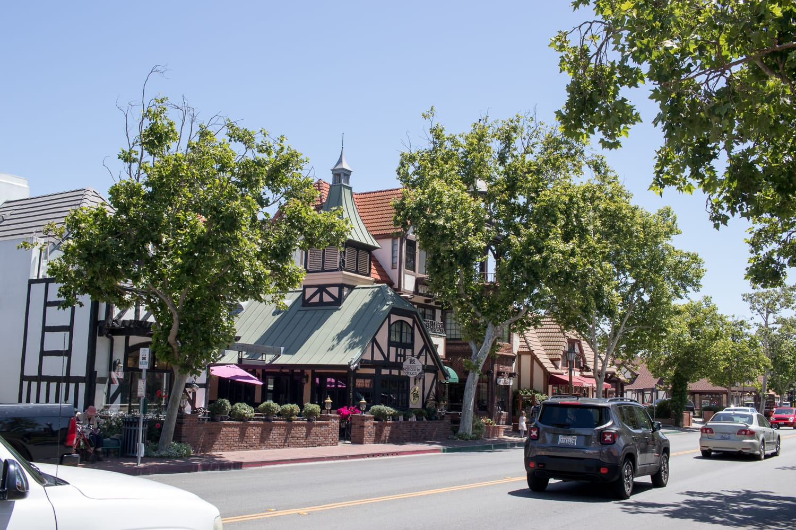
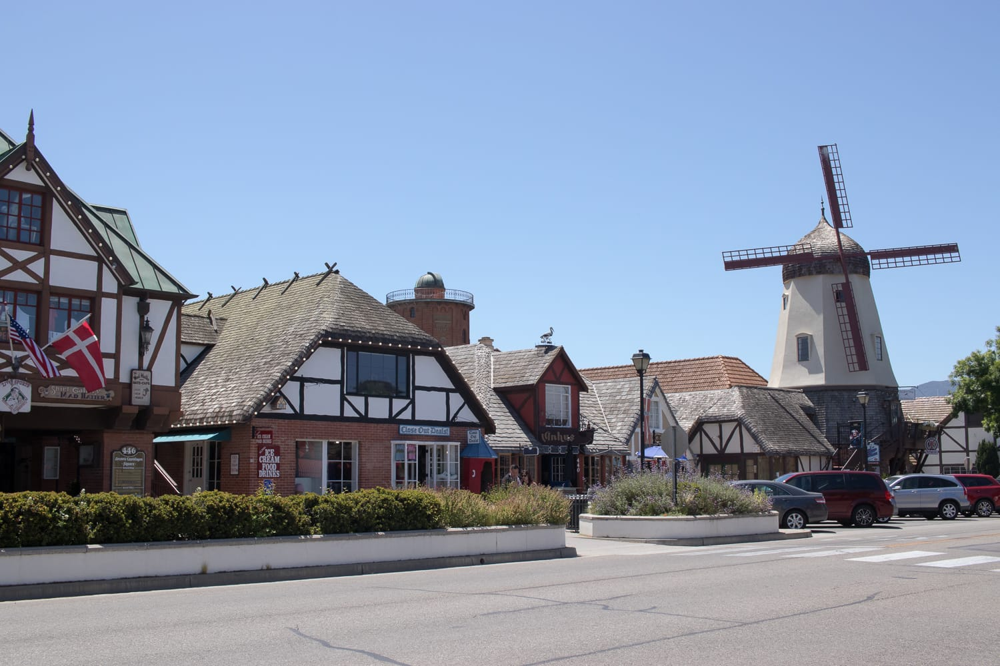
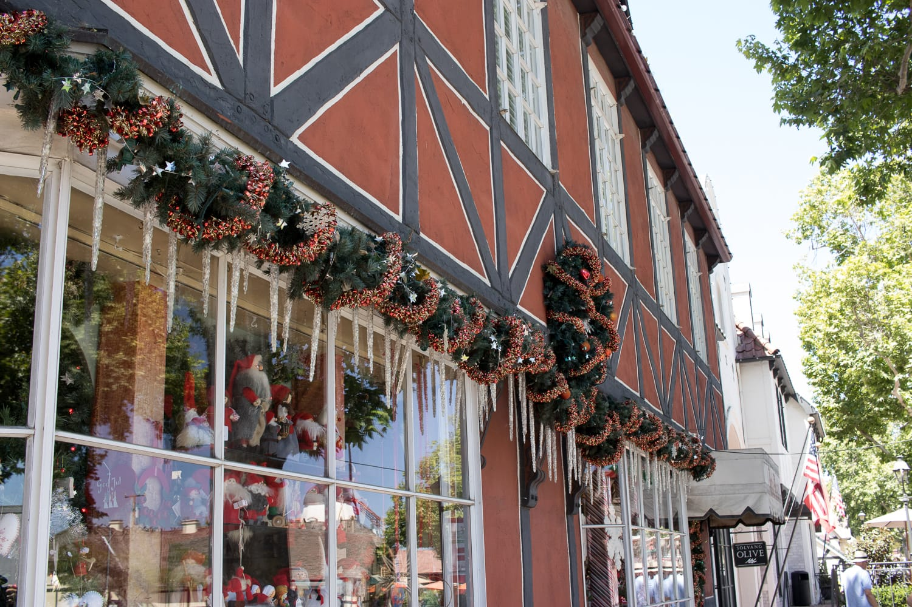
:::

An dem Tag klettert das Thermometer zum ersten Mal seit unserer Ankunft in Amerika über 90 Grad Fahrenheit (32 Grad Celsius). Wir setzen uns also bald wieder ins klimatisierte Auto, zurück auf den Highway One und weiter nach Santa Barbara.

Dort sind wir wieder den ganzen Tag zu Fuß unterwegs. Nach einer Stärkung in der Lilac Patisserie schlendern wir die Hauptstraße bis zum Strand und schauen in das eine oder andere Geschäft.

Am Sonntag geht es über Malibu Beach und Santa Monica nach Los Angeles. Was wir dort getrieben haben, lest ihr im nächsten Beitrag.

:::galerie
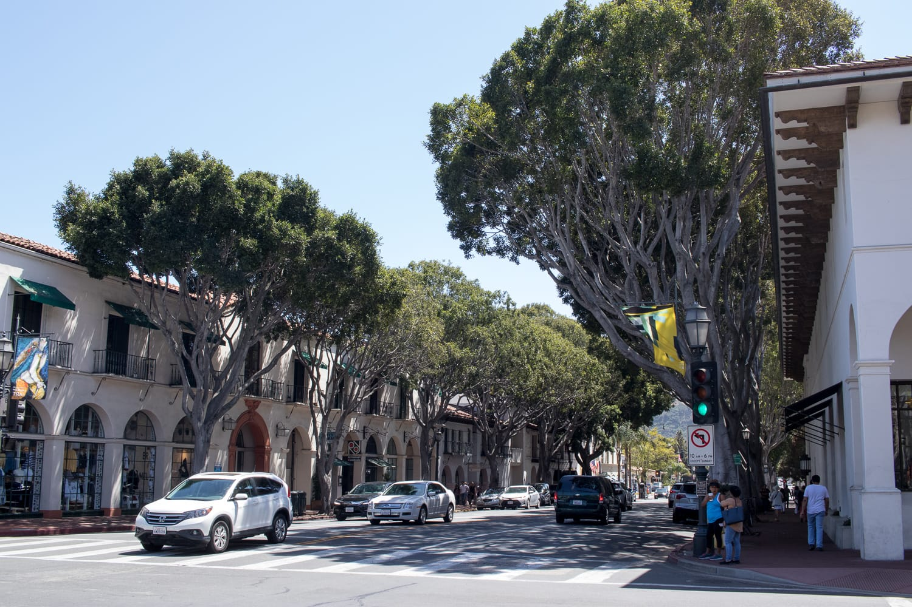
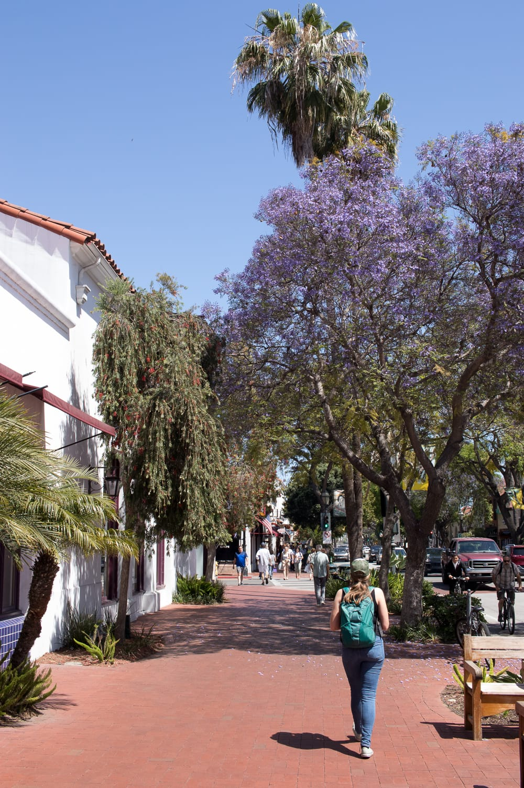
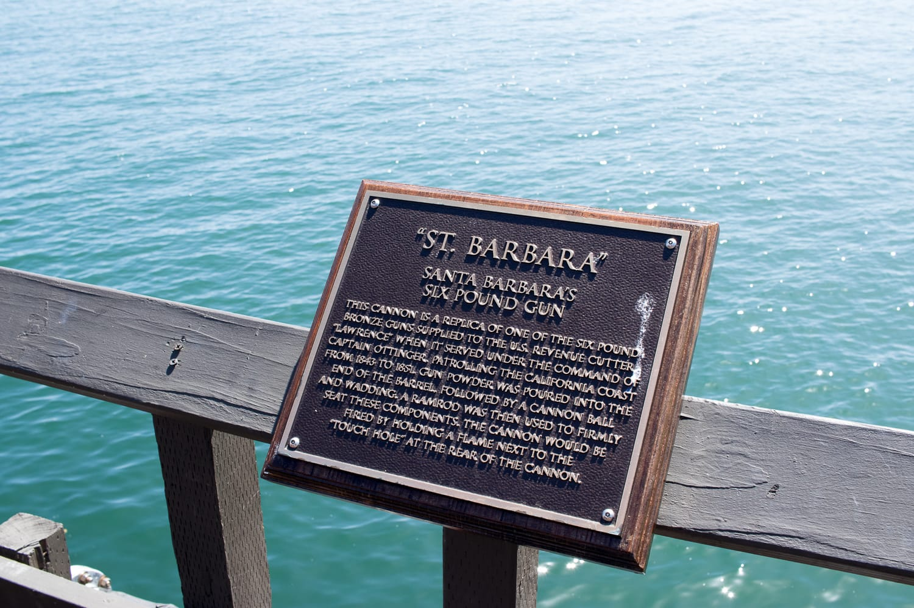
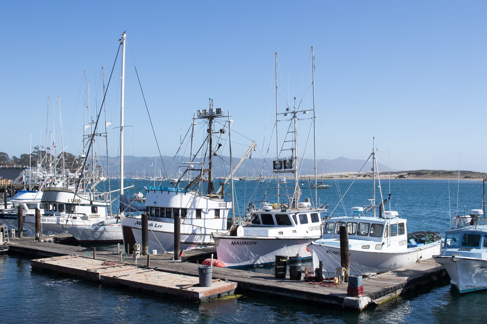
:::
