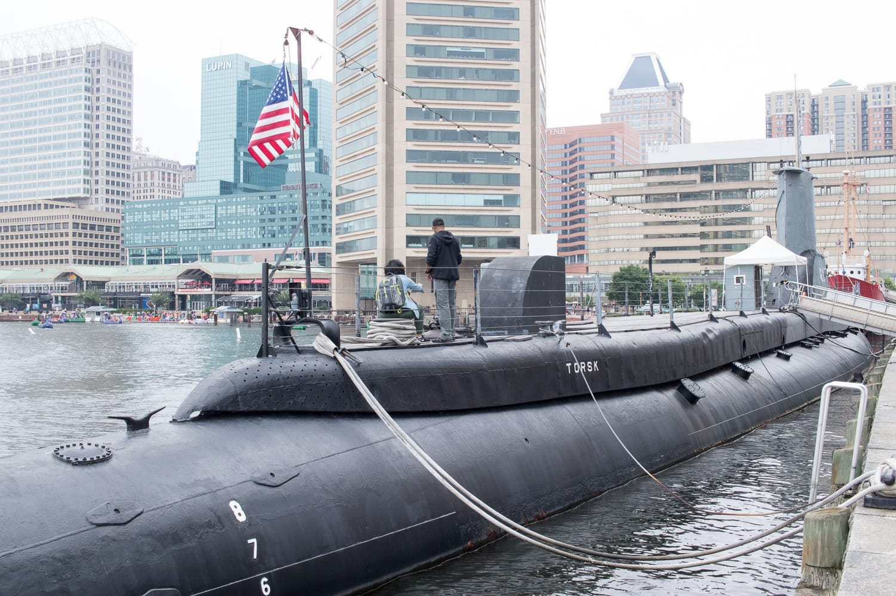
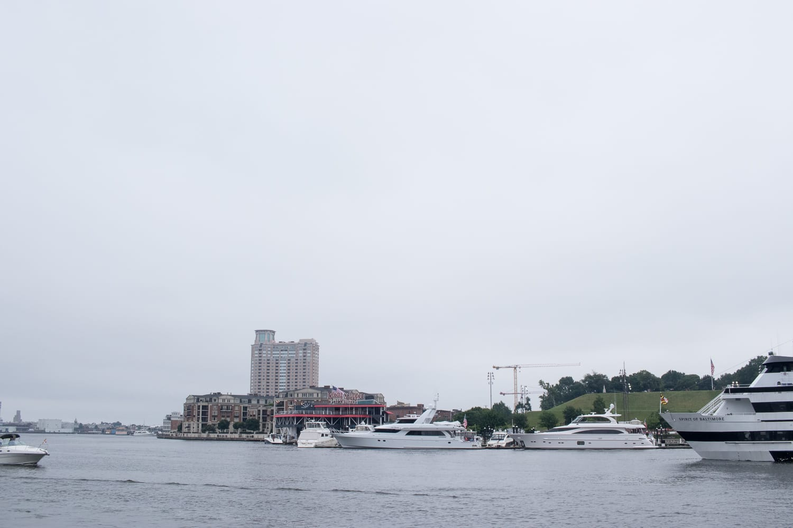
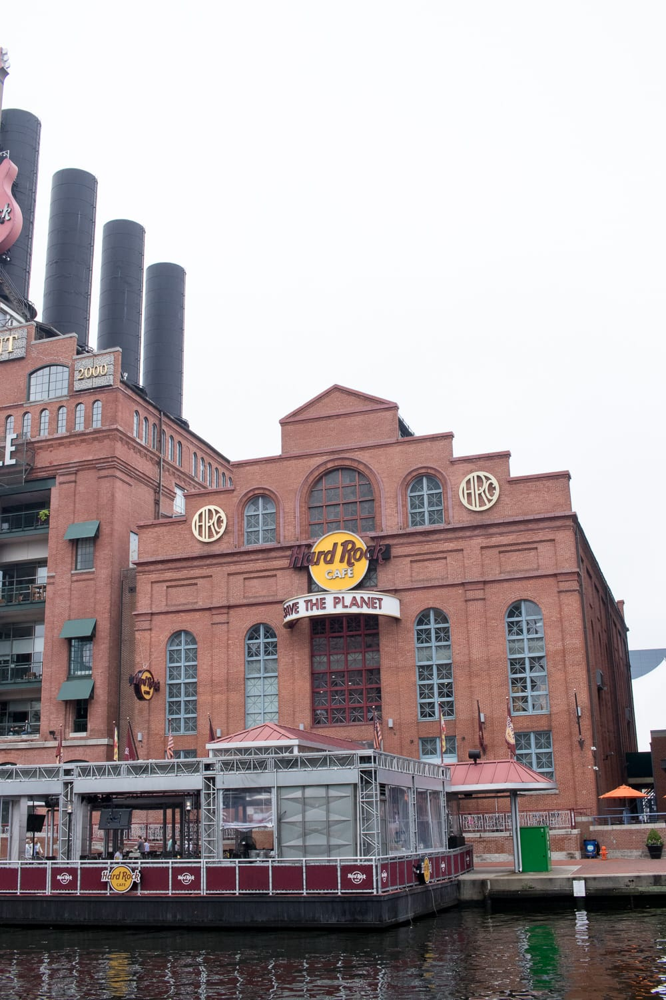
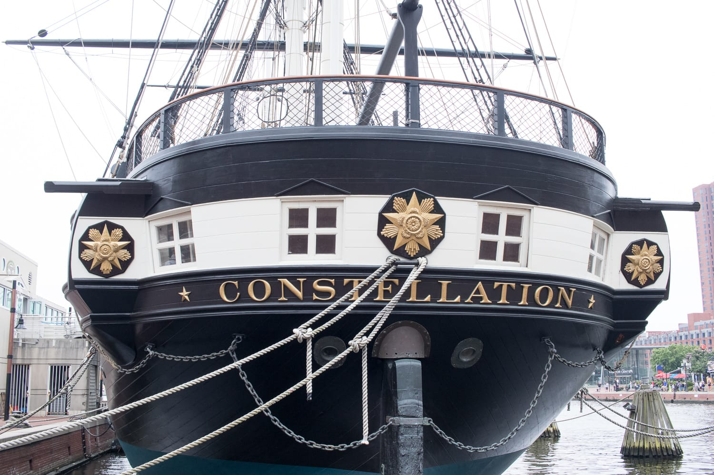
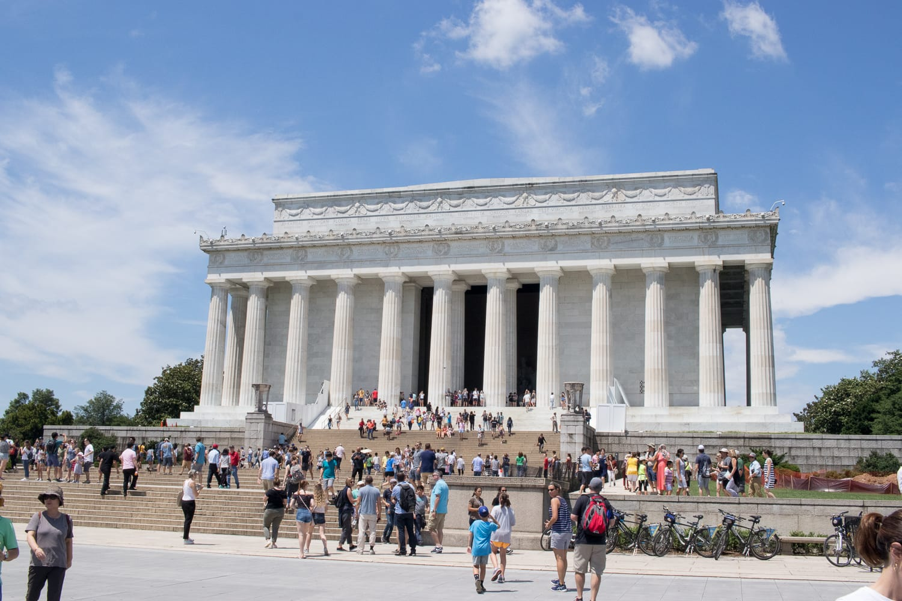
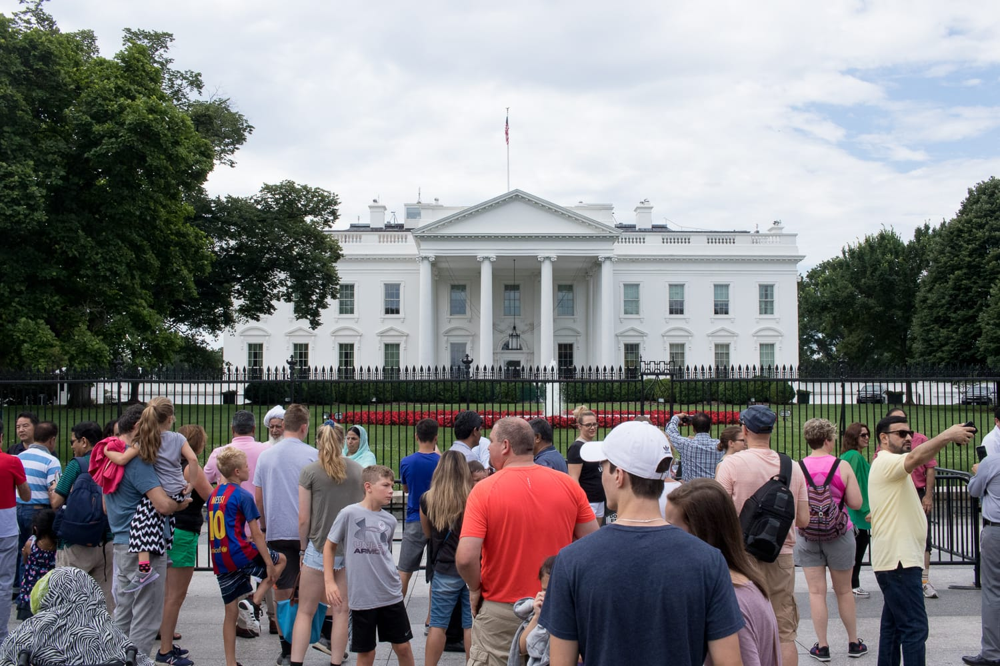
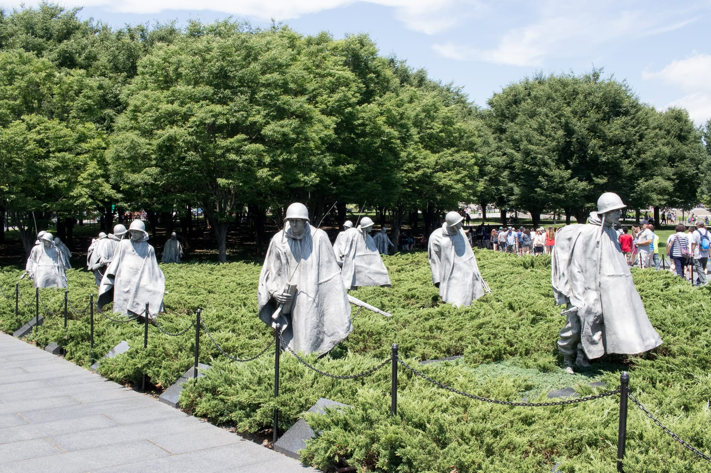
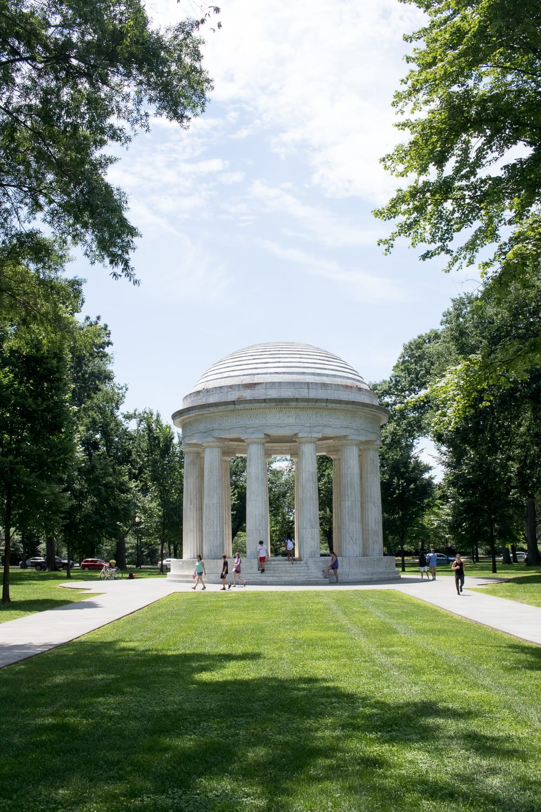
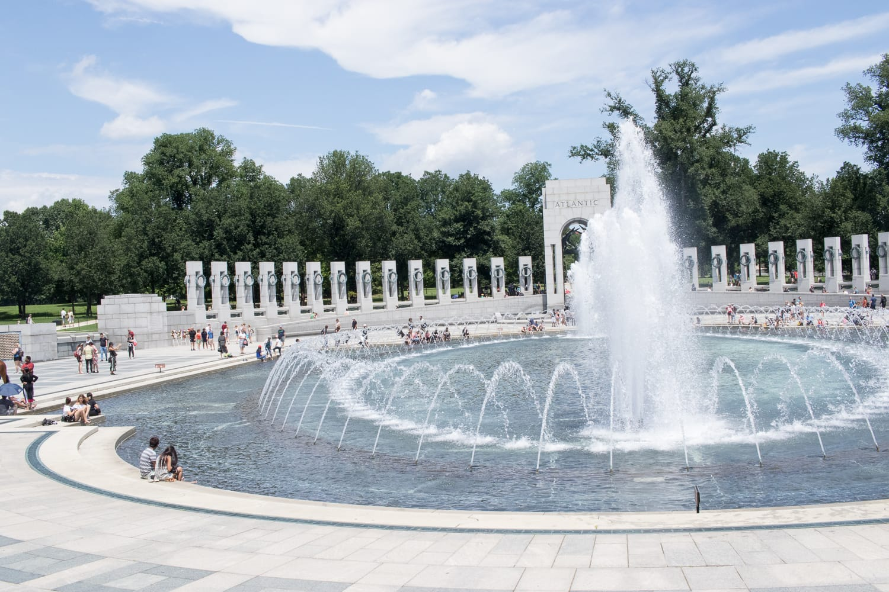
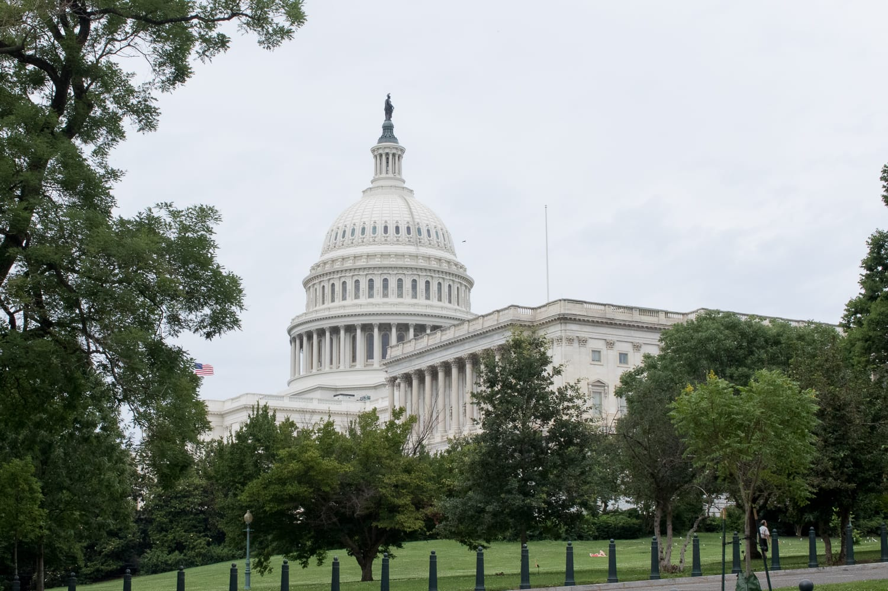

Nachdem unser Roadtrip in Annapolis zu Ende ist, bleiben wir ein paar Tage in der Stadt. Annapolis ist nicht nur die Zielstadt des Race Across America, sondern auch die Hauptstadt des Bundesstaats Maryland. Außerdem liegt sie nicht weit von Baltimore und Washington D.C. entfernt, zwei Städte, die wir uns ebenfalls nicht entgehen lassen wollen.

Am ersten Tag fahren wir nach Baltimore und schauen uns den Hafen an. Dort liegt auch das letzte Schiff aus dem Amerikanischen Bürgerkrieg, die USS Constellation, und man kann das U-Boot „Torsk" besichtigen. Von innen schauen wir es uns wegen des recht hohen Eintrittspreises nicht an und schlendern lieber am Wasser entlang.

:::galerie

:::

Washington D.C. erreichen wir nach rund 45 Minuten Fahrt. Als Erstes muss natürlich das Weiße Haus sein. Ich bin ein bisschen enttäuscht, irgendwie hatte ich mir das Haus viel pompöser und größer vorgestellt.

Viele weitere Sehenswürdigkeiten liegen in der Nähe, also gehen wir zu Fuß weiter, vorbei am Washington Monument, am Weltkriegsdenkmal und am Korean War Veterans Memorial. Das Lincoln Memorial darf nach dem Besuch in seinem Geburtsort natürlich auch nicht fehlen.

:::galerie

:::

Eigentlich wollten wir noch zum Kapitol gehen. Ich bin aber vor ein paar Tagen beim Laufen umgeknöchelt und habe seitdem Schmerzen im Sprunggelenk, also fahren wir mit dem Auto hin, statt den Marsch auf uns zu nehmen. Trotzdem hat sich der kurze Ausflug in die Stadt gelohnt, und ein nächstes Mal, um Washington genauer unter die Lupe zu nehmen, kommt bestimmt.

:::galerie

:::
