Wie im letzten Beitrag erwähnt, zieht es uns zurück in die USA. Die letzte Nacht in Kanada verbringen wir direkt an der Grenze in Windsor. Wir müssen beide schmunzeln, als wir vom Ufer aus hinüber in ein anderes Land schauen.

Durch den Detroit-Windsor-Tunnel geht's also zurück in die Vereinigten Staaten. Wie immer müssen wir ein paar Fragen beantworten, eine ist neu: „Wie viel Geld habt ihr für diesen Trip zur Verfügung?" Sonst läuft alles wie gehabt.

## Detroit

Detroit war ursprünglich die Autometropole Amerikas, aber davon ist heute nicht mehr viel übrig. Die Stadt wirkt ziemlich ausgestorben, und außer dass uns Drogen angeboten werden, passiert nichts Aufregendes. Wir drehen eine kleine Runde und entscheiden bald weiterzufahren. Vorher machen wir noch einen Abstecher zum Motown-Museum, aber wir haben den Andrang unterschätzt und müssen die Führung ausfallen lassen. Vier Stunden Wartezeit sind uns zu viel. Außerdem wartet die Unterkunft in Chicago, und es liegen noch über fünf Stunden Autofahrt vor uns.

## Chicago

:::galerie
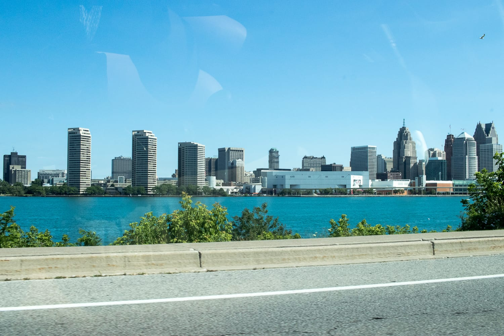
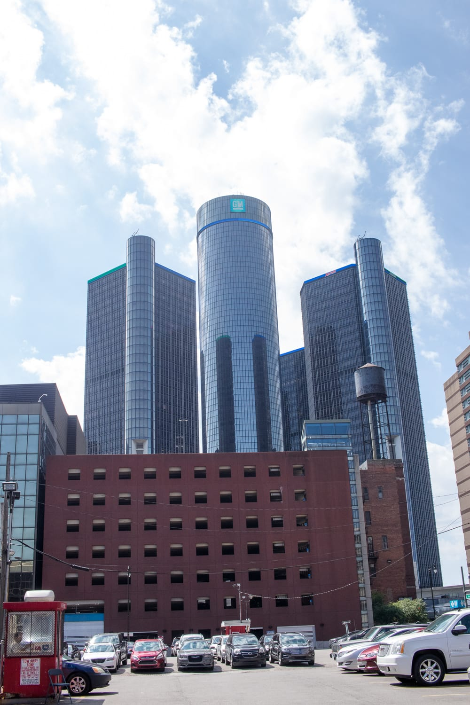
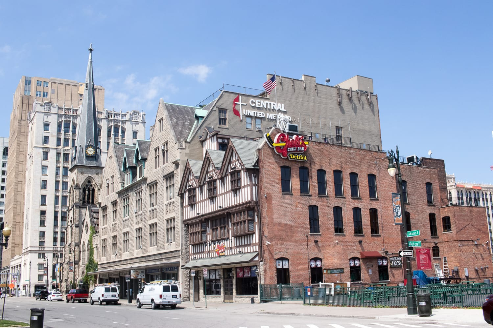
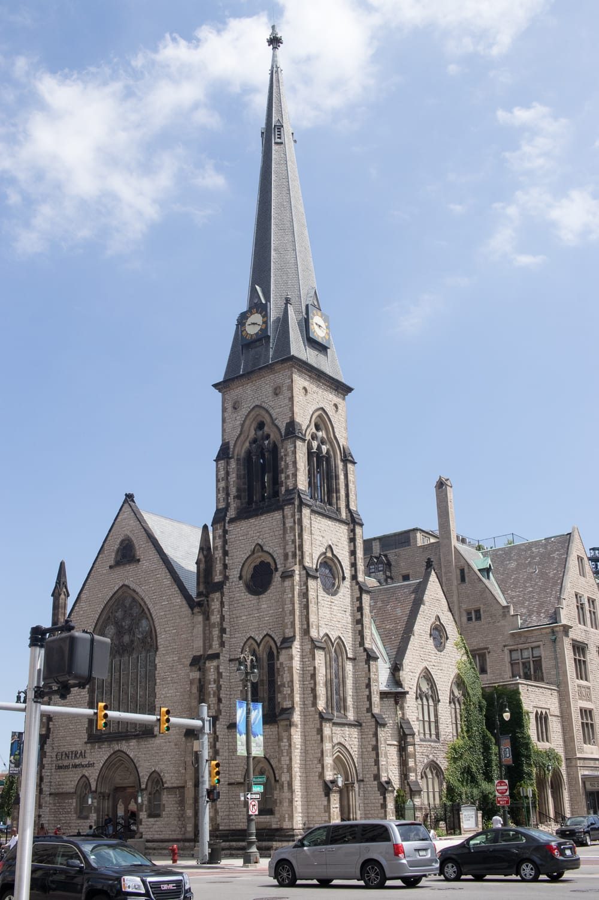
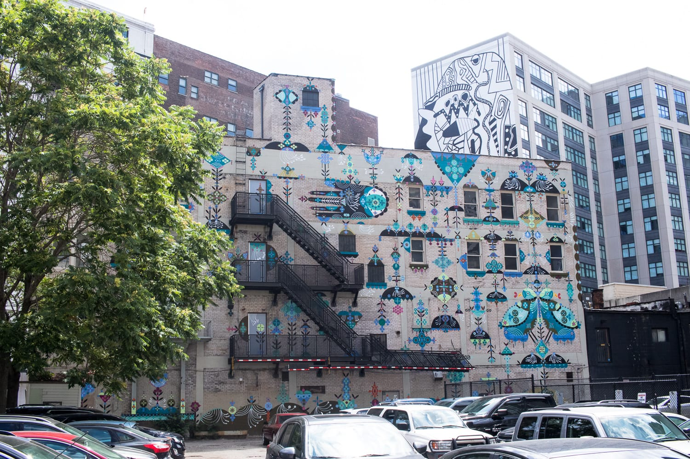
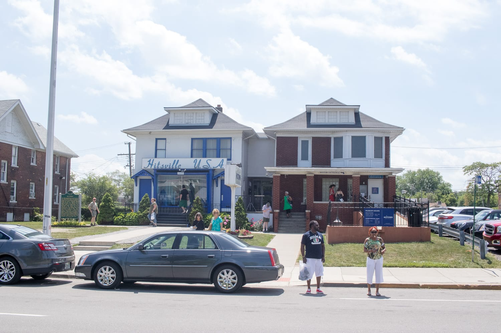
:::

Gut ausgeruht fahren wir am 4. Juli in die drittgrößte Stadt Amerikas, nach Chicago. Nach langer Parkplatzsuche, ich bin da schon etwas unentspannt, stellen wir das Auto endlich ab und gehen direkt in den Millennium Park, um das berühmte Kunstwerk „Cloud Gate" zu bewundern.

Von der Windy City ist an dem Tag nichts zu spüren, bei über 30 Grad schwitzen wir wie die Hunde. Als Nächstes geht's daher gleich in den klimatisierten Willis Tower, das höchste Gebäude Chicagos. Der Lift bringt uns ganz nach oben, und wir genießen den Blick vom zweithöchsten Gebäude Amerikas über die Stadt.

:::raster
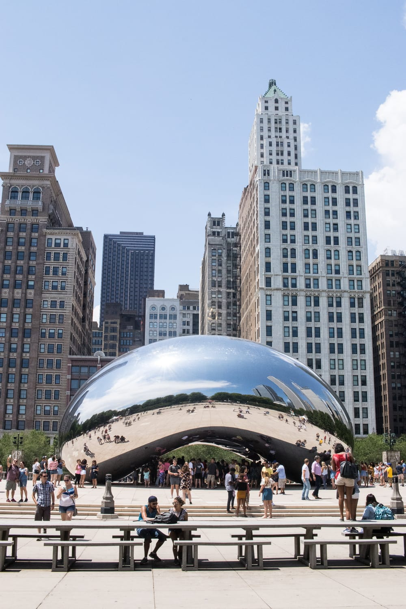
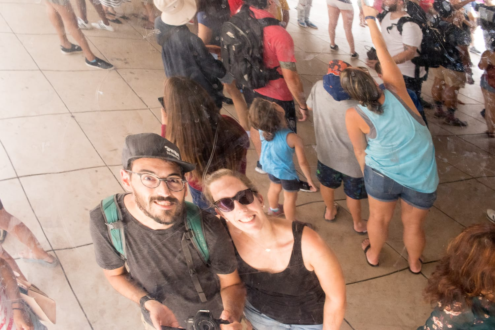
:::
<!-- bild: Quelle nicht ermittelbar -->
:::galerie
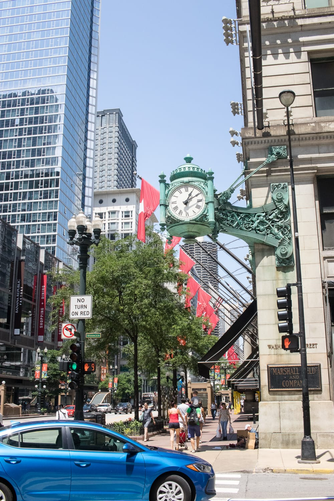
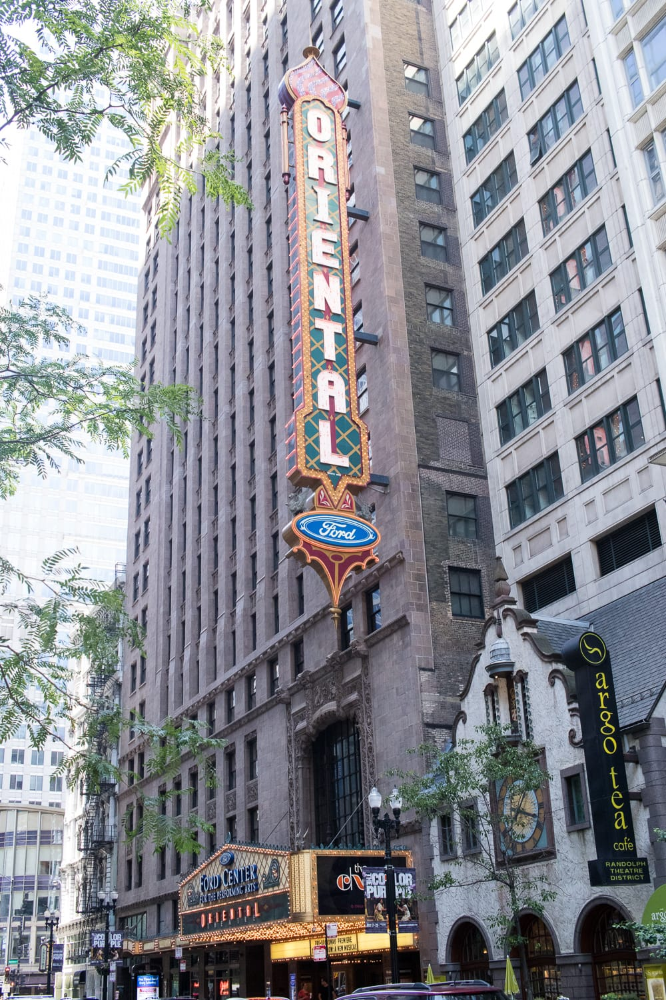
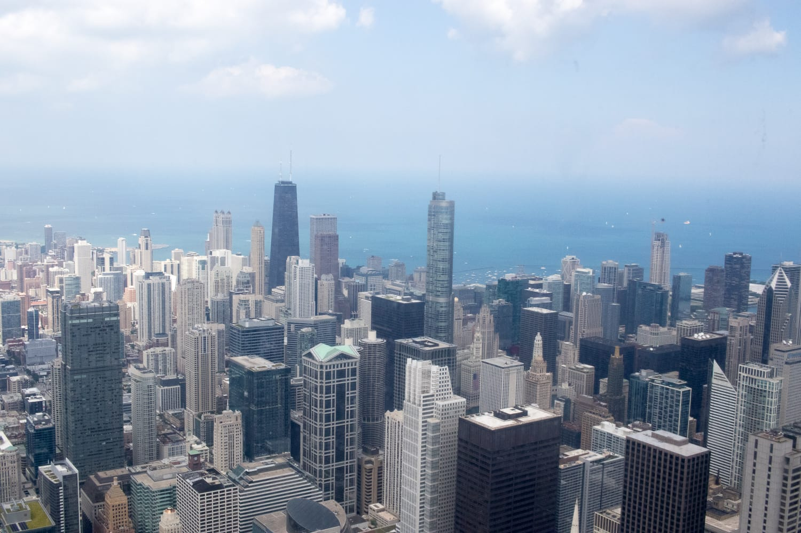

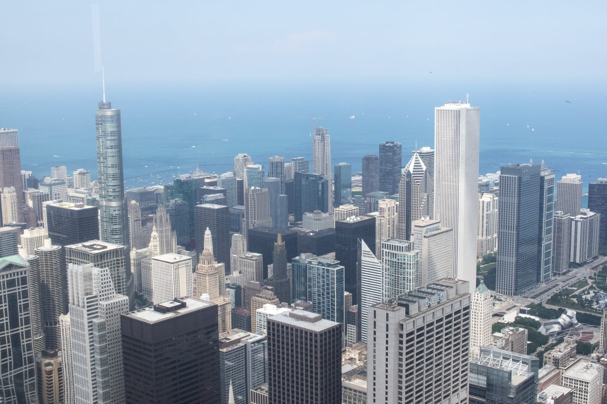
:::

Nach den ganzen Sehenswürdigkeiten ist eine Pause fällig. Im Hard Rock Cafe sitzen wir bei cooler Livemusik und gutem Essen. Gut gestärkt führt uns die Sightseeing-Tour zum Navy Pier, wo wir den 4. Juli ausklingen lassen wollen.

Wir müssen einige Zeit warten, bis das Feuerwerk pünktlich um 21.30 Uhr startet, aber das Warten hat sich eindeutig gelohnt. Das Feuerwerk direkt über dem Wasser ist atemberaubend und rundet den Tag wunderbar ab.

Weil wir die Besuchermassen schon ahnen, gehen wir ein bisschen früher Richtung Ausgang. Aber nicht die Besucher halten uns auf, sondern ein riesiger Wolkenbruch. Als wäre es geplant, fängt es genau mit dem Ende des Feuerwerks zu schütten an. Wir sind darauf genauso unvorbereitet wie alle anderen, und bis wir beim Auto sind, sind wir patschnass. Bis auf die Unterhose.

Diese Stadt hat uns schon vor Jahren fasziniert, und beim neuerlichen Besuch war es genauso.

:::raster
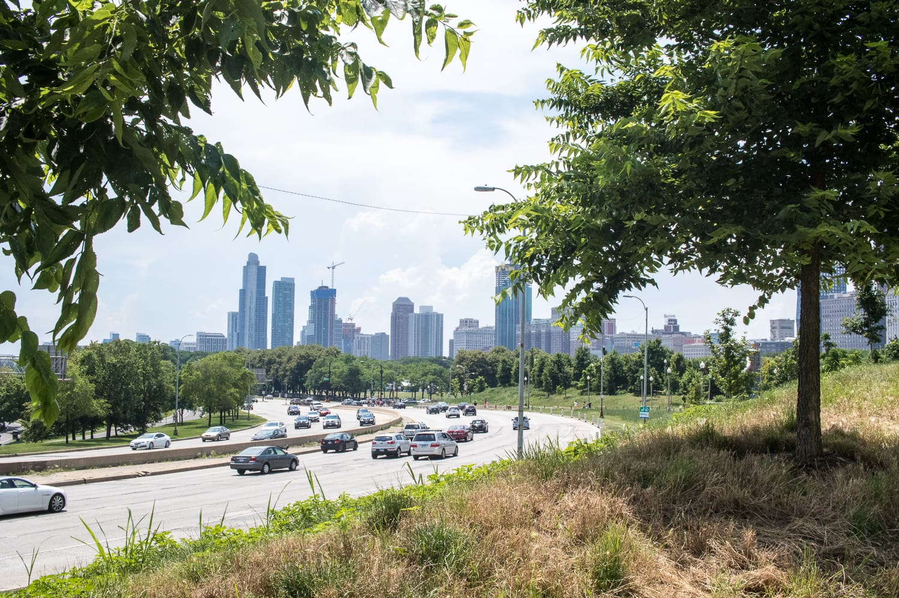
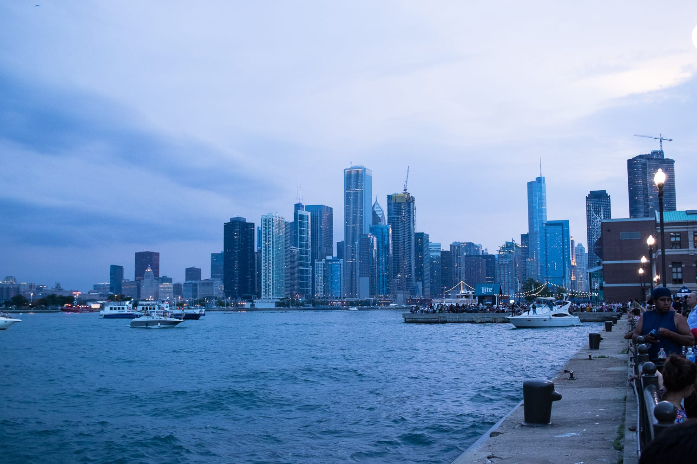
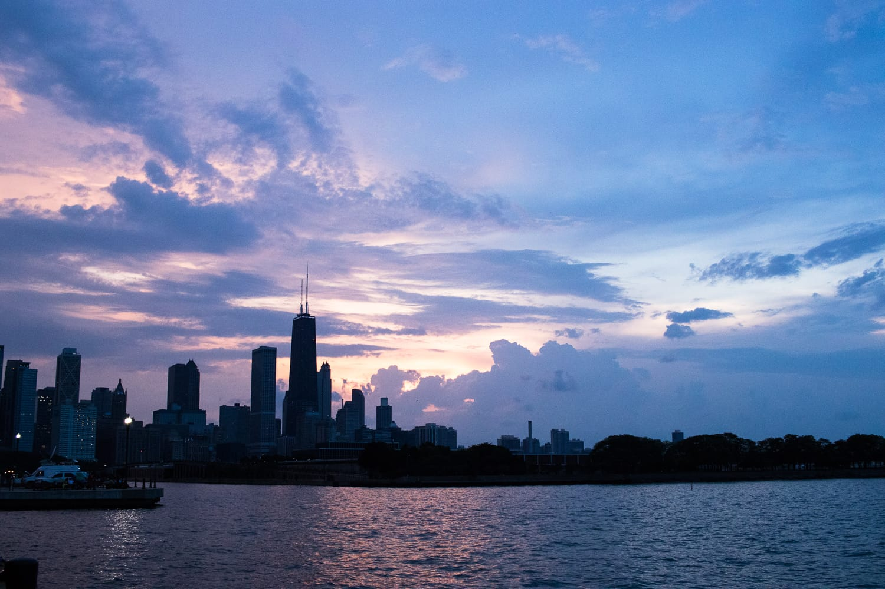
:::
