Es gibt Artikel, die schreiben sich von selbst. Und dann gibt es Artikel wie diesen, der einfach nicht geschrieben werden will. Wir haben schon mehrmals versucht, über Philadelphia zu schreiben, aber immer ohne Erfolg. Jetzt aber.

Vor der Unterkunft dürfen wir am Vormittag nicht parken, also fahren wir zuerst mit dem Auto in den Norden von Philadelphia. Die Erkundungstour beginnt etwas oberhalb des Philadelphia Museum of Art. Wir gehen vorbei an den berühmten Stufen des Museums, über den Benjamin Franklin Parkway zum Rodin Museum und weiter bis zum Naturkundemuseum. Auf dem Rückweg zum Auto machen wir noch einen Umweg zum Eastern State Penitentiary, einem alten Gefängnis. Die Führung lassen wir aus, weil sie von der Aufmachung her ähnlich sein dürfte wie die auf Alcatraz in San Francisco.

:::galerie
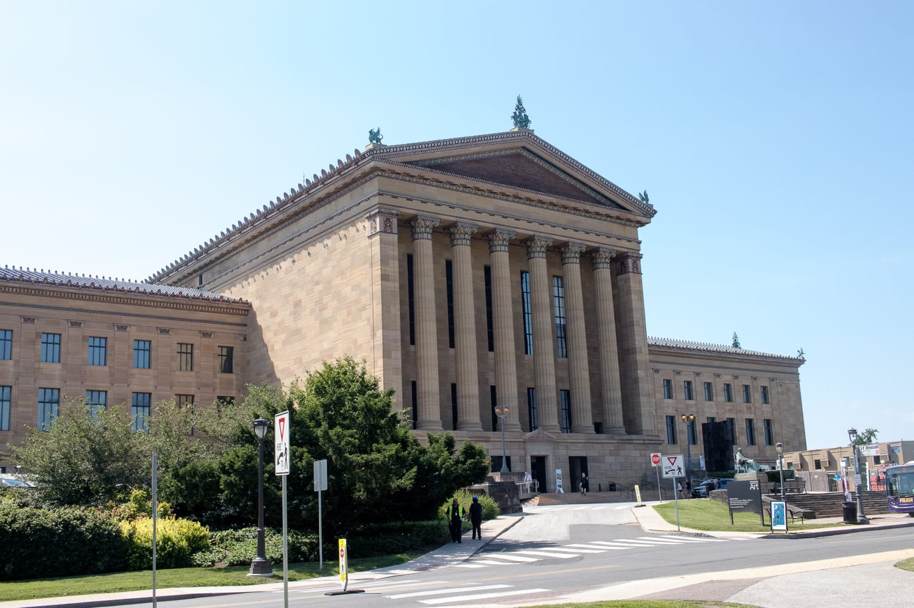
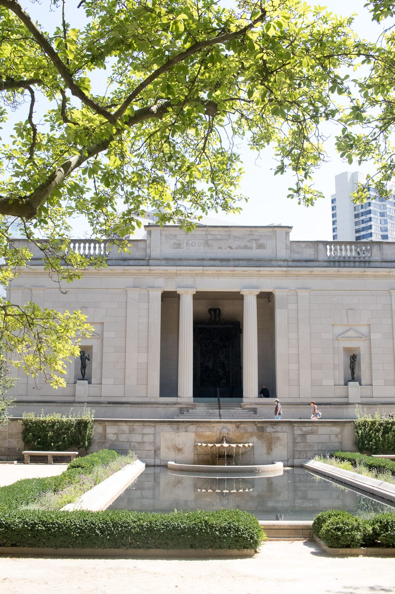
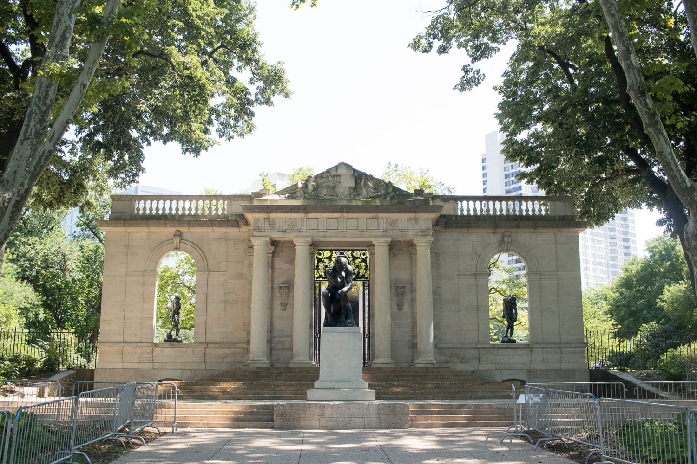
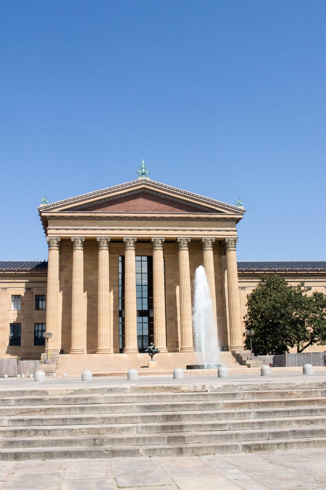
:::

Nachdem das Auto wieder vor der Unterkunft steht und wir ein paar Minuten verschnauft haben, treibt uns der Hunger zurück auf die heißen Straßen von Philadelphia.

Wir gehen zum Reading Terminal Market, einem riesigen Esstempel, wo man so ziemlich alles bekommt. Bei Fox & Son gibt's Corn Dogs und Cheeseburger Fries. Wir sagen's euch: So etwas Gutes habt ihr noch nicht gegessen!

:::galerie
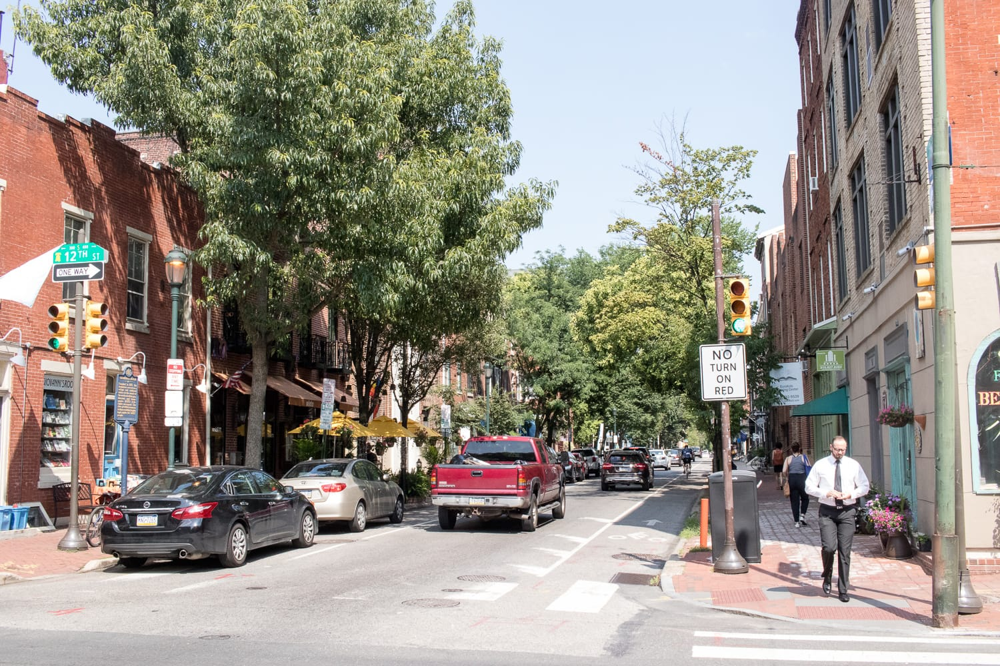
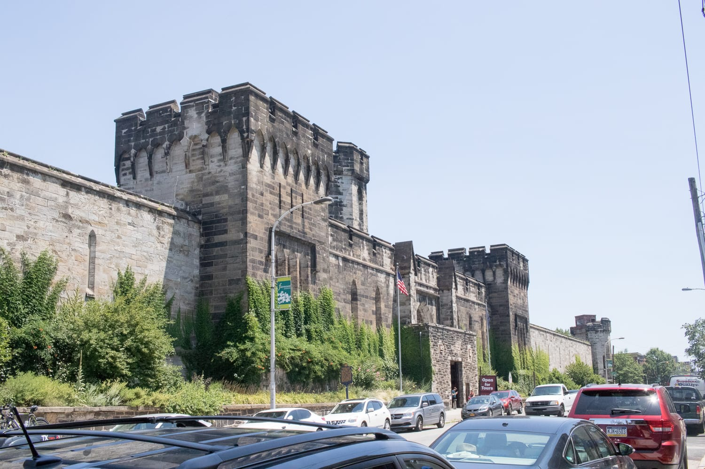
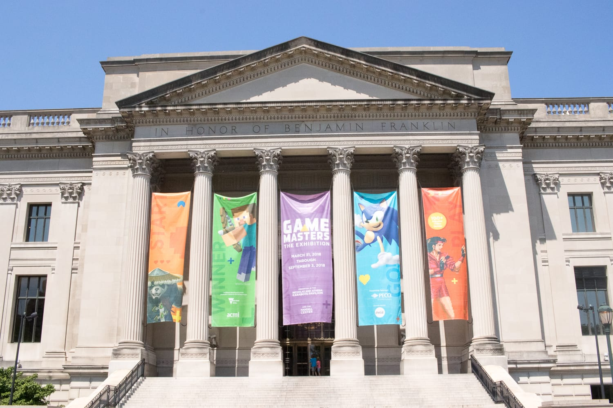
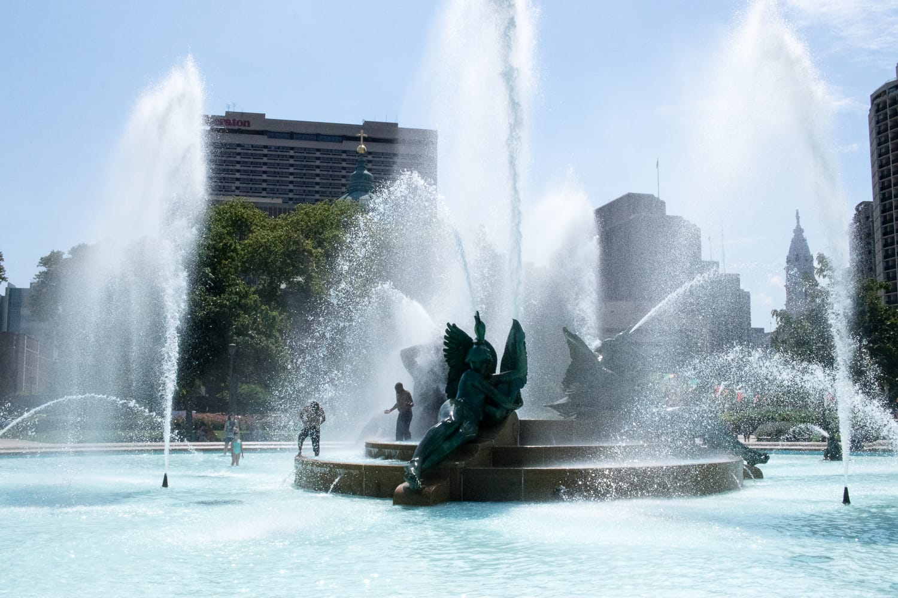
:::

Danach geht's zum Einkaufen in die Walnut Street. Seit wir in Amerika sind, zieht es uns immer wieder in Apple Stores. Einerseits, weil man an einem Apple Store einfach nicht vorbeigehen kann, andererseits, weil ich schon länger mit dem Gedanken spiele, mir ein neues Handy zu kaufen. Mit meinem bisherigen war ich nie zufrieden. Hier schlage ich endlich zu und kaufe mir ein neues iPhone. Ausreden gibt's keine mehr.

Mit dem neuen iPhone im Gepäck geht's weiter im Sightseeing-Programm: Wir besuchen die Liberty Bell, eine Glocke, die zur amerikanischen Unabhängigkeit geläutet wurde.

Auf dem Heimweg schlendern wir noch durch den „Italian Market", wo auch unsere Unterkunft liegt. Dann fallen wir erschöpft ins Bett und freuen uns auf eine ruhige Nacht. Warum die dann alles andere als erholsam wird, lest ihr im nächsten Beitrag.

:::galerie
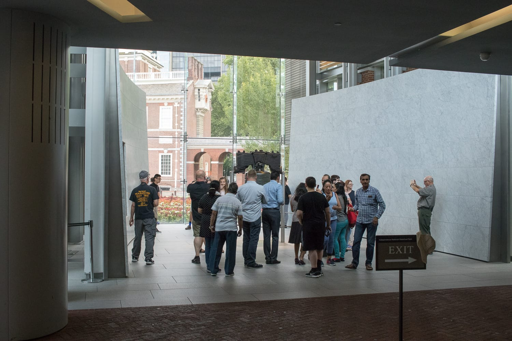
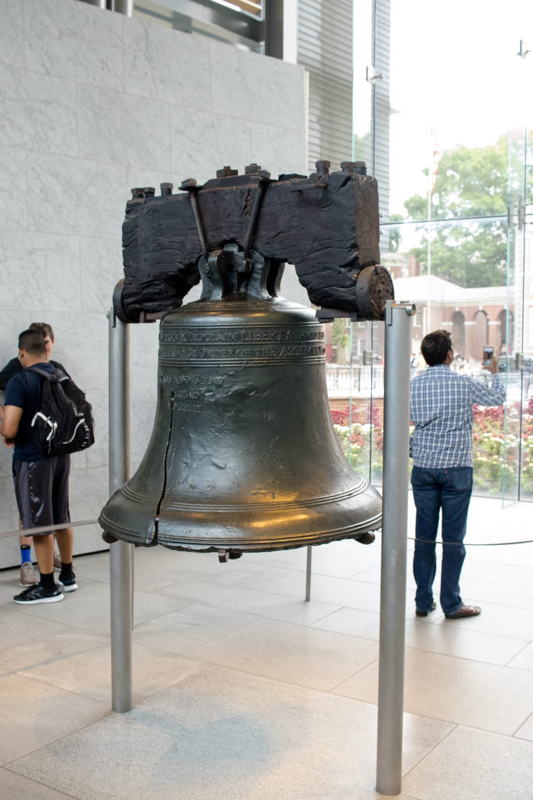
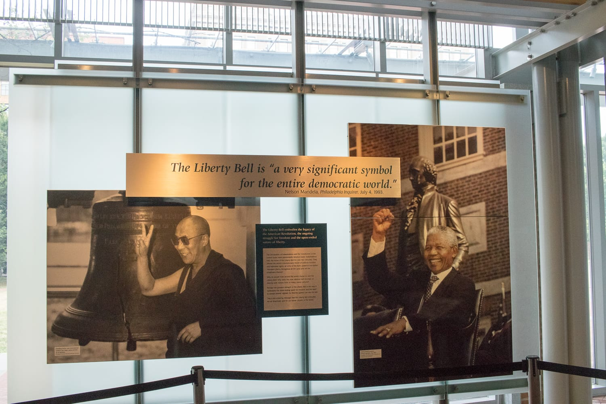
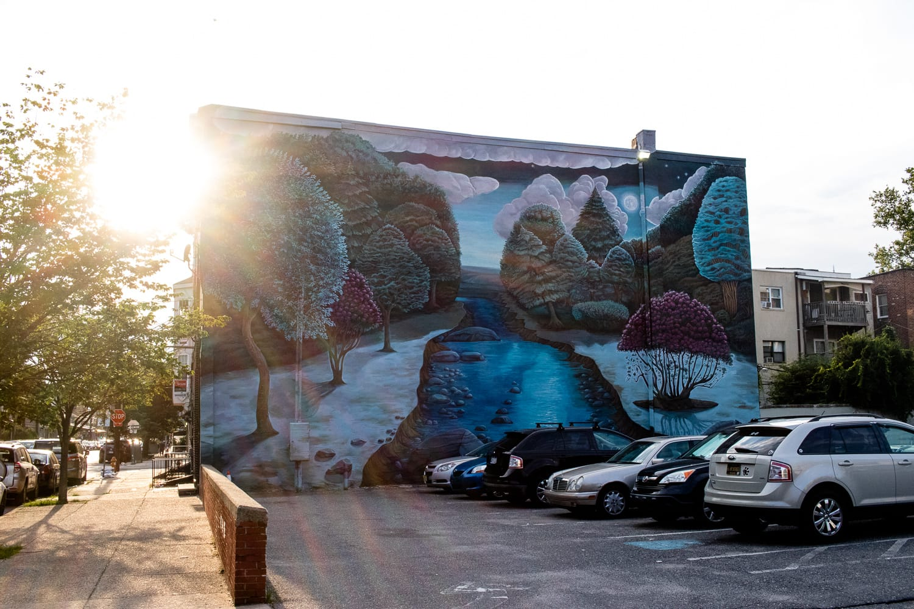
:::
