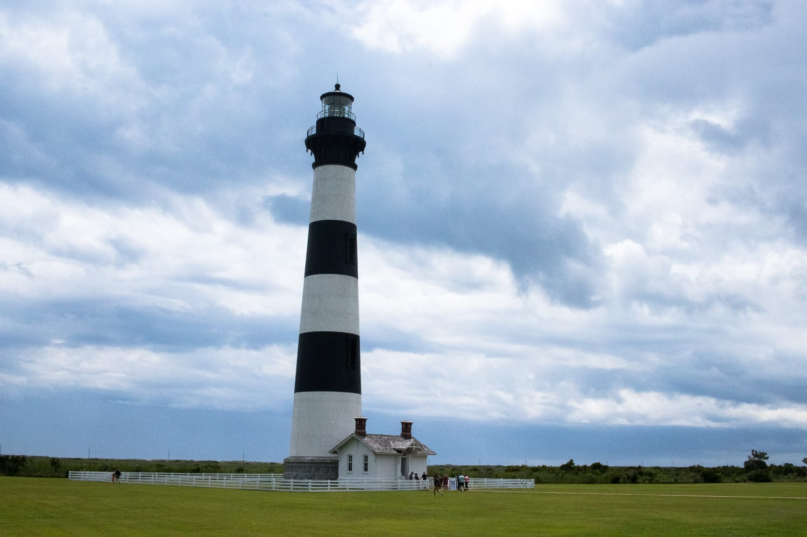
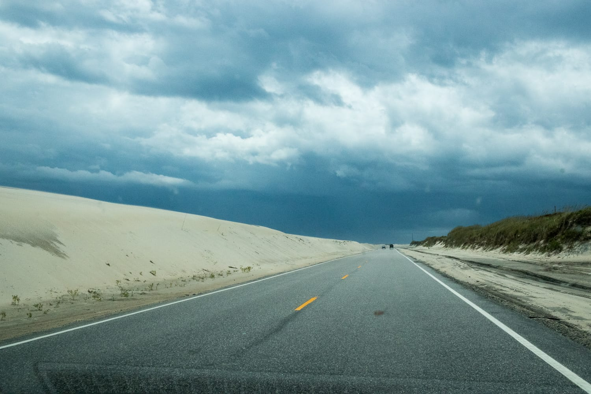

Nach dem bescheidenen Vortag kann es nur besser werden. Heute steht eine Route am Programm, auf die wir uns schon freuen, seit wir sie geplant haben.

Von Portsmouth in Virginia geht's zuerst auf dem Highway 158/168 Richtung Süden nach Point Harbor in North Carolina. Dort verlassen wir quasi das Festland und fahren über eine Brücke auf die Outer Banks. Das ist eine 280 Kilometer lange Inselkette vor der Küste North Carolinas. Wegen der exponierten Lage werden die Inseln oft von Hurrikans getroffen. Das sieht man auch gleich: Die meisten Häuser stehen auf Stelzen und beginnen erst im ersten Stock.

In Nags Head steigen wir nach rund 90 Minuten im Auto zum ersten Mal aus. Bevor wir den Strand und den Atlantik sehen, müssen wir noch eine Düne erklimmen, die gibt's hier fast überall. Als wir dann am Strand stehen, kommt zum ersten Mal nach Wochen am Festland ohne Meer wieder Urlaubsstimmung auf. Nach ein paar Schritten im heißen Sand setzen wir uns aber gleich wieder ins Auto, wir wollen mehr von der Insel sehen.

Der nächste Stopp ist der Leuchtturm von Cape Hatteras, der seit 1870 in Betrieb ist. Wie wichtig er ist, zeigen die historischen Tafeln davor. Wegen der Lage und der vielen Sandbänke heißt das Gebiet auch „Graveyard of the Atlantic". Nach wenigen Minuten geht's weiter.

Die Outer Banks waren 1903 auch Schauplatz eines Ereignisses, das in die Weltgeschichte einging: Auf Bodie Island gelang den Brüdern Wright der erste Motorflug. Das Denkmal lassen wir rechts liegen, denn wir haben Kurs auf Hatteras genommen, wo wir die Fähre nach Ocracoke erwischen. Unterwegs fahren wir immer wieder über Brücken zwischen den einzelnen Inseln, vorbei an kilometerlangen Sanddünen.

Sehr gern hätten wir auch einen Ausflug auf einen der Offroad-Tracks gemacht. Unser Mietauto würde aber die vorgeschriebene Kontrolle beim Visitor Center nicht schaffen. Beim nächsten Mal kommen wir auf jeden Fall mit einem geländetauglichen Auto :)

In Hatteras fährt das Auto auf eine Fähre. Die Überfahrt nach Ocracoke dauert rund eine Stunde und ist gratis! In Ocracoke geht's direkt zur nächsten Fähre, die wir schon am Vortag gebucht haben und die 15 Dollar fürs Auto kostet. Nachdem wir das Auto bei der Anlegestelle eingecheckt haben, bleibt noch eine gute Stunde, um Ocracoke zu Fuß zu erkunden und eine Kleinigkeit zu essen. Hier kommt richtig Urlaubsstimmung auf, es fühlt sich nicht mehr an wie Amerika, sondern wie irgendwo in der Karibik.

Die Fahrt mit der Fähre von Ocracoke nach Cedar Island dauert gut zwei Stunden. Die Zeit vertreiben wir uns mit Lesen, Sudokus und dem Schreiben neuer Beiträge. Spannend ist auch zu beobachten, wie unterschiedlich die Leute die Zeit verbringen: Manche arbeiten, andere spielen Karten, genießen die Sonne, und wieder andere machen es sich im Auto bequem und schlafen.

Auf dem Weg von der Fähre zur Unterkunft stellen wir fest, dass wir gern noch einmal herkommen und die Inseln mit weniger Stress erkunden würden. Dieses Gefühl hatten wir schon lange nicht mehr. Vielleicht war es die Abwechslung nach den vielen Städten, die nach einer Weile alle gleich aussehen, oder das karibische Flair in Ocracoke. Jedenfalls haben wir das Gefühl, hier noch nicht alles gesehen zu haben.
