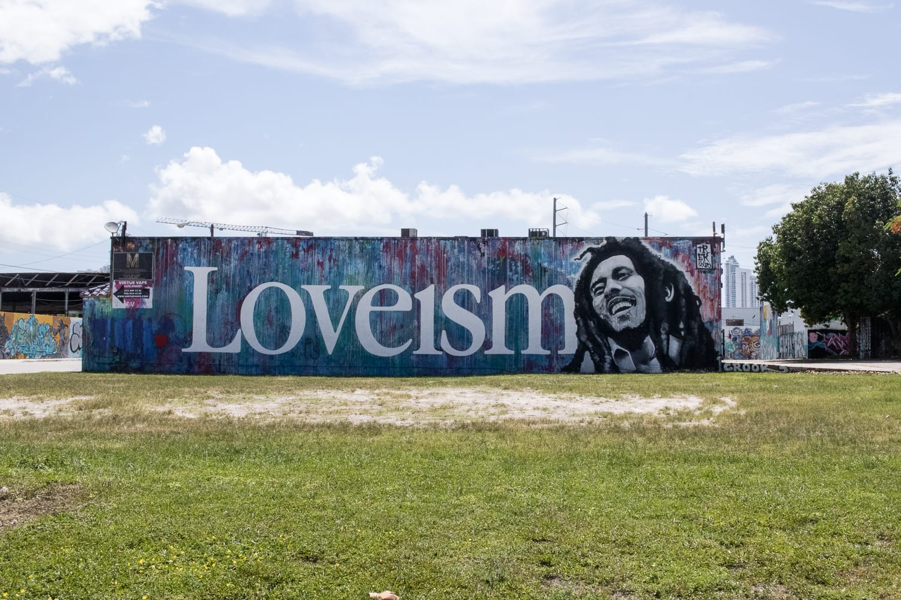
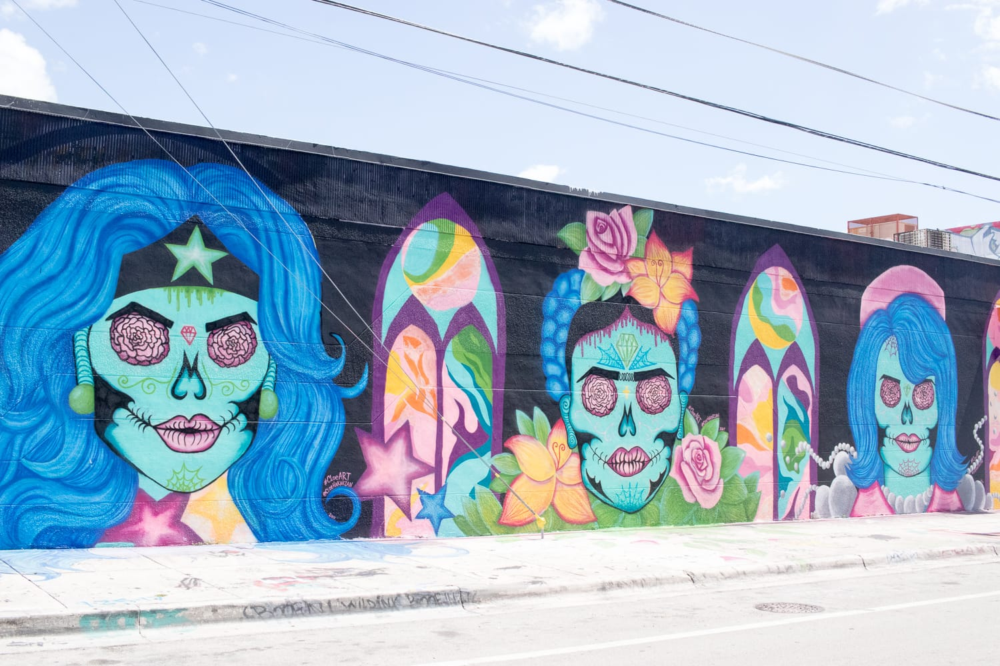
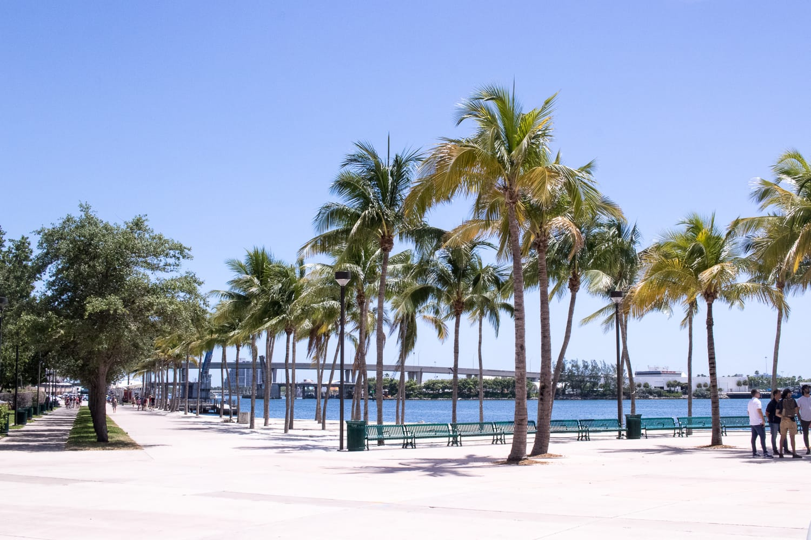
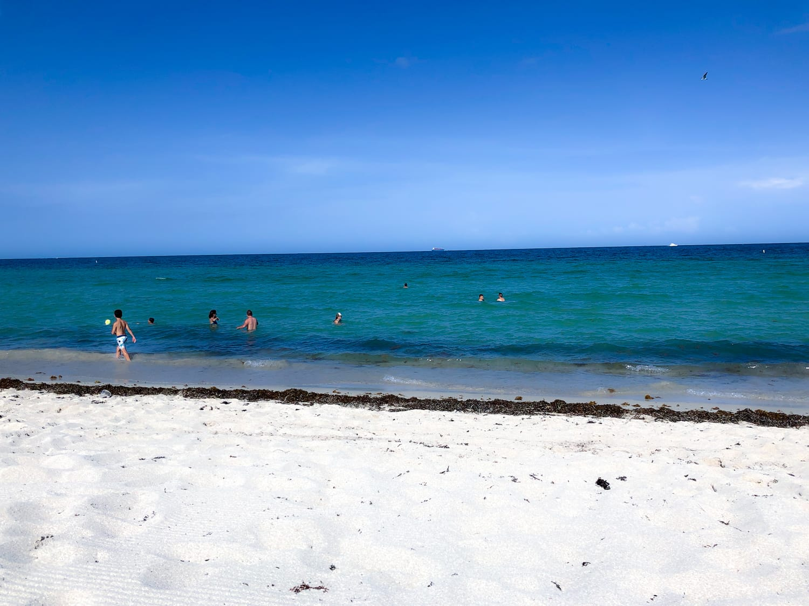
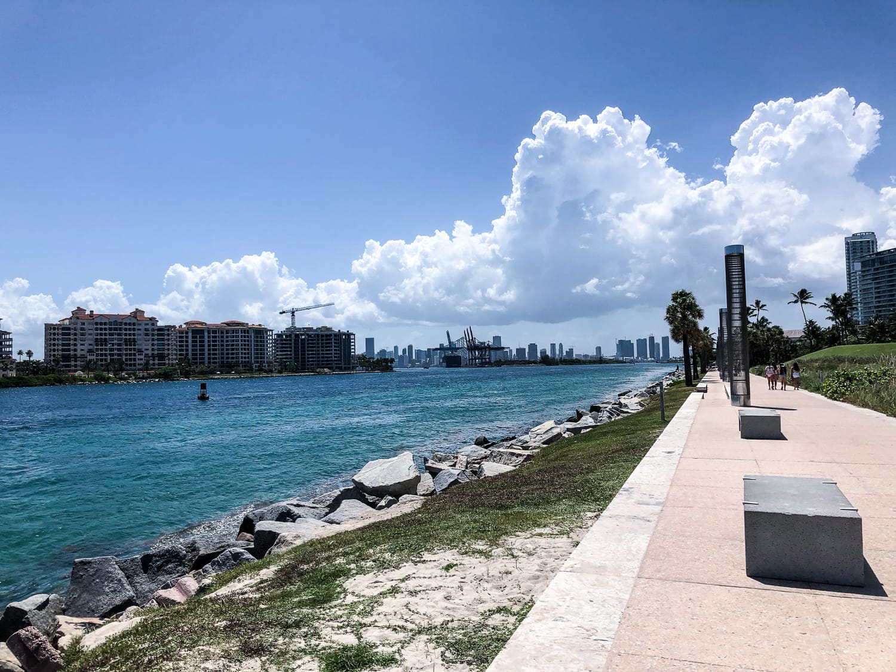
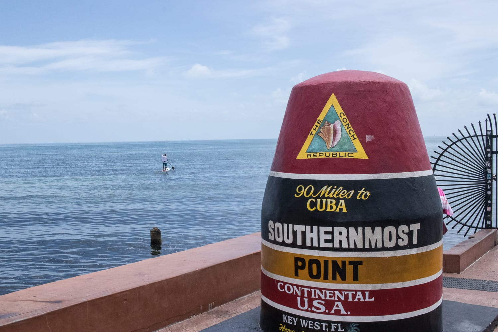
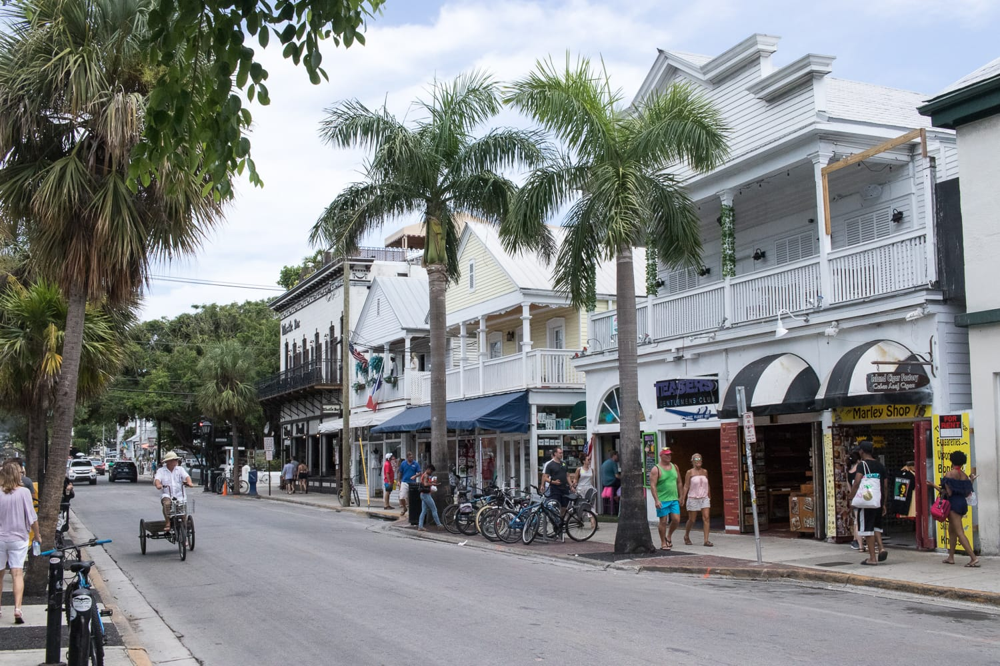
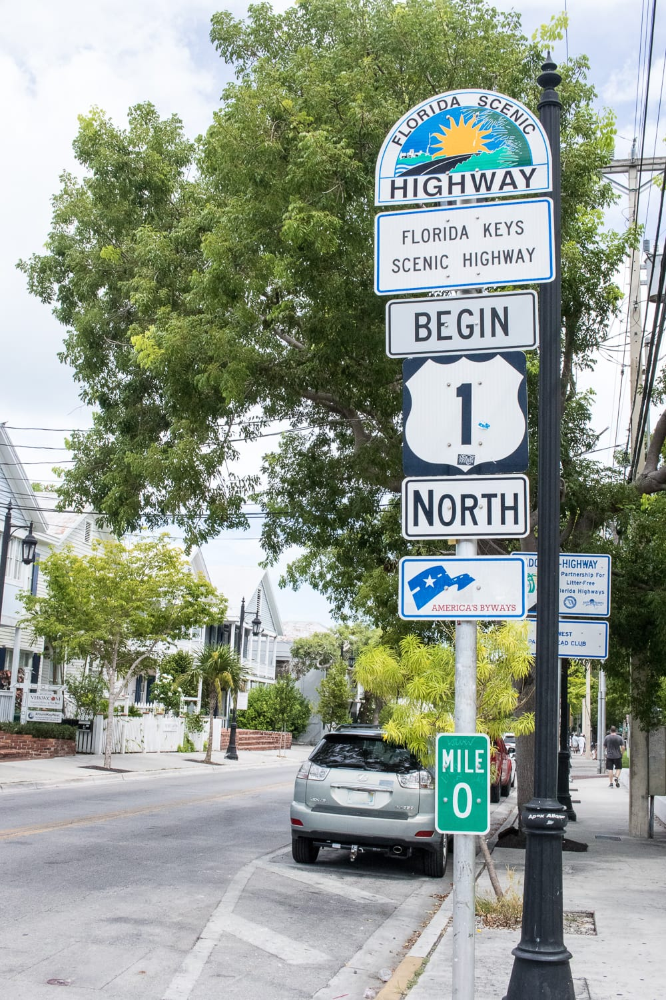

Miami ist definitiv eine Stadt, in die man sich verlieben könnte. Wir genießen die vier Tage dort richtig und nehmen uns ganz bewusst Zeit, um „richtig" Urlaub zu machen.

Die Unterkunft suchen wir uns wieder bewusst etwas außerhalb, um nicht mitten im Touristentrubel zu sein. Wir haben wieder richtig Glück: ein sehr schönes Zimmer mit eigenem Bad. Und ja, das muss mittlerweile betont werden, denn in den letzten Unterkünften haben wir das Bad immer mit mindestens einem anderen Gast oder den Eigentümern geteilt. Da ist ein eigenes Badezimmer ein richtiger Luxus.

Den ersten Tag beginnen wir ganz entspannt: lange schlafen, ausgiebig frühstücken, dann geht's in die Stadt. Zuerst zu den Wynwood Walls, einem Viertel mit extrem viel Streetart und Graffiti. Irgendwie haben es uns diese Kunstwerke angetan, und wir lieben es, durch die Gassen zu spazieren und sie zu bewundern.

:::raster

:::

Bevor es an den Strand geht, machen wir noch einen Halt an der Bayfront und im Bayfront Park. Dort findet man neben dem Hard Rock Cafe auch Restaurants und einige Geschäfte. Nach diesen Pflichtpunkten geht's endlich an den weltberühmten South Beach. Wir genießen Sonne und Wasser.

## Ausflug auf die Keys

:::raster

:::

Eigentlich haben wir uns extra den Wecker gestellt, aber als er aus ist, schlafen wir seelenruhig noch eine Stunde weiter. Mit leichter Verspätung treten wir den Tagesausflug auf die Keys an. Die Keys sind viele einzelne Inseln, die nur über Brücken mit dem Festland verbunden sind, ganz am Ende liegt Key West.

Key West ist der südlichste Punkt der USA und ein beliebter Urlaubsort. Wir nutzen die Zeit, um durch die Stadt zu spazieren, durch die Geschäfte zu bummeln, und essen ein leckeres Eis mit Key Lime und Erdnussbutter.

:::raster

:::

Den dritten Tag in Miami verbringen wir ganz entspannt. Wir bleiben bis Mittag in der Unterkunft und machen uns erst nachmittags auf zum Strand. Das Wasser hat eine so angenehme Temperatur und ist perfekt, um einfach nur drinnen zu stehen.

## Everglades

Die Everglades erkunden wir weder mit dem Motorboot noch mit dem Kajak noch zu Fuß. Ich habe ohnehin meine Probleme mit Sümpfen und Wildnis, in der ich nicht weiß, was mich erwartet, und beim Wort „Schlangen" ist mir das schon genug. Wir fahren also „nur" über die Schnellstraße, die am Everglades-Nationalpark vorbeiführt.

Eher zufällig fahren wir bei einer der vielen Ausbuchtungen hinein, um doch noch einen kurzen Blick und ein paar Fotos von der Natur zu machen. Und wir haben Glück: Wir sehen gleich zwei Alligatoren. Einer schwimmt ganz ruhig mitten im Wasser und lässt sich von uns nicht aus der Ruhe bringen, der zweite liegt nah am Ufer. Alles ist so abgesichert, dass die beiden keine Chance hätten, auf den Steg zu kommen. So haben wir ganz ohne teure Fahrt im „Dschungel" frei lebende, wilde Alligatoren gesehen.
