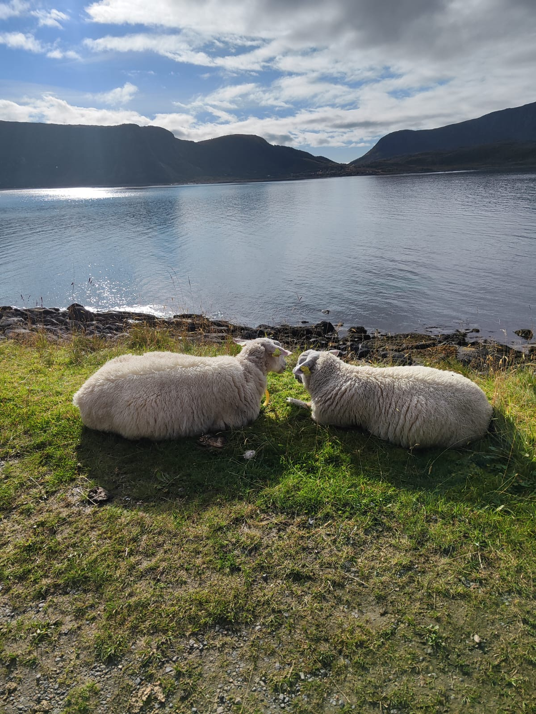

## Montag: Propellerflug und Camper-Übernahme

Früh raus, weil es zum Flughafen ging. Das gemütliche Frühstück haben wir uns aber trotzdem nicht nehmen lassen. Mit dem Bus eine Station zum Flughafen. Beim Sicherheitscheck war mehr los als erwartet, etwa 20 Minuten Wartezeit, trotzdem ist sich noch ein gemütlicher Kaffee vor dem Boarding ausgegangen.

Wir sind mit einer kleinen Propellermaschine geflogen, mit freier Sitzplatzwahl, und es war ein sehr interessanter Flug. Zuerst nach Andenes, wo viele Passagiere ausgestiegen und ein paar neue zugestiegen sind. Weiter nach Evenes, wo wir ausgestiegen sind. Andere sind sitzen geblieben, weil die Maschine noch weiter nach Bodø flog, und es sind auch wieder neue Leute zugestiegen. Ein sehr kurzweiliges Erlebnis.

In Evenes kam das Gepäck schnell. Mit dem Taxi ging es zum Vermieter für die Wohnmobil-Übernahme. Wir sind zum Glück gleich drangekommen, haben eine Einführung ins Fahrzeug bekommen, und schon ging die Fahrt los. Anfangs hat es leicht genieselt. Auf der Strecke gab es zuerst einige Baustellen, später dafür umso mehr Tunnel. Trotz Regen und teils wolkenverhangener Berge gab es immer wieder wunderschöne Ausblicke auf Meer, Berge und Seen.

<!-- BILD: Ausblick auf der ersten Fahrt Richtung Svolvær -->

Wir sind bis nach Svolvær gefahren und haben im Bacalao gegessen, schon ziemlich hungrig, mit einem kleinen Stadtbummel dazu. Danach haben wir beim Kiwi-Markt Grundnahrungsmittel und alles Nötige für den Camper eingekauft, das hat rund 200 € gekostet. Das Wichtigste schnell verstaut, dann noch etwa 10 Minuten zum Campingplatz in Kabelvåg, wie geplant.

<!-- TODO: Wie heißt der Campingplatz in Kabelvåg? -->

Dort haben wir den Camper eingerichtet: Betten bezogen, Lebensmittel verstaut, geduscht. Am Abend haben wir im Camper Phase 10 gespielt. Ich habe gewonnen, Denise hat es sportlich genommen. Dann kam die erste Nacht im Camper.

### Zustand des Campers

Auf den ersten Blick sah der Camper sehr gut und sauber aus, auf den zweiten leider nicht. Die Vormieter waren offenbar sehr schlampig. Der Grauwassertank war überhaupt nicht geleert, wir sind mit vollem Tank gestartet. Auch sonst war es an manchen Stellen schmutzig, teils lag noch Müll im Auto, und am Boden war Dreck. Schade, dass der Vermieter da nichts unternommen hat.

<!-- TODO: Habt ihr das dem Vermieter bei Übernahme oder Rückgabe gemeldet? -->

## Dienstag: Regen, Kirche und drei Seen

Aufgewacht bin ich vom Prasseln des Regens auf dem Dach. Die erste Nacht im Camper war sehr schön und angenehm, wir haben beide sehr gut geschlafen. Weil es regnet, haben wir den Vormittag ganz entspannt im Bett verbracht, mit Kaffee, danach gab es ein gemütliches Frühstück. Das Wetter sollte angeblich im Lauf des Tages besser werden.

Als der Regen nachgelassen hat, sind wir zu Fuß vom Campingplatz nach Kabelvåg gegangen, etwa 30 Minuten. Wir haben uns den Ort angesehen und bei einem Supermarkt ein paar Kleinigkeiten eingekauft. Weiter ging es zur Vågan Kirke, der markanten Holzkirche, die auch „Lofotkatedralen" genannt wird, und wir haben sie besichtigt. Zurück am Campingplatz waren wir rund drei Stunden unterwegs gewesen.

Dort kam dann auch die Sonne raus, ein bisschen blauer Himmel war zu sehen. Wir haben es uns auf einer Parkbank neben dem Camper gemütlich gemacht, Kaffee getrunken und Gifflar gegessen.

Danach sind wir noch zu den drei Seen hinter dem Campingplatz gewandert, etwa 4 km, mit schönen Ausblicken auf See und Berge. Wir haben wieder viele Fotos gemacht.

<!-- BILD: Die drei Seen hinter dem Campingplatz in Kabelvåg -->

Zurück am Platz habe ich gekocht: Nudeln mit Kichererbsen-Zucchini-Sauce, die sehr gut geschmeckt haben. Als Dessert hat Denise mit Joghurt und Früchten überrascht. Danach geduscht und ins Bett. Denise hat noch geflüstert, es war ein schöner Tag.

## Mittwoch: Festvågtind, Henningsvær und Valberg

Wir sind etwas früher aufgestanden, waren aber trotzdem ausgeschlafen. Nach dem gemütlichen Frühstück haben wir den Camper reisefertig gemacht, Tanks am Campingplatz geleert, Frischwasser aufgefüllt, und sind die etwa 15 Minuten nach Henningsvær gefahren.

Dort sind wir zu Fuß auf den Festvågtind gegangen, allerdings nicht ganz bis zum Gipfel, sondern bis zum ersten Aussichtspunkt. Der Aufstieg war steinig und felsig. Im unteren Bereich mussten wir über riesige Felsbrocken klettern, danach wurde es sehr steil. Oben gibt es ein kleines Plateau mit einem See, dem Festvatnet, und einen super Ausblick auf Henningsvær. Wir haben eine Runde um den See gedreht und Fotos gemacht. Dabei ist unterwegs ein Wanderstock verloren gegangen, deshalb mussten wir noch einmal den halben See zurückgehen, bis wir ihn wiedergefunden hatten. Dann der Abstieg.

<!-- BILD: Blick vom Festvågtind auf Henningsvær -->

Statt direkt zum Camper zurückzugehen, haben wir beschlossen, bis nach Henningsvær hinein zu spazieren, ein langer Fußweg entlang der Straße, über Brücken. Das hat sich ausgezahlt: Für den Parkplatz hatten wir extra 16 € bezahlt, so konnten wir die Parkzeit wirklich ausnutzen. In der Trevarefabrikken gab es Kaffee und eine Zimtschnecke. Dabei ist uns aufgefallen, dass die Bezahlung für den Parkplatz gar nicht durchgegangen war. Schnell nachbezahlt, in der Hoffnung auf keinen Strafzettel.

Nach dem Kaffee sind wir weiter durch Henningsvær spaziert, hinunter zum berühmten Fußballplatz, und haben die Aussicht vom Hügel daneben genossen. Inzwischen hatten sich die Wolken verzogen, es war richtig sonnig mit blauem Himmel, und wir konnten Henningsvær voll genießen. Auf dem Rückweg haben wir von der Brücke aus Quallen im Meer beobachtet. Beim Camper dann die große Erleichterung: kein Strafzettel, die Parkgebühr musste nicht doppelt bezahlt werden.

<!-- BILD: Fußballplatz von Henningsvær -->

Danach ging es gemütlich weiter zum Lofoten Fjordcamp in Valberg. Dafür haben wir die E10 verlassen und eine wunderschöne, schmale Landstraße genommen, auf der wir fast alleine unterwegs waren, mit immer wieder fantastischer Aussicht. Denise hatte extra einen Stellplatz in der ersten Reihe gebucht, den wir gleich gesucht und gefunden haben.

Gekocht habe ich Gemüsepfanne mit Couscous, die sehr gut geschmeckt hat. Großes Lob an Claude fürs Rezept, an Chefkoch Thomas und an die beste Gemüseschneiderin Denise. Als Dessert gab es als Überraschung nochmal dasselbe wie am Vortag, trotzdem wieder sehr gut, und die Freude war groß.

Nach dem Essen standen plötzlich Schafe vor dem Wohnmobil und haben den Rasen des Campingplatzes abgegrast. Denise hat versucht, Kontakt aufzunehmen, aber die Schafe sprechen offenbar auch in Norwegen nur Norwegisch. Sie haben sie nicht verstanden und sind vor ihr geflüchtet.

<!-- TODO: Passt das Schaf-Foto zum Campingplatz in Valberg, oder war es eine andere Begegnung? --> Am Abend haben wir wieder Phase 10 gespielt, diesmal mit Punktezählung. Wieder habe ich gewonnen, Denise war wieder eine faire Verliererin. Danach haben wir noch die tolle Aussicht aus dem Camper genossen, geduscht und sind schlafen gegangen.
