<!-- TODO: Koordinaten in der Route (Ramberg, Ryten, Kvalvika) sind ungefähr, bitte auf der Karte prüfen. -->

Trotz frühem Zubettgehen am Vorabend haben wir heute etwas länger geschlafen, bis 8:30 Uhr. Den Kaffee im Bett und unsere täglichen LinkedIn-Spiele lassen wir uns aber nicht nehmen. Danach gab es ein gemütliches Frühstück wie immer: Brot, Rührei, Kaffee, Saft, Gemüse und eine kleine Schüssel Müsli. Kurz nach 11 Uhr sind wir losgefahren, denn heute stand der Ryten auf dem Programm.

Auf der Anfahrt gab es eine kleine Schrecksekunde. Die Straße war sehr schmal, auf beiden Seiten Leitschienen, und wir waren schon mittendrin, als Gegenverkehr kam. Ich bin optimistisch bis an den Rand gefahren, so nah wie möglich an die Leitschienen, und habe dabei in der Kurve mit dem Heck des Wohnmobils ganz leicht die Leitschiene touchiert. Zum Glück ist kein Schaden entstanden, nur zwei kleine Kratzer, die man nur sieht, wenn man weiß, wo man hinschauen muss.

<!-- TODO: Habt ihr die Kratzer bei der Rückgabe gemeldet? Soll die Stelle so im Text bleiben? -->

Der Ryten hatte schon am Morgen eine Wolkenhaube, obwohl rundherum ein wunderschön blauer Himmel war. Beim Aufstieg war es etwas windig und ordentlich was los, eine regelrechte Menschenkarawane auf dem Berg. Der Aufstieg war nicht so anspruchsvoll wie am Vortag, nur zwischendurch mussten wir kurz klettern oder über größere Steinstufen gehen. Wir sind fast bis zum Gipfel gekommen. Weil es oben zugezogen und bewölkt war, haben wir die letzten Meter ausgelassen. Davor gab es schon einen tollen Ausblick auf den Kvalvika Beach. Nach einer kurzen Pause mit Blick auf den Strand ging es wieder hinunter zum Wohnmobil.

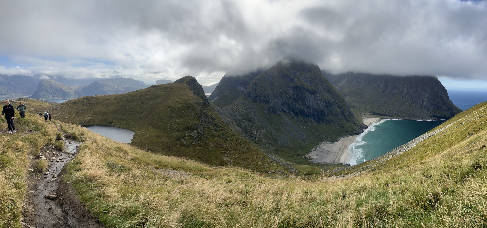

:::galerie
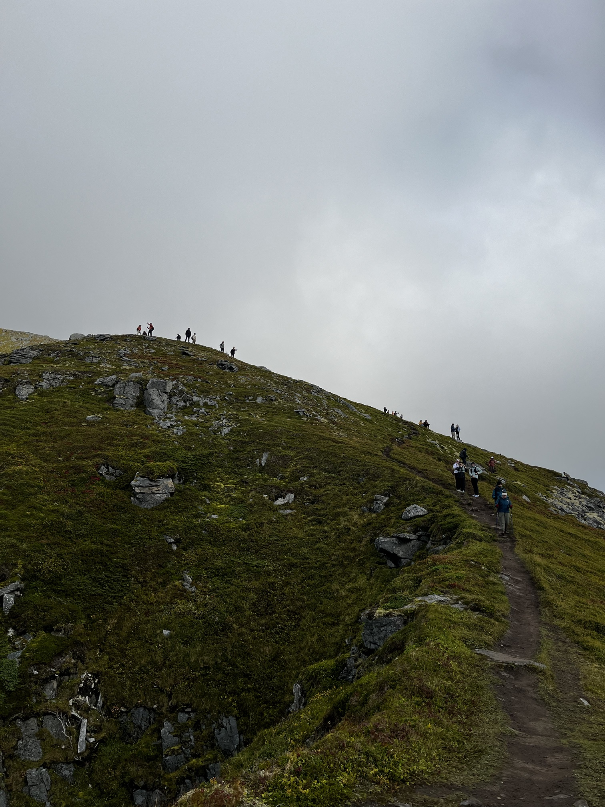
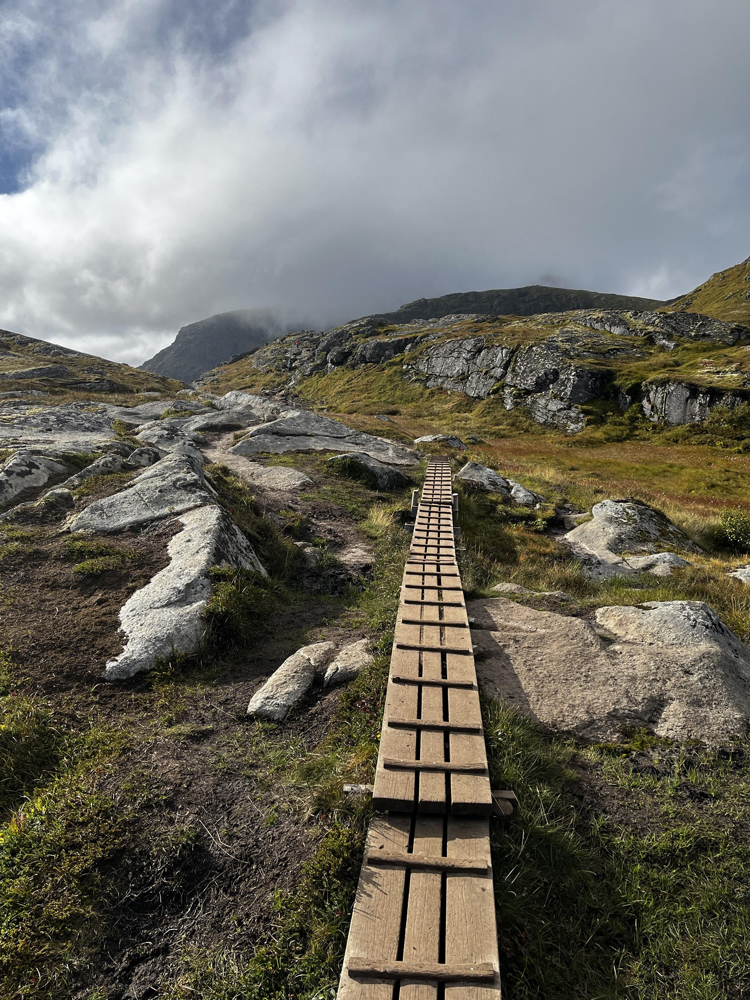
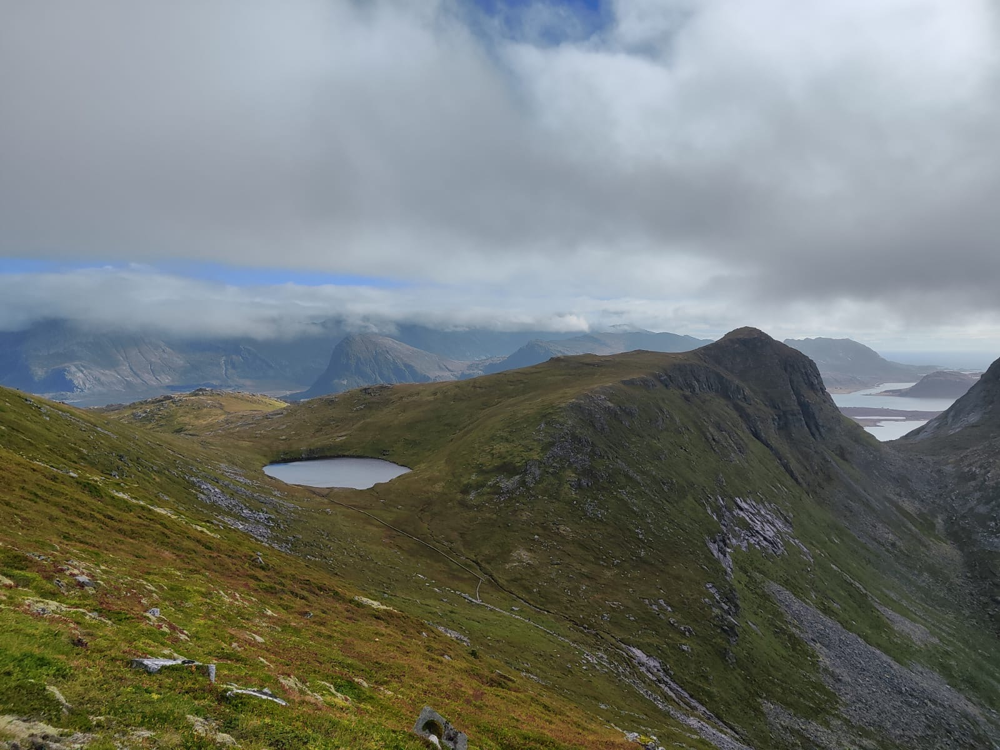
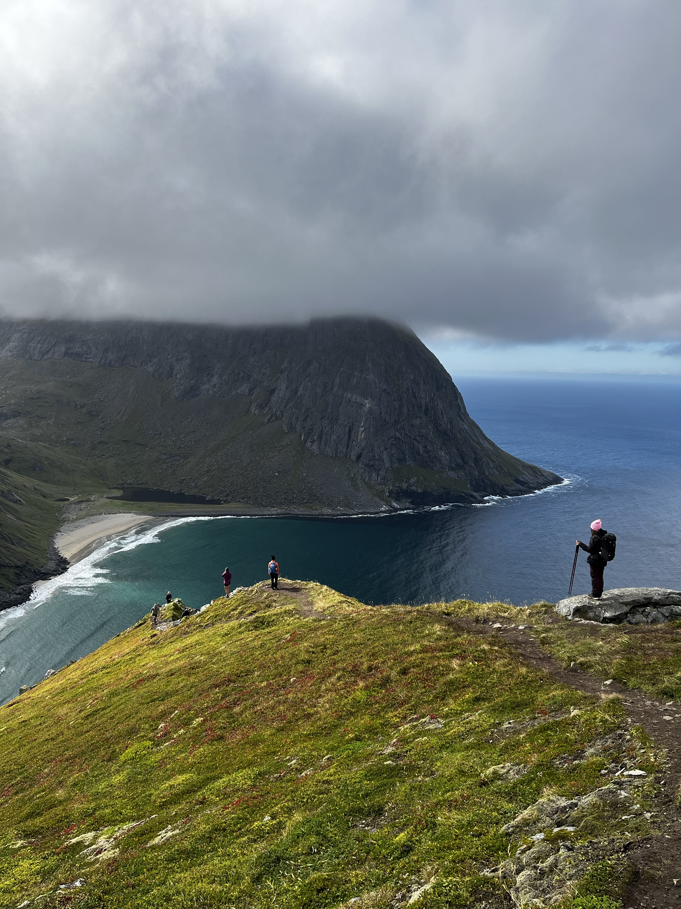
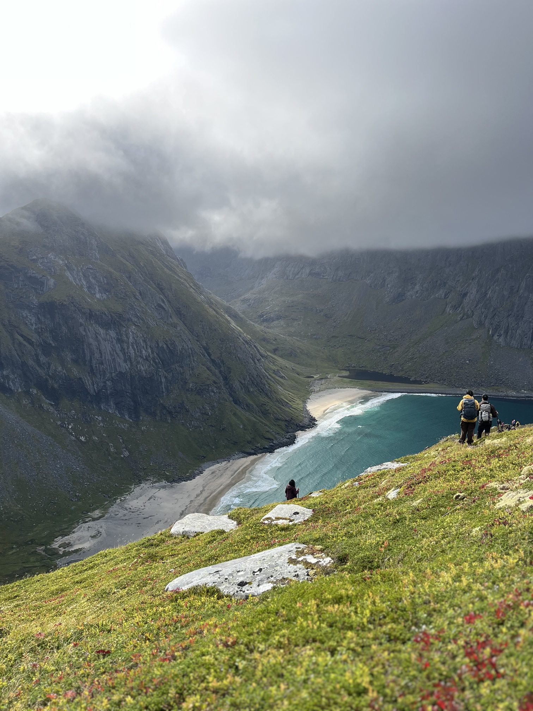
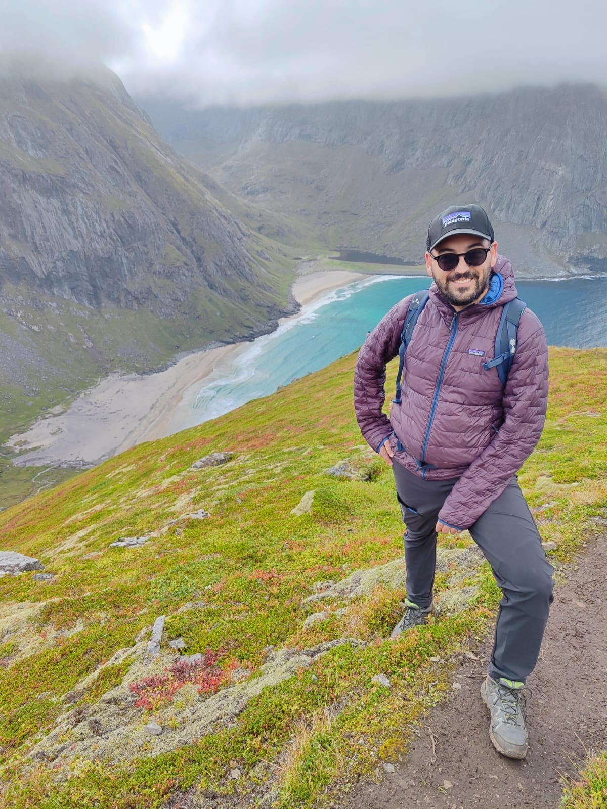
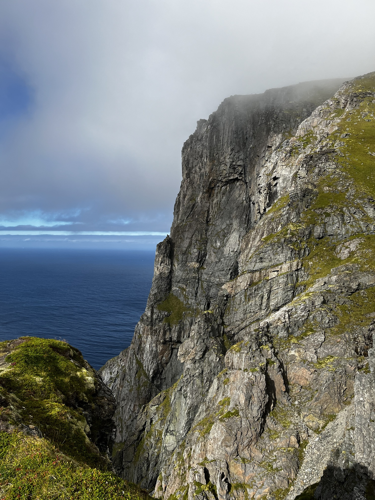
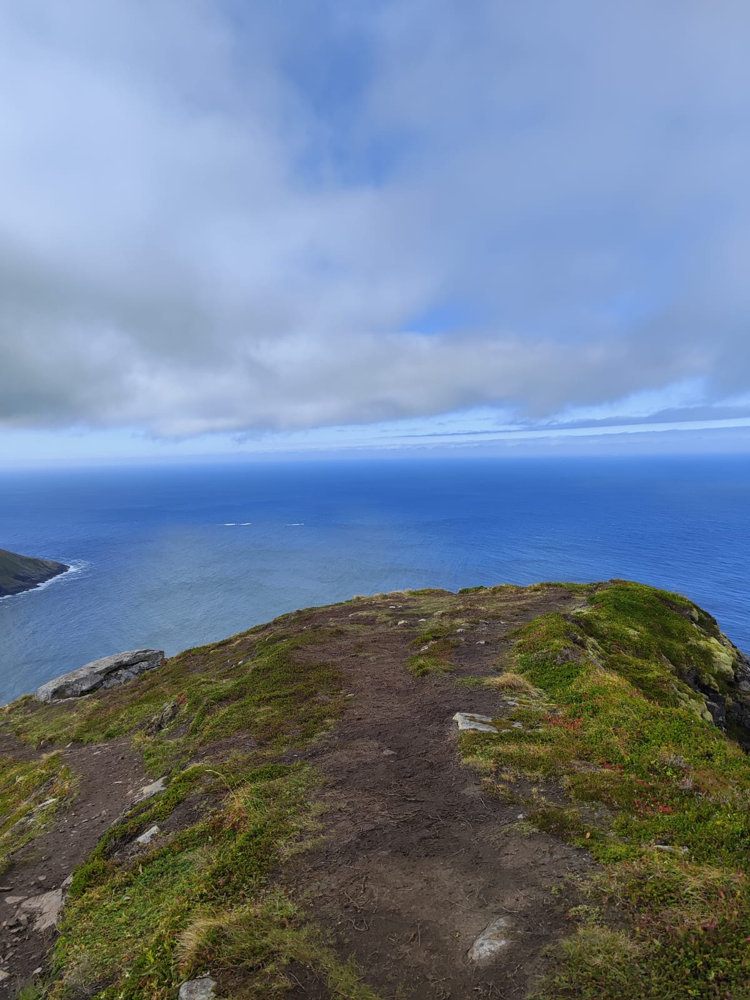
:::

<!-- TODO: Wo war der Ausgangspunkt der Wanderung (Parkplatz/Ort, vermutlich Fredvang)? Wie heißt das Café am Parkplatz? -->

Am Parkplatz gab es noch ein Café. Dort habe ich einen Kaffee mitgenommen, und wir haben im Camper die Süßspeisen von gestern dazu gegessen. Danach ging es zurück Richtung Lofoten Beach Camp, mit einer kleinen Pause in Ramberg für Fotos und Ausblick von einem Aussichtspunkt auf den Ramberg-Strand.

:::raster
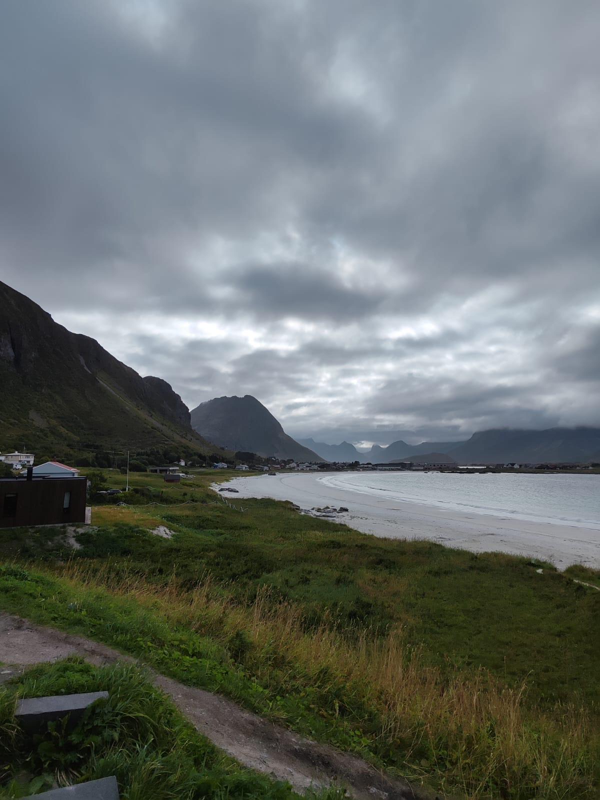
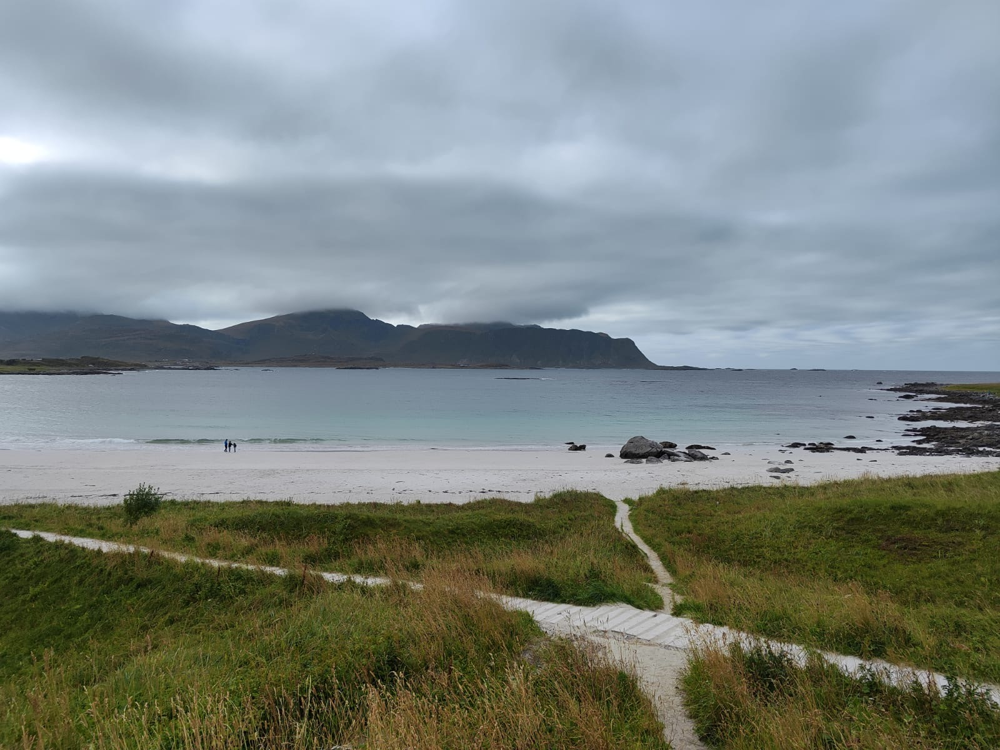
:::

Der Saunagang am Nachmittag war sehr angenehm. Wir hatten Glück, nur Denise und ich waren drin und hatten die ganze Sauna für uns. Rund eine Stunde haben wir dort verbracht, ich war dreimal drinnen, Denise sogar viermal. Danach haben wir geduscht und Kartoffel-Gemüse-Eintopf gekocht, der wieder sehr lecker war. Als Nachspeise hat Denise noch Schokopudding mit Pfirsichen gezaubert.

:::raster
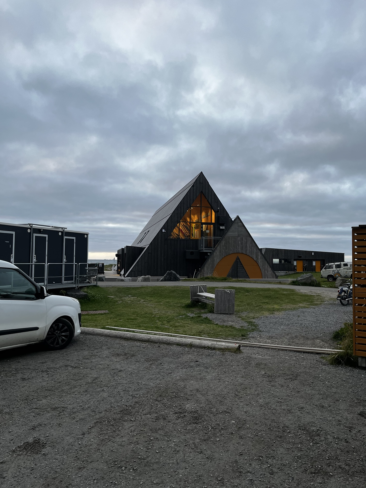
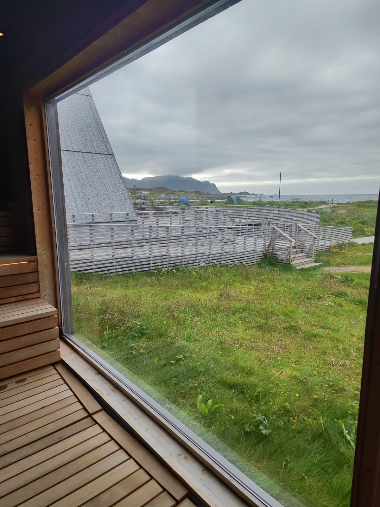
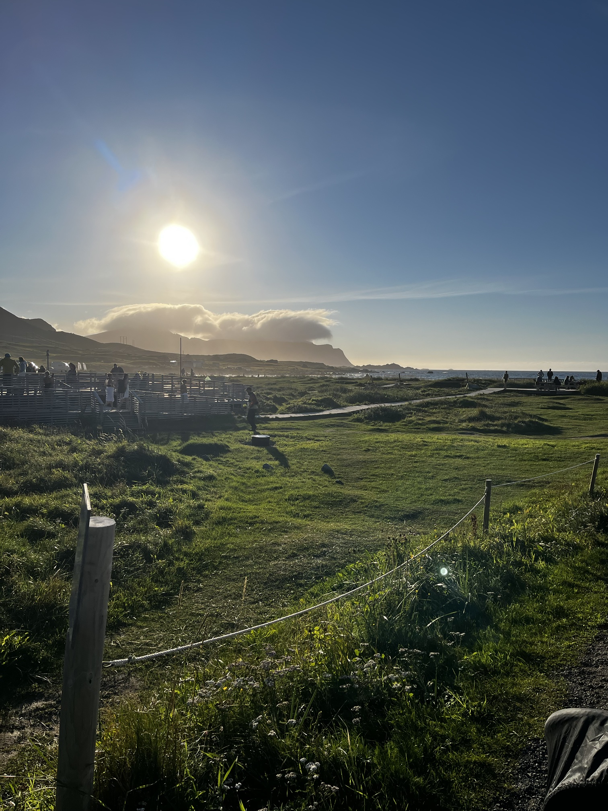
:::

Polarlichter, dachten wir, werden es heute wohl nicht mehr. In der Nacht davor gab es welche, aber die haben wir verschlafen. Erst heute Morgen habe ich auf Instagram gesehen, dass jemand direkt beim Lofoten Beach Camp Polarlichter fotografiert hat.

## Doch noch Polarlichter

Am Abend haben wir es uns im Camper gemütlich gemacht und uns den Film „Der Kinderflüsterer" auf Netflix angesehen. Kurz vorm Schlafengehen dann die Überraschung: Es waren tatsächlich Polarlichter zu sehen, wenn auch nur ganz leichte. Diesmal haben wir sie nicht verschlafen, nach der verpassten Sichtung in der Nacht davor ein schöner Ausgleich.
