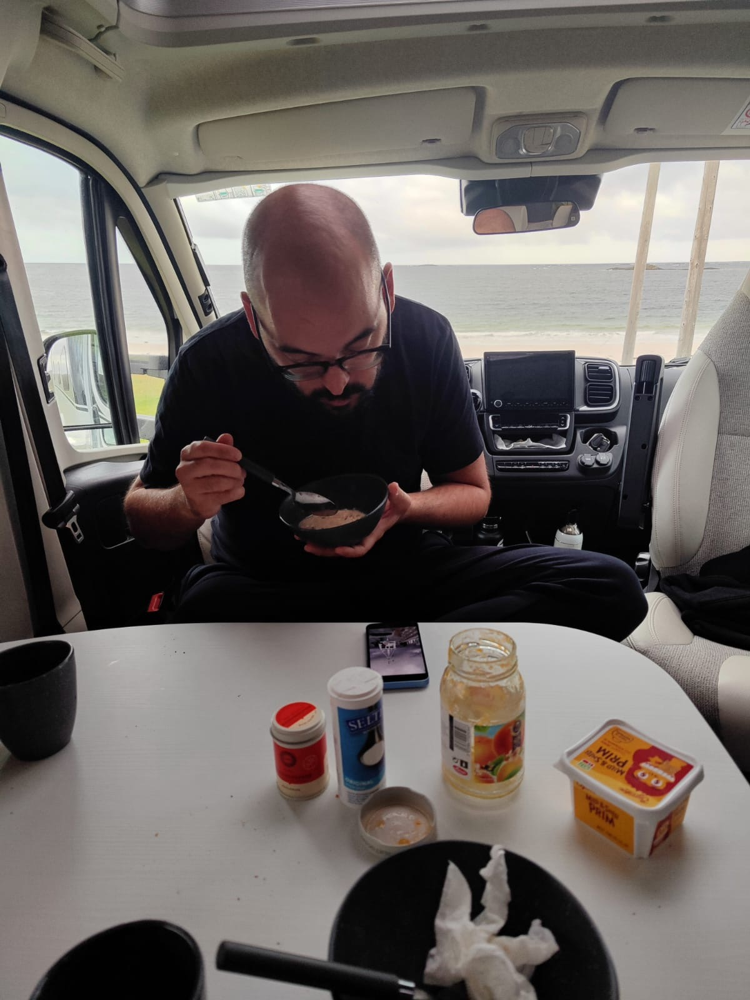
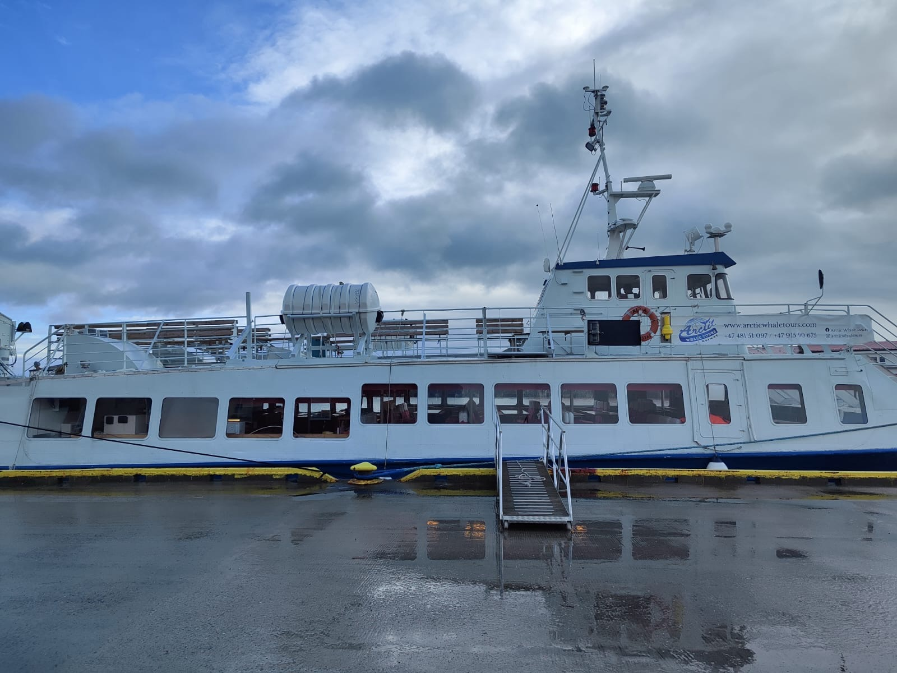
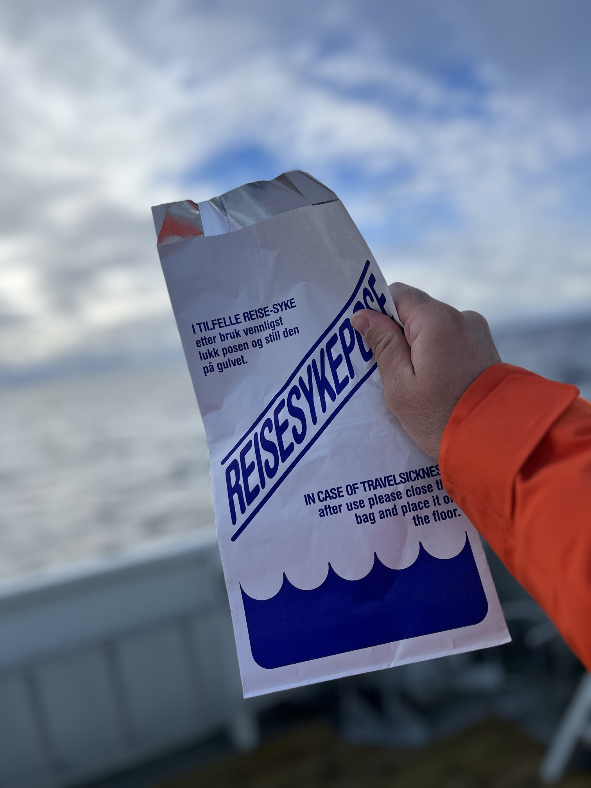
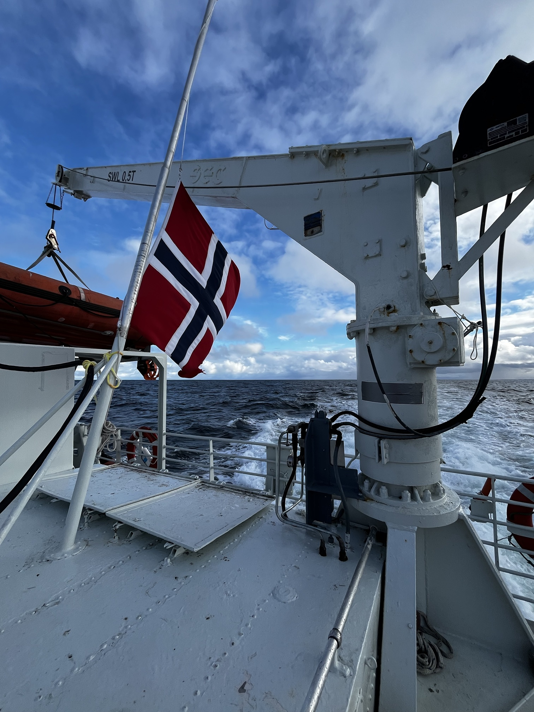
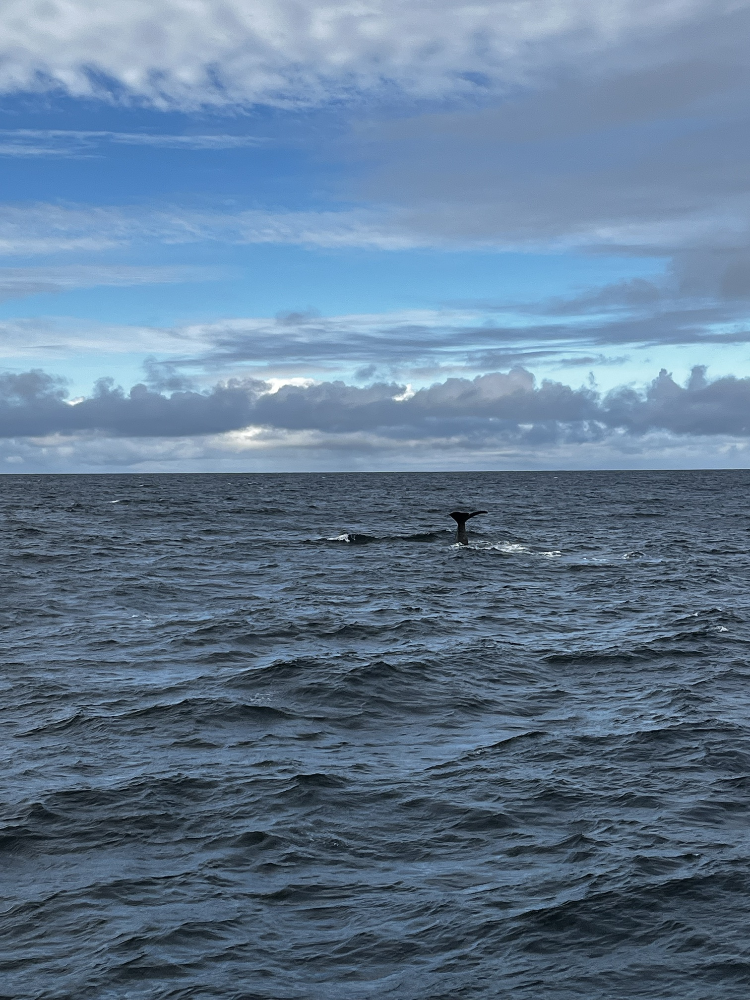
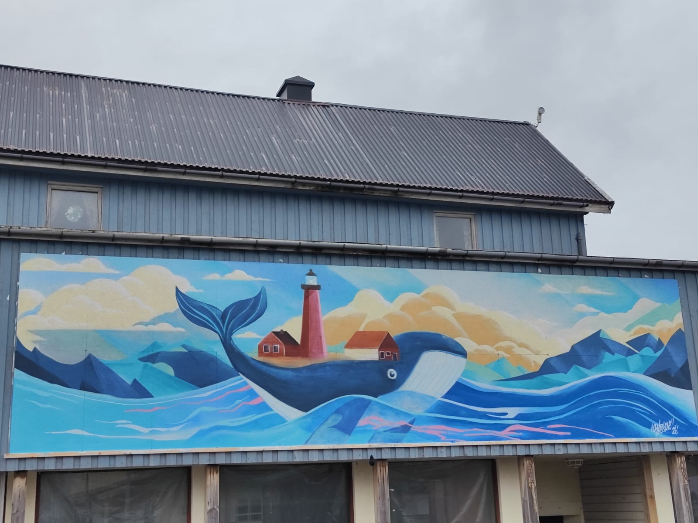

Heute hat der Wecker schon um acht Uhr geklingelt, weil wir früh genug am Hafen sein mussten. Kaffee im Bett und die ersten Spiele haben wir uns trotzdem nicht nehmen lassen. Zum Frühstück gab es wieder Eierspeis, Brot und Käse, danach ging es auch schon zum Hafen.

<!-- TODO: Auf dem Schiff steht „Arctic Whale Tours". Ist das der Anbieter? Wie lange hat die Tour insgesamt gedauert, und darf auch der Preis rein? -->

Mit einem mittelgroßen Katamaran sind wir aufs Meer hinausgefahren. Die Fahrt war ziemlich aufregend, es gab ordentlichen Wellengang. Denise hat das mächtig zu schaffen gemacht, und sie war froh, dass es Speibsackerl an Bord gab, die sie später auch gebraucht hat. Mir hat der Wellengang nichts ausgemacht, auch wenn es ein mulmig-lustiges Gefühl war, bei diesen hohen Wellen hinauszufahren.

:::raster

:::

<!-- TODO: Das Schiff auf den Fotos ist ein klassisches Ausflugsschiff mit Kran und Rettungsboot, kein Katamaran. Soll „Katamaran" im Text geändert werden? -->

Nach etwa vierzig Minuten waren wir am Ort des Geschehens. Der Kapitän hat das Schiff nur mehr treiben lassen, und dann hieß es warten. Die Wale haben sich Zeit gelassen.

Um ein Uhr wurde an Bord eine Trauerminute abgehalten. An diesem Tag fand das Staatsbegräbnis von König Harald V. von Norwegen statt, der am vergangenen Freitag verstorben war.

<!-- TODO: Bitte Daten zum Tod und Begräbnis von König Harald V. vor der Veröffentlichung noch einmal prüfen. Im Tagebuch wird es nur an dieser Stelle erwähnt. -->

Danach ging die Suche nach den Walen weiter. Irgendwann habe ich in der Weite einen Pottwal beim Abtauchen gesehen, genauer gesagt: Ich habe ihn gesehen, Denise leider nicht mehr. Ich dachte schon, das wäre für heute alles gewesen. War es aber nicht. Kurz darauf haben wir einen zweiten Wal gesichtet, der ganze fünf Minuten an der Wasseroberfläche blieb. Wir sind mit dem Schiff mitgefahren, bis er genauso wie der erste abgetaucht ist. Wir waren eigentlich schon zufrieden und haben uns auf die Rückfahrt eingestellt, aber es kam noch besser: Nach weiteren zwanzig bis dreißig Minuten kam ein dritter Wal an die Oberfläche, diesmal deutlich näher, und wir konnten ihm wieder rund fünf Minuten folgen, bevor er abgetaucht ist.

<!-- TODO: Waren der zweite und dritte Wal auch Pottwale, oder wisst ihr es nicht? -->

Danach ging es wirklich zurück, es war inzwischen schon nach 14 Uhr. Auf dem Rückweg gab es eine wärmende Gemüsesuppe für alle Gäste. Die Fahrt war spürbar angenehmer und ruhiger, weil wir offenbar mit den Wellen und nicht gegen sie gefahren sind.

## Andenes und Bleik

An Land wollten Denise und ich uns noch ein bisschen in Andenes umsehen und sind eine kleine Runde spaziert, nur gab es im Ort nicht wirklich etwas zu sehen. Das einzige Café hatte schon um drei Uhr nachmittags zugesperrt, und ausgerechnet um drei waren wir wieder im Ort, also nichts mit Kaffee und Zimtschnecke. Ziemlich durchgefroren sind wir zurück zum Camper.

Auf dem Weg zum Campingplatz haben wir noch bei einer Tankstelle getankt, für um die 117 Euro. Weiter ging es zum Stave Camping in Bleik, wo wir den Nachmittag und Abend verbracht haben.

Vor der Sauna habe ich noch das Chili mit Kartoffeln gekocht. Die Sauna selbst war dann sehr angenehm. In eineinhalb Stunden waren wir mit Pausen viermal drinnen und haben ordentlich geschwitzt. Denise ist zwischendurch sogar einmal zum Abkühlen ins Meer gegangen. Danach haben wir geduscht und das Chili mit Kartoffeln gegessen.

Nach dem Essen war es so weit: Wir haben rund eineinhalb Stunden gepackt, damit vor der Wohnmobil-Rückgabe am nächsten Tag nur noch die letzten Kleinigkeiten zu erledigen sind. Dann haben wir uns bettfertig gemacht, noch ein bisschen gelesen und sind bald eingeschlafen, wir waren beide schon müde.
